# Awrad Android Next — architecture

A proof-of-concept rebuild of the Android app that tests stricter, **build-enforced** structure. It uses the same stack as `awrad-android`: Kotlin 2.0, Compose, Hilt, Room, DataStore and Navigation. Versions are pinned to match so lessons transfer directly.

Status: **scaffold plus the goal domain and Hijri calendar (slices 1 and 1b), accounts (slices 2a and 2b), the dhikr catalog and library (slice 3a), custom dhikrs, tags, local profiles and the change queue (slice 3b), private audio for custom dhikrs (slice 3c), and practice settings (slice 3d).** The goal model and its rules are real; persistence and screens for them come in later slices. Accounts are real end to end: input rules, API client, device session, account settings and screens. The built-in catalog, search, the Library, collection and dhikr pages, and streamed audio are real. Custom dhikrs, tags, local recordings, local profiles and sync are real, and so are uploading recordings to the account, playing them on other phones and the storage line; end-to-end checks against `awrad-server-next` come after its 3b and 3c branches merge.

## Why this exists

The architecture review of `awrad-android` found these problems:

- Domain rules copied across UI, repositories and notifications.
- Single files of 3,000–4,000 lines.
- Logic that can only be "tested" by reading source text.

This project checks whether module boundaries plus build-time rules prevent that. It will **replace `awrad-android`** (ADR 0003). Neither app is released, so there is no user data to carry over.

## Modules

```mermaid
flowchart TD
  app[":app<br/>shell, nav host, Hilt root"]
  feat[":feature:*<br/>screens + ViewModels"]
  domain[":core:domain<br/>pure Kotlin: types, rules, ports"]
  data[":core:data<br/>adapters + Hilt bindings"]
  db[":core:database<br/>Room"]
  ds[":core:designsystem<br/>theme + shared components"]
  net[":core:network<br/>API client + device session"]
  testing[":core:testing<br/>one fake per port"]

  app --> feat & data & ds & domain & net
  feat --> domain & ds
  data --> domain & db & net
  testing --> domain
  feat -. test .-> testing
  domain -. test .-> testing
```



| Module | Plugin | May depend on |
|---|---|---|
| `:app` | `awrad.android.application` | anything |
| `:feature:*` (onboarding, account, library, sync, practice) | `awrad.android.feature` | `:core:domain`, `:core:designsystem` (and `:core:testing` in tests) |
| `:core:domain` | `awrad.jvm.library` + serialization (no Android; adhan-kotlin for Maghrib) | nothing |
| `:core:data` | `awrad.android.library` + `hilt` (Media3 ExoPlayer for audio) | `:core:domain`, `:core:database`, `:core:network` |
| `:core:database` | `awrad.android.library` + Room | nothing |
| `:core:network` | `awrad.android.library` + `hilt` + serialization (API client, device session, signed-link transfers) | nothing |
| `:core:designsystem` | `awrad.android.library` + `compose` | nothing |
| `:core:testing` | `awrad.jvm.library` | `:core:domain` |

**The key seam:** features never see adapters. A feature asks for a port, such as `OnboardingStatusStore` or `GoalRepository`. `:core:data` binds the real adapter in `DataModule`, and tests use the fake from `:core:testing`. That gives two adapters per port, which is the reason the seam exists.

## What the build enforces

| Standard | Mechanism | Problem in awrad-android it targets |
|---|---|---|
| Module graph above | `ModuleRulesConventionPlugin` fails configuration | No boundaries; anything imports anything |
| Explicit visibility | Kotlin explicit API mode in all library modules | Accidental public surface |
| No warnings | Kotlin `allWarningsAsErrors`, lint `warningsAsErrors` | Deprecations and lint debt pile up |
| Static analysis | detekt with compose-rules and ktlint formatting, `warningsAsErrors` | Inconsistent Compose and state patterns |
| ≤ 400 lines per file | `verifySourceFileSize` (part of `check`) | `CountingScreen.kt` at 4,341 lines |
| Committed schemas | Room Gradle plugin → `core/database/schemas/` | Same rule as today, now automatic |
| Colours only from the shared roles | `verifyAwradColors`, `verifyColorLiterals` (run by `detekt`), detekt `ForbiddenImport` | Hex values and sage shades scattered through screens |
| Fonts are the shared files | `verifyAwradFonts` | Fonts that drift from the other apps |
| Icons only from the shared set | `verifyAwradIcons` (and the generator's tests), detekt `ForbiddenImport` on `androidx.compose.material.icons` in every module | Material Icons, filled and outlined, picked per screen |
| Shapes, spacing, type and motion only from the shared tokens | `verifyAwradTokens`, `verifyDesignLiterals` (run by `detekt`) | 16 different durations, radii and paddings typed per screen |
| New IDs are UUIDv7 | `verifyForbiddenCalls` (run by `detekt`) rejects `randomUUID` outside tests | Random UUIDv4 keys made wherever an ID was needed |

Every rule lives in `build-logic/` or `config/detekt/detekt.yml`, so changing a standard is a reviewed diff.

## Identity

Root ADR-2026-10-28 and `contracts/identity/v1/`.

- **Format:** `AwradId` holds a lowercase, hyphenated UUID of any version except nil and max. `AwradId.parse` returns null for anything else and the constructor throws; nothing is trimmed or case-folded. It runs the shared `uuid_format` fixtures.
- **New IDs are UUIDv7** (`UuidV7` in `:core:domain`). `UuidV7.format(unixMs, random)` is the pure layout from a time and 10 random bytes, run against the shared `uuid_v7_layout` fixtures. `UuidV7.generate(clock, random)` feeds it the clock (system UTC by default) and a `SecureRandom`; `AwradId.random()` wraps it.
- **`:core:network`** can't see `:core:domain`, so it makes its installation id and `Idempotency-Key`s through its `IdGenerator` port, which `DataModule` binds to `UuidV7.generate`.
- Built-in dhikr IDs are fixed UUIDv4 content constants and are never regenerated. Nothing orders, expires or authorizes by an ID's timestamp.

## Goal domain

The goal model and rules live once, in `:core:domain`, and follow `contracts/goal-model/v1/` and `CONTEXT.md`. Nothing else in the app may re-derive a rule.

- **Types** (`app.awrad.core.domain.goal`): `Goal` (identity) wraps a `GoalDefinition`: `Schedule` (sealed: every day, weekdays, every N days, month days, specific dates, one time, Hijri month days, and `Yearly` with a `CalendarSystem` and inclusive `YearlyRange`s), `ActivePeriod`, `PausedRange`, `CountPolicy` with `StreakThreshold`, `Session`, `Requirement` (sealed: per due date, cumulative total, period total, days per period, tracker; periods are `CalendarPeriod` week, month or Hijri month) and `CompletionPolicy`. `CountEntry` is a whole-number count on an effective practice day. Invalid shapes (empty sets, a duration below 1) fail on construction.
- **Valid goals only** (`GoalValidity.kt`): `GoalDefinition`'s constructor is private. `GoalDefinition.create(…)` returns `GoalDefinitionResult.Valid` or `GoalDefinitionResult.Invalid` with every `GoalDefinitionError` (`TARGET_REQUIRED`, `SESSION_TARGET_REQUIRED`, `STREAK_THRESHOLD_VALUE_REQUIRED`, fixture `goal_validity`). Creation, sync and import go through it, so the rules never see a goal without a required target or streak threshold value.
- **Practice policy** (`app.awrad.core.domain.practice`): `DayReset`, `WeekStart`, and the `EffectivePracticeDay` rule. Maghrib is an input to it; slice 3d computes it ("Practice settings" below).
- **Rules** (`app.awrad.core.domain.goal.rules`), one file each, pure functions on `GoalDefinition`: `isDueOn` (`GoalDue.kt`), `standingOn` (`RequirementStanding.kt`), `daysPerPeriodOn` (`DaysPerPeriodStanding.kt`), `isCompletedOn` (`GoalCompletion.kt`) and `streakOn` (`GoalStreak.kt`). Every rule that reads schedules takes the account's `HijriCorrections` (no default, like `WeekStart`). Shared internals (count index, "does this day meet the target or streak threshold", `PeriodCalendar` for weeks, months and Hijri months) are in `DayProgress.kt`.
- **Fixture runner** (`:core:testing`, `app.awrad.core.testing.fixtures`): `FixtureRunner` finds `contracts/<model>/v1/fixtures/<rule>.json` (goal-model, hijri-calendar, account-model and dhikr-catalog) by walking up from the working directory; `contractFile` reads another file of a model, such as `catalog.json`. It fails when a file is missing or empty, runs every case, and reports failures by case id. `GoalModelJson.kt` decodes the fixture JSON into domain types through `GoalDefinition.create` (`goal()` for rule fixtures, which only hold valid goals; `goalResult()` for `goal_validity`); `HijriCalendarJson.kt` decodes corrections (`hijriCorrections()`, absent = none). `:core:domain:test` has one `…FixtureTest` per rule, and `FixtureCoverageTest` fails when a rule file in any of those directories has no runner. The fixtures are the spec: fix the rule, never the case.

## Hijri calendar

Hijri dates come from one shared Umm al-Qura table (root ADR-2026-10-26), never from `HijrahDate`, ICU or another library.

- **The table** is `contracts/hijri-calendar/v1/umm-al-qura.json`, bundled as committed Kotlin source: `core/domain/.../hijri/UmmAlQuraTable.kt` (generated, don't edit). The app reads nothing from `contracts/` at runtime.
- **Freshness check:** `./gradlew :core:domain:generateUmmAlQuraTable` regenerates it (`UmmAlQuraTableTask` in `build-logic`). `verifyUmmAlQuraTable` fails the build when the committed file differs from the contract. It runs before `:core:domain:test` and as part of `check`, so the validation command catches a stale table.
- **Types** (`app.awrad.core.domain.hijri`): `HijriCorrection` is an unvalidated `{year, month, offsetDays}`. `HijriCorrections.create(…)` returns `HijriCorrectionsResult.Valid` or `Invalid` with every `HijriCorrectionsError` (fixture `hijri_corrections_validity`), so an invalid set can't exist. `HijriCalendar(corrections)` gives the corrected `HijriMonth` (first day, length) or `HijriDate` of a day, or null outside the table.

## Accounts and device sessions

Slice 2a ([`docs/slices/02-accounts.md`](../docs/slices/02-accounts.md)), following root ADR-2026-07-12 and ADR-2026-10-26. An account is optional: signing in or out never touches local practice data.

- **Input rules** (`app.awrad.core.domain.account`, `AccountInput.kt`): `EmailAddress.parse` (trim an explicit whitespace set, basic shape, at most 160 code points), `PasswordPolicy.errors` (12 to 128 code points after NFC) and `EmailCode.parse` (spaces and hyphens removed; Arabic-Indic, Eastern Arabic-Indic and fullwidth digits to ASCII). They run the shared `contracts/account-model/v1/` fixtures, and the client only checks length: the server is the authority and also rejects common passwords.
- **Ports:** `AccountRepository` (the `SignInState` flow, register, verify, resend, request and reset password, sign in, refresh account, sign out) and `AccountSettingsRepository` (slice 2b, below). Results are `AccountResult`; failures are a sealed `AccountError`. `:core:data`'s `NetworkAccountRepository` and `NetworkAccountSettingsRepository` map the API's problem `code`, and only it, to an `AccountError` (`AccountErrors.kt`), and `validation_failed` field codes to `InputProblem`s; unknown codes are `Unexpected`. Tests read every `x-error-codes` entry of the operations the app uses, and every field code their `422` responses document, and fail when one has no specific error or input problem.
- **Signed out, and why:** `SignInState.SignedOut` carries a `SignOutReason`: not signed in at start, signed out here, `SESSION_ENDED` (the server ended the session: revoked from another device, a password change or reset elsewhere, expiry) or `ACCOUNT_DELETED`. The account screen shows each with its own message. The reason is kept in memory only.
- **API client** (`:core:network`, ADR 0005): hand-written `@Serializable` classes (`ApiModels.kt`, `AccountSettingsModels.kt`), `ApiOperation` (every operation used, with method, path template and headers), `AccountsApi` and `AccountSettingsApi` over a shared `ApiCaller` and an `HttpTransport` (OkHttp in the app, a fake in tests). Errors decode as RFC 9457 `Problem` with `Retry-After`. Public operations never carry a bearer token; every POST sends a fresh UUIDv7 `Idempotency-Key`; operations that may send email send `Accept-Language` with the app's language (`en`, `ar` or `ml`). `ApiContractTest` checks each `ApiOperation` against `contracts/api/openapi.bundled.json` and round-trips every request and response example of those operations through the classes, failing on any difference.
- **Device session** (`DeviceSessionManager`):
  - Sign-in sends the installation id (a UUIDv7 made once and kept in secure storage), the device's real model name (`Build.MANUFACTURER` + `Build.MODEL`) and `android`.
  - The refresh token is stored encrypted (ADR 0006); the access token stays in memory and is refreshed 30 seconds before it expires, or once after a `401`.
  - **Single flight:** a `Mutex` guards the tokens, so concurrent callers share one refresh.
  - **Refresh keys:** each refresh gets an `Idempotency-Key` that is stored before the call and reused until the refresh gets an answer, also across a restart. The server then replays a rotation it already did instead of treating the retry as token reuse.
  - **Failures:** tokens survive network errors, `5xx` and `429`. Only a `401` from refresh (`refresh_token_invalid`, `refresh_reuse_detected`) drops them and signs the device out (`SESSION_ENDED`). A session revoked elsewhere shows up this way: the next authenticated call gets `401`, the refresh it triggers gets `401`, and the device is signed out.
  - **Account deleted:** after `delete_account` succeeds, the session is forgotten without a sign-out call (the server has already ended every session).
  - **Sign-out** clears local credentials at once and queues `sign_out_device_session` with the refresh token, so it works after a restart without an access token. The queue is sent straight away and again at each app start (and before each sign-in) until the server answers.
- **Screens** (`:feature:account`, one `AccountDestination`): sign in, register, verify the email (resend with a 60-second cooldown, or the server's `Retry-After`), forgot password, reset password, and the signed-in account area. Verifying or resetting doesn't sign in, so the flow then signs in with the password typed earlier (kept in memory only). The home placeholder links to it.
- **Account settings** (slice 2b, tag `account_settings`): `AccountSettingsRepository` lists the account's sessions (`AccountSession`: device or browser, name or null, platform, created and last used, `isCurrent`; unknown kinds and platforms are `OTHER`), revokes one or all others, changes the password, requests and confirms an email change, and deletes the account. Every call goes through `DeviceSessionManager.authorized`. A confirmed email change updates the stored email; a deletion signs the device out with `ACCOUNT_DELETED`. Local practice data is never touched.
- **Signed-in area** (`settings/`): a nested `NavHost` inside `AccountRoute`, internal to the feature, so each page has its own ViewModel for as long as it's open. When the session ends, `AccountRoute` swaps the whole area for the sign-in screen.
  - **Account:** the email, links to the pages below, and sign out.
  - **Devices:** every session, this device first and marked, with its platform and "last used" (relative, from Android's `DateUtils`); "Web browser" for an unnamed browser. Any other session can be signed out, and all others at once, each after a confirmation. A session that had already ended (`not_found`) says so and the list reloads. This device signs out from the account page.
  - **Change password:** current and new password (the 12-character hint, checked before sending), then a confirmation that other devices were signed out.
  - **Change email:** current password and new address, then the code sent to the new address (resend with the same cooldown, by repeating the request), then the new email. `email_taken` offers to use a different address.
  - **Delete account:** says that the account and its server data go immediately and for good, and that data on this device stays; then the password and a destructive confirmation.
  - Shared pieces: `AccountPage` (Back, title, progress line, status), `ResendCooldown`, `ConfirmDialog`. Text edits update the ViewModel's state synchronously ("Text fields" under "Components").
- **Server address:** `BuildConfig.API_BASE_URL` in `:app`. Debug is `http://10.0.2.2:4000` (the host's `localhost` from the emulator), overridable with `-Pawrad.apiBaseUrl=…`; only debug allows cleartext (`src/debug/res/xml/network_security_config.xml`). Release points at a reserved `.invalid` host until the server is deployed.

## Dhikr catalog and library

Slice 3a ([`docs/slices/03a-dhikr-catalog.md`](../docs/slices/03a-dhikr-catalog.md)). The built-in dhikrs come from one shared catalog, `contracts/dhikr-catalog/v1/catalog.json`, never a hand copy.

- **Bundled asset:** `core/data/src/main/assets/dhikr-catalog.json` is the contract's file byte for byte (generated, don't edit). `./gradlew :core:data:generateDhikrCatalog` regenerates it (`DhikrCatalogTask` in `build-logic`); `verifyDhikrCatalog` fails when it differs, and runs in `check` and before `:core:data`'s unit tests, lint and detekt. Both first check the contract against `DhikrCatalogShape`, the keys and values the app reads: an unknown key (at any level), kind, audio style or reference type fails generation rather than being dropped (Qur'an references are `ayah_start`/`ayah_end` since `contentRevision` 4). Its tests (`DhikrCatalogShapeTest`, also against the real contract) run with the check. The catalog is a JSON asset, not Kotlin source, so its 113 dhikrs can't hit the JVM's 64 KB method limit.
- **Types** (`app.awrad.core.domain.dhikr`): `DhikrCatalog` (`contentRevision`, `dhikrs`, `collections`, `tags`; `dhikr(key)`, `collection(key)`), `Dhikr` (`AwradId`, key, `DhikrKind`, Arabic with `arabicLines`, `LocalizedText` title and translation, `Transliteration`, aliases by `ContentLanguage`, resolved `CatalogTag`s, `Audio?`, `Reference`s, `Virtue`s), `Reference` (sealed: `Quran`, `Hadith`, `Book`, `Shaykh`, `Other`), `Virtue` (text and its resolved references), `Collection` (key, title, its `Dhikr`s in order) and `Audio` (`AudioStyle`, repetitions, optional reciter and file facts).
- **Parsing:** `DhikrCatalog.parse(json)` (`CatalogJson.kt`) decodes with kotlinx.serialization, strictly (unknown keys fail), into internal JSON shapes, then maps them, failing on a broken link: a collection, tag or virtue naming something that isn't there. It's read-only and in memory; there's no Room table.
- **Port:** `DhikrCatalogSource.catalog()`; `:core:data`'s `BundledDhikrCatalogSource` (singleton) reads and parses the asset once, off the main thread. The fake (`FakeDhikrCatalogSource`) serves the contract's own catalog (`contractCatalog` in `:core:testing`).
- **Search** (`DhikrSearch.kt`): `DhikrSearchText.normalize` / `compact` and `DhikrSearch(dhikrs).search(query, language)` follow fixtures `dhikr_search_normalization` and `dhikr_search` (`DhikrSearch…FixtureTest`, over the contract's catalog; `FixtureCoverageTest` covers `dhikr-catalog`).
- **Display language:** `ContentLanguage.of(locales)` is the app's language (the first configured locale the app ships, else English, as resources resolve). `Dhikr.textIn(language)` gives the title, transliteration and translation in it, else English; Arabic shows no transliteration. `Reference.label(quranWord)` formats a citation ("Qur'an 112:1–4", "Sahih Muslim 408 · grade", "title, author, 2:45", the shaykh's name, other's text and link), with numbers in a left-to-right isolate so they keep their order in Arabic.
- **Audio:** the `AudioPlayer` port (`play(url)`, `pause()`, `release()`, a `PlaybackState` flow: `PlaybackStatus`, position, duration, `isPlaying`, `progress`) and `AudioPlayerFactory`. `:core:data`'s `ExoAudioPlayer` streams with Media3 ExoPlayer (`media3-exoplayer`), as speech with audio focus and "becoming noisy" handled, and reports the position every 250 ms while playing; `playbackStatusOf` maps ExoPlayer's state and is unit-tested. Built-in recordings stream and aren't cached; a custom dhikr's uploaded recording is downloaded once and played from its file ("Private audio for custom dhikrs").
- **Screens** (`:feature:library`). The library is a tab, not a destination, so the feature's public interface is wider than one destination: `LibraryDestination` (sealed: `Collection(key)`, `Dhikr(key)`, pushed over the tabs) with `NavGraphBuilder.libraryScreen(onNavigate, onBack)`, plus two composables for the app's tab shell, `LibraryTab` and Home's `FeaturedCollections`.
  - **Tab shell** (`:app`, `MainShell`, `MainDestination`): the floating `AwradBottomBar` with Home and Library, tabs swapped with `tabSwitch()` and kept in a `SaveableStateHolder`; Back on Library returns to Home. Home keeps its placeholder content and adds "Featured dhikr collections" (`sectionTitle`, "View all" switches to Library) over a row of collection tiles.
  - **Library** (`LibraryViewModel`, shared by both tab composables): an `AwradLargeTitlePage` "Library", `AwradSearchField` ("Search dhikrs"), "Collections" over the tiles, "All dhikrs"; while the query isn't blank, only the results or an empty state (a polite live region). The route sends the app's language (`LanguageChanged`), which picks the translation search reads.
  - **Dhikr row:** an `AwradCard` tile with the title (`rowTitle`), one ellipsized right-to-left line of the Arabic (`quranLine`) and a trailing `chevron`.
  - **Collection** (`CollectionViewModel`, assisted by the key): a top bar with Back and the title, then its rows. **Dhikr detail** (`DhikrDetailViewModel`; components.md, "Dhikr detail screen"): Back and the title in `title`, then the Arabic card (`ArabicCard`, a `surface` card) by kind: Qur'an one ayah per line in `quran` with its reference label in `caption`; a name of Allah in `nameOfAllah` with its meaning in `title`; the others' Arabic in `quran`. With audio, the player bar sits at the bottom of the card (`PlayerBar`: a play/pause `AwradRoundButton` that shows a spinner while loading, an `AwradLinearProgress` and "0:12 / 0:45" in `caption`, or the failure line). Below, each under a `sectionTitle`: "Transliteration" (none in Arabic) and "Translation" on every kind but a name, "Tags" (`AwradChip`s) and "Virtues" (a card each, its references as `caption` lines, a link for `other`). The player is made on the first play, paused when the page stops (`pauseOnStop`, a lifecycle observer on `ON_STOP`: another page on top, Home, another app, the screen off) and when the page leaves composition, and released with the ViewModel; `DhikrDetailViewModelTest` drives a `LifecycleRegistry` through it.
  - Collection tiles in a row (`CollectionTilesRow`, a scrolling `Row` of `IntrinsicSize.Max` height) share the tallest one's height. The bottom bar shows only on the Home and Library tabs: collection and dhikr pages are destinations pushed over `MainShell`.
  - Unknown keys (a stale link) show "isn't in the library". Plurals ("100 dhikrs") have Arabic's six forms.

## Custom dhikrs, tags, local profiles and the change queue

Slice 3b ([`docs/slices/03b-custom-dhikrs-sync.md`](../docs/slices/03b-custom-dhikrs-sync.md)), following root ADR-2026-10-28 "The change queue", "The mobile apps are complete without an account" and the UUIDv7 ADR, and `contracts/sync/v1/`. Everything works signed out and offline; signed out, nothing contacts the server.

- **Domain** (`app.awrad.core.domain.personal`, `app.awrad.core.domain.sync`), plain Kotlin with no Android types:
  - `CustomDhikr` (the catalog shape: `DhikrKind`, Arabic, `OptionalTexts` title and translation, `CustomTransliteration`, `Reference`s, `CustomAudio` with the file on this phone or null when the recording was made elsewhere), `asDhikr()` so it lists, searches and plays like a built-in, and `textIn(language)` (app language, then English, then any). `CustomDhikrJson` reads and writes `$defs/custom_dhikr_document` (`ayah_start`/`ayah_end`); `CustomDhikrValidity` is fixture `custom_dhikr_validity`.
  - `TagName.of` is fixture `tag_name_normalization`: White_Space trim and collapse, NFC, then full case folding. The JVM has no case-folding API, so `CaseFolding` upper-then-lower-cases each code point until stable, with Cherokee and dotless ı as CaseFolding.txt has them. Graphemes come from `BreakIterator` (ICU on Android). `UserTag`, `UserTagJson`, `PersonalDocument` (`{tag_ids}`) and `TagFilter` (the Library's AND filter).
  - The queue rules work on a `SyncStore`, one profile's state inside one local transaction (entities with known versions, outbox, conflicts, `after`): `Outbox.enqueue` (fixture `outbox_enqueue`; a replaced never-sent command that names a tag or custom dhikr with a never-sent put later in the queue moves to just after the last such put, which `RoomSyncStore.replaceOutbox` writes by renumbering the queue; deleting a tag queues only the tag delete and takes the tag out of never-sent personal-record commands in place), `ApplyChanges.applyPage`, `applyReceipts` and `resolve` (fixture `apply_changes`; removing a custom dhikr takes its personal record, removing a tag takes it out of every local record and unsent command; a delete in a changes page cleans up like a `gone` receipt, even with queued commands or an open conflict; an `applied` receipt's `cascaded` entries set known versions straight away), `ProfileSwitch` and `ProfileMerge` (fixture `profile_switch`, `merged_data` included: Add to my account into an existing profile folds same-name tags, unions a shared record's tags with the account's first, capped at 20, and queues the new tags and the new or changed records) and `SyncCadence` (2 s debounce, 5 min period, 5 s–5 min backoff with ±20% jitter).
  - Ports: `CustomDhikrRepository`, `TagRepository`, `SyncService` (status, conflicts, refused-change notices, `requestSync`, `resolve`) and `ProfileService` (profiles, the pending question, `answer`, removal). Fakes are in `:core:testing`, with `InMemorySyncStore` for the fixture runners.
- **Fixtures:** `:core:domain:test` runs the five phone fixtures unedited (`tag_name_normalization` 32, `custom_dhikr_validity` 50, `outbox_enqueue` 22, `apply_changes` 34, `profile_switch` 26 cases); `RoomSyncStoreTest` runs `apply_changes` and `outbox_enqueue` again through Room, with real files for `local_audio_files`. `sync_receipts` and `sync_changes_feed` are the server's; `FixtureCoverageTest` lists them as such.
- **Local profiles** (`:core:data` `profile/`): each profile is its own Room database (`AwradDatabase`, file `profile-<id>.db`, still schema version 1) and folder under `files/profiles/<id>/`; a separate `ProfileRegistryDatabase` records every profile (local ID, account, email, `after`, created and last used, `account_deleted`) and the active one. `ProfileDatabases` opens the active profile (making the first, anonymous one on a new install) and runs every write in one Room transaction, serialized with switching, optionally bound to an expected profile so a write never lands in one that's no longer active. Observers `flatMapLatest` over `active`; a switch emits the new database and closes the old one a moment later. `ProfileManager` turns the account session (sign-in, sign-out, `ACCOUNT_DELETED` with the account's ID) into `ProfileSwitch` events, holds the question ("Add to my account" or "Erase"; a deleted account's data), and carries out the outcome: registry, activation, queue-all (tags, then custom dhikrs, then personal records), erasing, and an immediate sync. When an anonymous profile with data signs in as an account that already has a profile here, Add to my account merges its data into that profile through `ProfileMerge` (recordings copied) and erases it; an empty anonymous profile stays. Removing the active profile activates the anonymous one if there is one, else a fresh one. Keep on a deleted account's profile marks it `account_deleted` and drops its queue. Only a profile that belongs to an existing account queues edits (`OpenProfile.queuesEdits`), and the engine never syncs one marked `account_deleted`.
- **Room** (`:core:database`): `custom_dhikrs` (document JSON, the local recording's path, created-at), `user_tags`, `dhikr_personal` (tag IDs JSON), `outbox` (ordered by `position`; a replaced command keeps its row), `sync_conflicts`, `sync_notices` and `sync_meta` (`after`, last synced). `RoomSyncStore` adapts them to `SyncStore`; `replaceOutbox` writes only what changed. `after` lives in the profile's database, written with each page; the registry's copy mirrors it.
- **Engine** (`:core:data` `sync/`): `SyncEngine.syncOnce` runs only while the signed-in account owns the active profile; it sends the queue in order in batches of up to 100 (marking them sent first), applies each batch's receipts, then pulls pages of 200 from `after`, each in one transaction with its `next_after`. Every request names the account in `X-Awrad-Account` through `SyncRemote` (`NetworkSyncRemote` over `SyncApi` and the device session). `409 account_mismatch` stops that profile until the account or profile changes; `401` leaves it to the session (which signs out); `429` waits for `Retry-After`; other failures back off. `SyncScheduler.runWhileOpen` is the cadence; `MainActivity` runs it while started, and `AwradApplication` runs `SyncLifecycle.followAccount`. It's a coroutine schedule, not WorkManager: the contract only syncs while the app is open.
- **Network:** `ApiOperation.POST_SYNC_COMMANDS` and `LIST_SYNC_CHANGES` (`namesAccount`), hand-written `SyncModels.kt` (receipts told apart by `status`, `applied` with its `cascaded` list; documents kept as `JsonObject`); `ApiContractTest` round-trips every example of both operations and checks `X-Awrad-Account`. A refresh's `401 account_deleted` signs out with `SignOutCause.ACCOUNT_DELETED` and the account's ID.
- **Recordings:** `AudioFiles` copies an `.mp3` or `.m4a` picked with the system picker (`OpenDocument`) into the profile's `audio/` folder, refusing anything over 10,000,000 bytes and any other type with "unsupported type" (the file name's extension decides; without one, the system type, `audio/x-m4a` counting as `audio/mp4`; a raw `.aac` stream is refused); it plays through the same `AudioPlayer` from its `file://` URI. Until an upload is confirmed the document says `{"local_only": true}` (slice 3c, below). A replaced or removed recording's file is deleted after the change commits; removing a profile deletes its folder.
- **Screens:**
  - `:feature:library`: the + round button on the Library header (the editor), the "Your dhikrs" tile first in the collections, on the Library and Home alike (a collection page), the tag filter chips with "Manage tags", and custom dhikrs in the list and search. Dhikr pages go by ID for built-in and custom dhikrs alike, with Edit and Delete (with a confirmation) for custom ones, "Sources" after Virtues (`Dhikr.sources`: the references no virtue cites and the card doesn't show; all of a custom dhikr's), "Manage tags" for every dhikr (a bottom sheet of checkbox rows plus a new-tag field), and the conflict banner (`AwradConflictBanner`). The editor shows the kind as chips, the Arabic (required, multi-line), the title, transliteration and translation one language at a time (segmented pills), a Qur'an reference and free-text references, the recording (import, play, replace, remove) and tags; problems from the shared validity rules show on their fields, a reversed ayah range (`range`) included. "Manage tags" creates, renames in place and deletes after a confirmation.
  - `:feature:sync`: `DataSyncDestination`, "Data and sync" (status, last synced, changes waiting, Sync now or Sign in; open conflicts; every profile with "Remove from this device", warning when it has unsent changes, or "Account deleted" for a kept profile of a deleted account), linked from Home. `SyncPrompts()` sits over every page in `AwradNavHost`: the sign-in question about anonymous data (must be answered), a deleted account's data (Remove or Keep), and the "Change refused" notice (its reason, one message per rejection code, and OK).
- **Design system additions** (components.md, slice 3b): the filter chip `AwradChip(text, selected, onSelectedChange)` (selected is `primary` with an `onPrimary` label after a `check` icon; a checkable button, so TalkBack says "toggle button"), `AwradConflictBanner` (`secondaryContainer`, the `error` icon, Keep mine and Use theirs as text buttons at the end) and the multi-line `AwradTextField(singleLine = false)` (one line to start, growing to 6, then scrolling). All are in the gallery.
- **Debug:** `DebugSeedActivity` (debug builds only) fills the active profile with sample custom dhikrs and tags through the repositories, for screenshots.
- **Tests:** fixture runners; `RoomSyncStoreTest` (DAOs and transactions, on Robolectric with in-memory Room); `SyncEngineTest` against `FakeSyncServer`, a small in-memory server (every receipt status, the merge rewrite, conflicts and both resolutions, paging, batches, account mismatch, the ownership guard, failures); `SyncSchedulerTest` (debounce, period, backoff and `Retry-After` in virtual time); `ProfileManagerTest` (the profile story with real database switches, the merge, Keep, removal and the tag delete); ViewModel tests for the Library, dhikr page, editor, Manage tags, Data and sync, and the prompts; `FastTypingTest` (Compose on Robolectric: one character per frame, none lost).

## Private audio for custom dhikrs

Slice 3c ([`docs/slices/03c-audio-upload.md`](../docs/slices/03c-audio-upload.md)), following root ADR-2026-10-29 "User audio lives in a private bucket reached only by signed links" and `contracts/audio/v1/`. Signed out, nothing here runs: recordings stay on the phone as in 3b.

- **Domain** (`app.awrad.core.domain.audio`, `…personal`, `…sync`):
  - `AudioUploadRules.check(byteSize, contentType, usedBytes)` is fixture `audio_upload_validity` (27 cases): the type (`AudioContentType`, exactly `audio/mpeg` or `audio/mp4`), then the size (1 to 10,000,000 bytes), then the quota (500,000,000 bytes); the first failure is an `AudioUploadError`.
  - `CustomAudio(localUri, uploaded)`: the file on this phone (imported, or downloaded) and the account's copy, `UploadedAudio(assetId, byteSize, contentType, durationMs)`. `CustomAudioJson` reads and writes the document's `audio` member (`null`, `{"local_only": true}` or `$defs/uploaded_audio`, every member present); `CustomDhikrValidity` accepts exactly those (fixture `custom_dhikr_validity`, 50 cases).
  - **Audio rejections lose nothing** (`AudioRejections`, part of `ApplyChanges.applyReceipts`, fixture `apply_changes`): a custom dhikr put rejected with `audio_not_found` or `audio_mismatch` keeps the local document, with `audio` back to `{"local_only": true}` and the upload queued again when the file is on the phone (`SyncStore.hasAudioFile`, `queueUpload`), else `null`; the known version becomes the server's, and the entity's unsent commands become one put of the kept document (or a delete, if it was deleted here since) ahead of every other unsent command, with IDs from `newCommandId`. The user gets a notice with the code.
  - Port `CustomAudioService`: each dhikr's upload state (`RecordingUpload`: none, queued, failed), upload notices (`AudioUploadNotice`: an `AudioUploadProblem` and, for a full account, its `AudioStorage`), `playable(dhikrId)` (`RecordingPlayback`) and `usage()` (`AudioUsage`). The fake is `FakeCustomAudioService`.
- **Upload queue** (`:core:database`): `audio_uploads` in each profile's database (still schema version 1), one row per custom dhikr: a new UUIDv7 `asset_id`, the file, the `sha256`, `byte_size`, `content_type` and `duration_ms` measured on the first attempt and kept (so a retry reserves the same body, which the server treats as idempotent), a state (`queued` or `failed`, with the problem, the account's use for a full account and whether its notice was dismissed) and the `upload_mismatch` count. It survives restarts like the outbox. Uploads are queued:
  - by a save with a new recording, in a profile that belongs to an account (`queuesEdits`, so also signed out; nothing is uploaded until signed in), in the transaction that writes the dhikr and its put;
  - by "Add to my account" (`ProfileTransfers.queueAll`, and the merge into an existing profile), for every recording kept only on the phone;
  - by an audio rejection (above).

  A recording replaced or removed, here or by another device's recording arriving, or its dhikr deleted, drops its upload (`RoomSyncStore`). The document keeps `{"local_only": true}` until the upload is confirmed, so the dhikr's text syncs straight away.
- **The worker** (`:core:data` `audio/AudioUploader`) is the first step of each `SyncEngine.syncOnce`, not WorkManager: it inherits the engine's guards (signed in, the account owns the active profile, not `account_deleted`, no `account_mismatch`), its schedule (on start, 2 s after an edit, every 5 minutes, backoff) and its offline handling, and the put it queues goes out in the same run. When the receipts queue a recording again (an audio rejection), the run takes one more round of uploading and sending, so the new asset's put lands without waiting for the next run; the send loop stops once a batch holds only commands already sent in the run. For each queued row it checks the recording is still the dhikr's, measures the file (`RecordingFiles`: SHA-256, size, the type from the extension, a `.aac` stream imported before imports refused them staying `audio/aac`, which the rules refuse; the length from `MediaDurationProbe`), runs `AudioUploadRules` (with no quota known), reserves (`create_audio_upload`), PUTs the file to the signed link with exactly `upload_headers` (`SignedLinkTransport`), confirms (`complete_audio_upload`), then, in one transaction, points the dhikr's `audio` at the ready asset (size and type copied from it) and queues its put. Answers:
  - `413`, `415`, `invalid_size` and `storage_full` (also when the local check finds them) mark the row failed: the recording stays local, the dhikr syncs with `{"local_only": true}`, and a notice says why ("Audio couldn't be uploaded", with "X of 500 MB used" for a full account) until dismissed. Dismissing deletes the row, except a `storage_full` one, which only hides its notice (the row's `dismissed` flag). While a `storage_full` row is left, dismissed or not, each run first reads `get_audio_usage` and queues again, oldest first, each one the room left fits (its `byte_size` counted against it); failing again shows a new notice; replacing or removing the recording clears the row;
  - `upload_incomplete` reserves again (a fresh link for the same body) and PUTs again; `asset_id_in_use` and a `404` on confirming (a pending upload cleaned up) start over under a new asset ID;
  - `upload_mismatch` starts over once under a new asset ID with the file measured again; a second in a row leaves the recording local with a notice;
  - a refused PUT (an expired link) leaves the row for the next run; no connection, `429` and `5xx` end the uploads for backoff (the queue is still sent); `401` and `account_mismatch` stop the run as they do for the queue.
- **Playing and the cache** (`ProfileCustomAudioService`): a custom dhikr whose recording is in the account but not on this phone is downloaded on its first play (`get_audio_download`, then a GET of the signed link, written to a `.part` file and renamed into place) into the profile's `audio/<asset_id>.mp3|m4a`, and becomes the dhikr's local file, so later plays, offline too, use it through the same ExoPlayer port. The cached file goes when the document names another recording or none (a pull, a rejection fallback keeps it), when the user removes or replaces the recording, when the dhikr is deleted, and with the profile. A download needs the account that owns the profile signed in.
- **Network** (`:core:network`): `ApiOperation.CREATE_AUDIO_UPLOAD`, `COMPLETE_AUDIO_UPLOAD`, `GET_AUDIO_DOWNLOAD` and `GET_AUDIO_USAGE` (all `namesAccount`, so `X-Awrad-Account` is required), `AudioApi` and hand-written `AudioModels.kt` (`AudioUploadReservation` is `Pending` with the link or `Ready` with the asset, told apart by their members); `Problem` carries `used_bytes` and `limit_bytes`. `ApiContractTest` round-trips every `example` and every named `examples` entry of the four operations. Signed links go through `SignedLinkTransport` (`OkHttpSignedLinkTransport`, its own client with longer timeouts): the PUT sends the file with exactly the given headers and no `Authorization`. `AudioRemote` (`NetworkAudioRemote`) runs each call through the device session.
- **Screens:** the editor's recording card says where the recording is ("Saved in your account", "Waiting to upload to your account", "Kept on this phone only", on this phone, on another device) and plays an account-only recording after downloading it; the dhikr page's player bar shows for an uploaded recording, with the document's `duration_ms` as the total before the first play (`DhikrDetailUiState.player`), and downloads it on the first play. "Data and sync" shows "Audio storage: 120.5 of 500 MB" (decimal megabytes, the locale's number format, a plural chosen by the limit) under the queue line while signed in as the profile's account, asked when the page opens and after each sync run. `SyncPrompts` shows upload notices after the profile questions and refused changes, and `audio_not_found` and `audio_mismatch` have their own reasons.
- **Tests:** `AudioUploadValidityFixtureTest` and the updated sync runners; `AudioUploaderTest` (the worker through Room against `FakeAudioServer` and `FakeObjectStore`: success and the put in the same run, `413`, `415`, `invalid_size`, the local checks, `storage_full`, `upload_incomplete`, `upload_mismatch` once and twice, `storage_full` retried once the usage has room (dismissed too) and cleared by a new or removed recording, a dropped connection and the retry under the same asset ID, server faults and an expired link, an asset cleaned up before its put landed, signed out, Add to my account, a recording removed before upload); `AudioFilesTest` (the types an import accepts); `RecordingCacheTest` (first play, offline replay, removal on change, edit and delete, each failure, usage); `RoomSyncStoreTest` (the cache and upload rows follow the document); `AudioApiTest` and the contract test; ViewModel tests for Data and sync, the prompts, the editor and the dhikr page.

## Practice settings

Slice 3d ([`docs/slices/03d-practice-settings.md`](../docs/slices/03d-practice-settings.md)), following root ADR-2026-10-29 "Practice settings travel in the change queue; location stays on the device", `contracts/practice-settings/v1/` and `contracts/places/v1/`. Everything works signed out and offline; nothing adds a sign-in gate.

- **Domain** (`app.awrad.core.domain.practice`, `…places`, `…hijri`):
  - `PracticePolicy` (`DayReset`, `CalculationMethod` by adhan's names, `Madhab`, `WeekStart`, `HijriCorrections`; `DEFAULT` is midnight, Karachi, Shafi'i, Monday, none). `PracticePolicyJson` reads and writes the `practice_policy` document (corrections sorted by year, then month) and gives its `{field, code}` errors (fixture `practice_policy_validity`).
  - `PracticePolicyMerge.merge(base, mine, theirs)`: merge by setting, corrections month by month, the server's corrections kept with a notice when the merge isn't valid (fixture `practice_policy_merge`). `PracticePolicyFirstSignIn.decide` (fixture `practice_policy_first_sign_in`).
  - `Maghrib.on(date, place, method, madhab)` with adhan-kotlin (`com.batoulapps.adhan:adhan2` 0.0.5, the newest built with a Kotlin this compiler reads), null where the sun doesn't set or rise (fixture `maghrib_time`, within 60 s).
  - `CityList.parse` (strict) and `CitySearch` (search keys computed once; fixture `city_search`). `HijriAdjustment`: the offset in force for a month, the offsets "Adjust" may offer (only those that keep every month 29 or 30 days), an offset equal to the carried one dropping its own correction, removals that stay valid, and the months to offer (this one, and the next from day 29).
  - Ports: `PracticeSettingsRepository` (the active profile's policy; `update` marks it chosen), `DeviceContextStore` (the installation's `DeviceLocation`: coordinates, name, `LocationSource` `gps`/`city`/`search`, city ID), `CitySource`, `PlaceSearch` and `CurrentLocation`. Fakes are in `:core:testing` (`FakePracticeSettings.kt`, `contractCities`).
- **The change queue:** `EntityType.PRACTICE_POLICY`; `LocalEntity.baseDocument` is the server copy a policy was edited from (the default without one). `ApplyChanges` sets it from a page with nothing queued and from an applied put's document, and turns a conflict on the policy into a merge: no conflict opens, the server copy becomes the base and known version, unsent commands go, and the merge is queued unless the server already has it, with the notice `hijri_corrections_replaced` (`RejectionCode.HIJRI_CORRECTIONS_REPLACED`, shown by `SyncPrompts` under its own title). `entity_id_invalid` is a rejection code. Fixture `apply_changes` (41 cases) runs in memory and through Room.
- **Data:**
  - Each profile's database has a one-row `practice_policy` table (still Room version 1): the document, `base_document`, the known version, `chosen`, the account's ID once it's the account's entity, and `seed_pending`. No row means the default. `RoomSyncStore` serves it as the account's entity. `RoomPracticeSettingsRepository` saves an edit and, in a profile that queues edits, queues a put in the same transaction.
  - **First sign-in** (`PolicySeed`): when a sign-in makes a new account profile from the anonymous one (adopted, or a fresh one on Erase), `ProfileManager` copies the anonymous policy into it, bound to the account and `seed_pending`; after the profile's first complete pull, `SyncEngine` settles it: a policy from the feed has already replaced it, else a chosen one is queued as a create and sent in the same run; untouched defaults are never sent. Signing in to an account that already has a profile here keeps that profile's policy. The policy isn't data for the Add / Erase question.
  - **Device location** is in the app's preferences (`DataStoreDeviceContextStore`), one per installation, shared by every profile, never sent. The time zone is the system's.
  - **Cities:** `core/data/src/main/assets/cities.json` is the contract's file byte for byte (generated, don't edit). `./gradlew :core:data:generateCityList` regenerates it (`CityListTask`, whose `CityListShape` refuses keys the parser doesn't know); `verifyCityList` fails on drift and runs with `check`, the unit tests, lint and detekt. `BundledCitySource` parses it once, the first time search opens.
  - `GeocoderPlaceSearch` (Android `Geocoder`, only when the network is up; `Unavailable` otherwise) and `AndroidCurrentLocation` (one coarse reading: the network provider, else GPS, else the last fix). `:core:data`'s manifest asks for `ACCESS_COARSE_LOCATION` and `ACCESS_NETWORK_STATE`.
- **Screen** (`:feature:practice`, `PracticeSettingsDestination`, linked from Home next to Data and sync until a Settings tab exists): "Today" (the effective practice day's Hijri date and today's Maghrib, refreshed each minute), "New day starts" (option rows, with the hint when Maghrib is chosen without a location), "Location" (the place, a note that it stays on the phone, Use my location after the coarse-permission prompt, Search for a place, Remove location), "Prayer times" (the method in a bottom sheet), "Asr time", "Week starts on", and "Hijri calendar" (Adjust this month, and the next from day 29, in a bottom sheet of the allowed offsets; the corrections saved, each Remove disabled when removing it would leave an invalid set). The place search (`LocationSearchViewModel`, Compose state behind its field) swaps in over the page: bundled "Cities" on every keystroke, then "More places" from the Geocoder after a pause, then the GeoNames attribution. Country names come from the platform's locale data. All of it in en, ar and ml.
- **Tests:** the five practice and places runners (`FixtureCoverageTest` covers both models), `HijriAdjustmentTest`, `PracticePolicySyncTest` (signed out, the first sign-in's four outcomes, merge by setting through the engine against `FakeSyncServer`), `CityListShapeTest`, and ViewModel tests for both pages.

## Colours

Every colour is one of the 15 shared roles in `contracts/design-tokens/v1/colors.json` (light and dark; read its README for what each role is for). Light or dark follows the system; there is no dynamic (wallpaper) colour.

- **Generated, committed source:** `core/designsystem/.../theme/AwradColors.kt` (the `AwradColors` class, `LightAwradColors`, `DarkAwradColors`, alpha kept; and `AwradStates`, below) and the same roles as resources, `res/values/awrad_colors.xml` and `res/values-night/awrad_colors.xml` (`@color/awrad_background` is the window background before the first frame). Don't edit them: regenerate with `./gradlew :core:designsystem:generateAwradColors` (`AwradColorsTask` in `build-logic`). `verifyAwradColors` fails when any of the three differs from the contract; it runs before the module's unit tests and lint, and in `check`.
- **Reading a role:** `MaterialTheme.colorScheme` for the roles Material has, `AwradTheme.colors` for all of them, including those Material lacks (`surfaceBar`, `outlineStrong`, `accent`, `progress`).
- **Material mapping** (`AwradColorScheme.kt`, every slot set, checked by `AwradColorSchemeTest`): `background`, `surface`, `onSurface` (also `onBackground`), `onSurfaceVariant`, `primary`, `onPrimary`, `primaryContainer`, `onPrimaryContainer`, `error`, `onError` map to their namesakes. `outline` and `outlineVariant` are `outline`. Secondary and tertiary repeat the primary roles (one brand colour, so the navigation bar's pill is `primaryContainer`). `surfaceContainerHighest`, `surfaceVariant` and `surfaceDim` are `surface` (filled cards and fields); `surfaceContainerLow`, `surfaceContainer`, `surfaceContainerHigh` and `surfaceBright` are `surfaceBar` (sheets, menus, navigation bar, dialogs); `surfaceContainerLowest` is `background`. Error containers are `error`/`onError`; `surfaceTint` is `surface`, which turns tonal elevation off; inverse slots (snackbars) are the other theme's `background`, `onSurface` and `accent`; the scrim is black.
- **No outlines** (the tokens README, "No outlines by default"): the design is filled shapes. The only lines on Android are a field's `error` border (always with its message, `strokes.fieldError`) and, once one exists, a checkbox's or radio's `outlineStrong` box (`strokes.checkbox`); `outline` is only the progress track. Rows in a list or card are separated by spacing, never dividers.
- **Disabled** controls keep their colours and are drawn whole at `states.disabled.opacity` (0.38): `AwradStates.disabledOpacity`, read as `AwradTheme.states`. Every Awrad component dims itself with `Modifier.disabledOpacity(enabled)` and ignores input; there are no disabled colours. `AwradColorsTask` fails on a state or key in `states` it doesn't know.
- **Fill follows the container:** `LocalAwradContainer` (`AwradContainer.Background` by default) says what content sits on. `AwradCard` fills the other way from where it sits and sets it for its content; `AwradContentSheet` sets `Surface`; dialogs and bottom sheets count as the page (`Background`). Anything else drawing a `surface` fill provides it too. Two rules read it (checked by `AwradContainerTest`):
  - a field or a card fills with `AwradTheme.fill` (`fillOn`): `surface` on a `background`, `background` on a `surface`;
  - a secondary control (secondary button, unselected option row or segmented pill) fills with `AwradTheme.secondaryFill` (`secondaryFillOn`): `secondaryContainer` with `onSecondaryContainer` on the page, but `background` with `onSurface` on a `surface` area, since in light `secondaryContainer` is the colour of `surface`.
- **Components:** Material draws `primary` as text, focus and progress colour, and borders or indicator lines on its outlined and filled controls; `#23553C` is unreadable on a dark background. So screens use the design system's components ("Components" below), which pick the roles. detekt's `ForbiddenImport` keeps the Material buttons, icon buttons, fields, cards, dialogs, bottom sheets, checkboxes, switches, top and navigation bars, dividers, progress indicators and `border`/`BorderStroke` out of features and `:app`, and Material Icons out of every module ("Icons").
- **No literals:** `verifyColorLiterals` (in every module, run by `detekt` and `check`) fails on `Color(0x…)` in Kotlin or `#…` in resource XML outside the generated files. The launcher icon's background is part of the icon artwork and exempt.
- **Previews:** the design system's `ComponentPreviews.kt` and every screen preview render in light and dark (`uiMode = UI_MODE_NIGHT_YES`). The debug build's component gallery shows every component in every state ("Components").

## Fonts

The fonts are the shared files in `contracts/design-tokens/v1/fonts/` (read its README), bundled under the same names in `core/designsystem/src/main/res/font/`.

- **Interface text** is Google Sans Flex Rounded, the frozen apps' font: `InterfaceFontFamily` in `theme/Type.kt`, four static instances (Regular 400, Medium 500, SemiBold 600, Bold 700). Every named style but `quran` (`AwradType`, "Design tokens" below) and so every Material slot uses it. `AwradTypographyTest` fails when a style uses another family or a weight that isn't bundled (which Android would synthesise).
- **Arabic and Malayalam interface text** uses the system font. Google Sans Flex has no glyphs for them, and Compose falls back to the system font glyph by glyph, so nothing sets a font per language.
- **Qur'anic and dhikr text** in Arabic script uses `ArabicScriptFontFamily` (Noto Naskh Arabic, same four weights), through the `quran` style (`AwradType.quran`), the one style with its own `fontFamily`. Never use it for interface text. No screen uses it yet.
- **Freshness check:** `verifyAwradFonts` (`AwradFontsTask` in `build-logic`) fails when `res/font/` isn't exactly the files listed in the contract's `SHA256SUMS`: a missing file, an extra one, or one whose SHA-256 differs. It runs before the module's unit tests and lint, and in `check`. To change a font, change the contract first, then copy the file here.

## Icons

Every icon is one of the shared set in `contracts/design-tokens/v1/icons.json` (Material Symbols Rounded, outline, weight 300; read the README's "Icons"), used by its name. There are no Material Icons: the `material-icons-extended` dependency is gone, and detekt's `ForbiddenImport` rejects `androidx.compose.material.icons.*` everywhere, the design system included (`config/detekt/designsystem.yml` is layered over `detekt.yml` for that module, since `detekt.yml`'s import bans exclude it).

- **Generated, committed source:** one vector drawable per icon, `core/designsystem/src/main/res/drawable/awrad_ic_<name>.xml` (the name in snake case), and `core/designsystem/.../icon/AwradIcons.kt`, a `@Composable` `ImageVector` accessor per icon (`AwradIcons.Home`, `AwradIcons.Back`…) plus `AwradIcons.all` (name and icon, for the gallery). Don't edit them: regenerate with `./gradlew :core:designsystem:generateAwradIcons` (`AwradIconsTask` and `IconTokens.kt` in `build-logic`), which also deletes `awrad_ic_*` drawables the contract no longer names.
- **The conversion:** the SVG's `width`/`height` become dp, its `viewBox` the viewport, and a `group` moves the view box's origin to 0 (Material Symbols use `0 -960 960 960`), so each `pathData` is the SVG's `d` unchanged. The fill is a placeholder (`@android:color/black`): components tint every icon. `mirrorInRtl` sets `android:autoMirrored`, so `back` and `forward` flip in RTL wherever they're drawn.
- **Drift check:** `verifyAwradIcons` fails when a drawable or `AwradIcons.kt` differs from what the contract generates, or a stale `awrad_ic_*` drawable is left. It runs before the module's unit tests, lint and detekt, and in `check`, and runs the generator's tests (`build-logic`'s `AwradIconsTest`: mirroring, the view box, unknown keys, unsupported SVGs, the real contract) first. Generation fails rather than guessing on an unknown key in `icons.json` or an icon entry, a missing file, a name that isn't lowerCamelCase, or an SVG that isn't plain paths: anything besides an `svg` root with `xmlns`, `width`, `height`, `viewBox` and `path` children with only a `d` (a fill, fill rule, stroke, transform, group or other shape) is rejected.
- **Where they're used:** `AwradBackButton` (`back`), the option row's and the checkbox's tick (`check`; the checkbox reveals it from its start on `spatial`), and every icon a screen or the gallery passes to `AwradIconButton`, `AwradRoundButton`, a button's `leadingIcon` or an `AwradBottomBarItem`. The bottom bar draws the same outline icon selected or not; the pill shows the selection. The account screens' settings and device rows have no icons: the set has none for them.

## Design tokens

Shapes, spacing, sizes, type and motion come from `contracts/design-tokens/v1/{shape,spacing,typography,motion}.json` (read its README), exactly like the colours. Screens use a token by name, never a number.

- **Generated, committed source** in `core/designsystem/.../theme/` (don't edit): `AwradShapes.kt` (`AwradRadius`, `AwradShapes`, `AwradStrokes`), `AwradSpacing.kt`, `AwradType.kt` and `AwradMotionTokens.kt`. Regenerate with `./gradlew :core:designsystem:generateAwradTokens` (`AwradTokensTask` in `build-logic`, with `DesignTokenRenderers.kt` and `MotionTokens.kt`). `verifyAwradTokens` fails when any of them differs from the contracts; it runs before the module's unit tests and lint, and in `check`. Generation fails on a token it can't type (a new key in a named motion, a stroke, a text style or `reducedMotion`; a font family missing from the `fontFamilies` map in `core/designsystem/build.gradle.kts`; a `full` radius where a length is needed) rather than dropping it.
- **Names:** the contract's scale steps `2xl`…`5xl` are `xl2`…`xl5` in Kotlin.
- **Reading them**, inside `AwradTheme`:
  - `AwradTheme.shapes`: the roles (`card` 24; `tile`, `button`, `field` 16; `chip`, `roundButton`, `navPill`, `tabIndicator` fully rounded; `navBar` 28; `sheet`, `dialog`, `screenDepth`, `contentSheet` 32; `checkbox` 4; `stepDot` 2, so step dots read as squares). The scale is `AwradRadius` (`xxxs` 2 to `xl3` 32).
  - `AwradTheme.strokes`: every line width the design allows, as `Dp`: `fieldError` 1.5 (`AwradTextField`'s error border), `checkbox` 2, and the web's `focusRing` 2 with `focusRingOffset` 2 (generated, unused on Android).
  - `AwradTheme.elevation`: the shadows (`shape.json`'s `elevation`), generated as `AwradElevation(colors)`: each level's `y` and `blur` with its colour role resolved for the theme. `floating` (y 4, blur 16, `shadow`) is under the bottom bar; `shadow` is transparent in dark, so dark has none. `Modifier.awradShadow(shadow, shape)` draws one. The project's Compose (BOM 2024.09) has no `Modifier.dropShadow`, and `Modifier.shadow` is the platform's light-source elevation, which takes no offset or blur, so it blurs the outline with a `BlurMaskFilter` (the design's blur is twice the Gaussian sigma, converted to Android's blur radius); hardware canvases draw that from API 28, so API 26 and 27 have no shadow. `AwradTokensTask` reads `colors.json` for the role names and fails on an unknown role or key.
  - `AwradTheme.spacing`: the scale (`none` 0 to `xl5` 48) and the roles (`pageMargin`, `sectionGap` 20; `cardPadding` 16; `rowGap` 12; `inlineGap` 8). `AwradTheme.sizes`: `touchTarget`, `listRow`, `icon`, `iconSmall`, `ringSmall`, `ringStroke`, `control` 56 (the height of the full-width buttons and the field in `AwradTextField`), `logo` 148 (`AwradLogoMark`), the component sizes (`topBar` 56, `navBar` 72, `navPillWidth` × `navPillHeight` 56 × 32, `roundButton` 48 and `roundButtonSmall` 32, `avatar` 36, `checkbox` 20, `switchWidth` × `switchHeight` 52 × 32 with `switchThumb` 24, `stepDot` 8, `tabIndicatorWidth` × `tabIndicatorHeight` 24 × 4), `contentMaxWidth` 448 and `dialogMaxWidth` 384 (the dialog's widest).
  - `AwradTheme.type`: `largeTitle` (34, the large-title header), `title`, `cardTitle`, `rowTitle`, `sectionTitle`, `body`, `input` (what's typed into `AwradTextField`, 16), `bodySmall`, `label`, `button`, `caption`, `navLabel`, `counter` (tabular digits, `fontFeatureSettings = "tnum"`) and `quran` (Noto Naskh Arabic, 24 on 44; "Fonts" above). Line heights are the whole line, centred (`AwradLineHeightStyle`); letter spacing is 0 unless a style has `tracking`.
  - `AwradTheme.states`: `disabledOpacity` ("Colours", "Disabled").
  - `AwradTheme.motion`: see "Motion".
- **Continuous corners:** every role is a `SmoothCornerShape`, written in-house (no library): a `CornerBasedShape` whose corners are a circular arc eased into the edges by two cubics, with smoothing 0.6 (close to iOS's `.continuous`). With less room than the smoothing needs (a pill), it smooths less, down to a plain round rect, which it then returns as `Outline.Rounded`. It mirrors in RTL and supports Material's `copy(topStart = …)`.
- **Material mapping:** `AwradMaterialShapes` (extra small `xs`, small `chip`, medium `button`, large `card`, extra large `dialog`, so dialogs and sheets get 32) and `AwradTypography` (display `counter`; headlines and title large `title`; title medium `cardTitle`, small `sectionTitle`; body large `body`, medium `bodySmall`, small `caption`; label large `label`, medium and small `navLabel`). `AwradTokensTest` checks a sample of roles, the strokes, sizes and disabled opacity, the `input` and `quran` styles, the mappings, the springs and easings, and the corner geometry.
- **No literals:** `verifyDesignLiterals` (`DesignLiteralTask`, in every module but `:core:designsystem`, run by `detekt` and `check`) fails on a non-zero `.dp`/`.sp` literal or `Dp(…)`, `RoundedCornerShape`/`CutCornerShape` with a number, `tween()` or `tween(<number>)`, `durationMillis`/`delayMillis = <number>`, a raw `spring(…)` (`motion.spring(…)` is fine), and `MaterialTheme.typography`/`.shapes`. `0.dp` is allowed. A genuinely structural value goes in the allowlist in `configureDesignLiterals` (`AwradBuild.kt`) as `<path suffix>: <matched text>` with its reason; it's empty.
- **What the tokens don't cover** lives as a named, commented constant inside `:core:designsystem`: the text selection highlight (`accent` at 40%, `AwradTextField.kt`) and the blur-radius conversion (`AwradShadow.kt`). Values the spec implies are computed from tokens inside the components: the top bar's inset (`pageMargin` less an icon button's padding, so icons line up with the page), the switch thumb's inset, and the sheet handle (`xl3` × `tabIndicatorHeight`).

## Motion

`AwradTheme.motion` is an `AwradMotion` (`designsystem/motion/`) built from the generated `AwradEasing`, `AwradDurations`, `AwradSprings` (`AwradSpring(dampingRatio, stiffness)`, `.spec()` is the Compose `spring`) and `AwradMotions` (each named motion Android uses). Never write a raw `tween`/`spring` outside the design system.

- **Reduced motion:** `AwradTheme` reads the system setting (`rememberSystemReducedMotion`: the animator-duration or transition animation scale at 0, which is what "Remove animations" sets) and follows changes while the app runs; `AwradTheme(reducedMotion = …)` overrides it. When reduced, `AwradMotion` turns every movement, scale and spring into a 150 ms cross-fade on `reducedMotion.easing` (linear), movements (`movement()`) jump, scales stay at 1, and there's no screen depth. Haptics stay. `AwradMotionTest` covers the switch.
- **Live now:**
  - **Page transitions** (`AwradPageTransitions`): both `NavHost`s (the app's, and the account area's) take `pagePush`/`pagePop` from `rememberAwradPageTransitions()` and provide it as `LocalAwradPageTransitions`. Push: the new page scales from 0.96 and fades from 0.35; the old one scales to 0.985. Pop: the page behind scales from 0.985 and fades from 0.6; the leaving page scales to 0.96 and fades over `short`. All `page` (350 ms), emphasized.
  - **Screen depth:** every destination wraps its content in `AwradPage(scope = this, key = entry)`. The transition functions record which page went behind (push) or is coming back (pop), and `AwradPage` animates that page to the `screenDepth` radius and a 0.34 `scrim` dim with the page transition. It costs nothing at rest; while it runs, both values are read only in the draw phase (no recomposition or relayout per frame); the dim is one rectangle over the content; the corners are the page layer's outline clip, which the RenderNode applies without an offscreen buffer (continuous corners from API 33, where any outline can clip; a platform round rect before, where a path outline would fall back to a per-frame canvas clip). The frozen app composited the whole page offscreen for every frame of the transition. The fade-in of the page in front is the contract's and costs a layer for its 350 ms, as any alpha animation does.
  - **Predictive back:** `android:enableOnBackInvokedCallback="true"`. Navigation seeks the pop transition with the gesture, and screen depth is part of that transition, so both follow the finger. The account flow's own steps use `BackHandler` and swap without a gesture animation.
  - **Press:** `Modifier.pressFeedback(interactionSource, AwradPressTarget.Button | Card)` shrinks to 0.98 / 0.985 over `fade` on `pressEasing` (emphasized) and springs back on `spatialFast`, in the layer (a `Modifier.Node`, no recomposition). Every tappable component uses it (buttons and bar items `Button`; cards, option rows, checkbox and switch rows `Card`), except segmented pills, whose fill the bar draws (a ripple instead).
  - **`select`** (`AwradMotion.select()`): option rows, checkboxes, switches and step dots cross-fade their colours over `color`, linear. The checkbox tick (the shared `check` icon) draws in from its start and the switch thumb slides on `spatial` (`movement()`); reduced, the tick fades and the thumb jumps.
  - **`segmentIndicator`** (`segmentIndicator()`, `segmentColor()`): the selected pill's fill and bar spring to the new pill on `spatial`; reduced, the old and new fills cross-fade.
  - **`navPill`, `tabSwitch` and the `tick` haptic** in `AwradBottomBar` (the gallery's tabs use `tabSwitch()`); **`sheet`** in `AwradBottomSheet`.
  - **`contentSwap`** (`AwradContentSwap`): in over `color`, out over `fade`, on `contentSwap.easing` (linear), size on `spatial`. Used where content swaps in place: signed in ↔ out, the account steps and their titles, the status line and progress line, the change-email steps, change-password's Done, and the devices list replacing Retry.
  - **`expand`** (`AwradExpand`): height on `spatial`, opacity on `effects`; the "no other devices" line.
- **The specs:** `tabSwitch()` (and `tabSwitchEnter`/`Exit`), `navPill` (pill scale-in on `bouncySoft`, icon pop on `bouncy`, colours over `color`, linear, since `navPill` names no easing), `countTap` (pop scale, `bouncy`, the `roll` `ContentTransform`, a `tick`), `countComplete`, `ringFill()`, `sheet` (Android only: settle spring, overshoot, radius, release velocity in dp per second), `listAppear(index, density)` (8 dp rise, `short`, decelerate, 40 ms stagger up to 6), `chevronRotation()`, and `rememberAwradHaptics()` with `tick()`, `threshold()` and `success()` (`CLOCK_TICK`; `GESTURE_THRESHOLD_ACTIVATE` from API 34, else `LONG_PRESS`; `CONFIRM` from API 30, else `LONG_PRESS`, since the contract's one-second vibration would need the `VIBRATE` permission).

## Components

`:core:designsystem`'s `component/` package follows `contracts/design-system/v1/components.md`, tokens only. Every component mirrors in RTL, follows reduced motion, has a disabled state (where it's interactive) and exposes its role, state and label to screen readers; its own labels ("Back", "Close", "Loading", "Step 2 of 7") are `awrad_*` strings in `values`, `values-ar` and `values-ml`.

- **Library pieces** (slice 3a): `AwradCollectionTile` (`collectionTile` wide and at least as tall, `cardPadding` inside, the title in `rowTitle` on at most two lines that break only between words, through the internal `WordWrapText`, since Android would split a word too wide for the line between its letters; a word or title that doesn't fit ends in an ellipsis; the count in `caption`, a small `primary` `forward` arrow at the bottom end that's part of the one tap target), `AwradSearchField` (the text field's field without a label: leading `search`, placeholder as its screen-reader label, a trailing Close button that clears it, the Search IME action), `AwradChip` (a static `chip`-shaped label on the secondary fill, padded `sm` by `md`) and `AwradLinearProgress(progress)` (known length, no Material gap or end dot). `AwradRoundButton(isLoading)` swaps its icon for a spinner. They follow components.md, "Library components (slice 3a)".
- **Containers:** `AwradCard` (static, or `onClick`; `size` `Card` 24 or `Tile` 16; fill from the container), `AwradContentSheet` (`surface`, `contentSheet` top corners, scrolls) with `AwradSectionTitle`, `AwradBottomSheet` (`surfaceBar`, the `sheet` motion, a handle that closes it), `AwradDialog` (`surfaceBar`, `dialog` corners, up to `dialogMaxWidth`; buttons at the end) and `AwradOptionRow` (`AwradSelectionMode.Single` as a radio, `Multiple` as a checkbox; optional avatar; check in a circle when selected). Dialogs and sheets draw their own `scrim` in a window laid out under the system bars.
- **Buttons:** `AwradButton` (full width, `control` tall; `AwradButtonVariant` `Main`, `Secondary`, `Error`; `isLoading` swaps the label for Android's own circular progress indicator in the content colour, as the spec asks of each platform, and ignores taps without dimming; optional `leadingIcon`), `AwradRowButton` (the same, `touchTarget` tall and as wide as its label), `AwradTextButton` (`accent` or `error`), `AwradRoundButton` (`AwradRoundButtonSize.Regular` 48 or `Small` 32 in a 48 target), `AwradIconButton` (no fill, press scale only) and `AwradBackButton` (the shared `back` chevron, mirrored in RTL).
- **Inputs:** `AwradTextField` (label above, the field exactly `control` tall; `error: String?` is the message, so the error border can't appear without one, and a blank one counts as none; `supportingText`, `placeholder`, `trailingIcon`; one screen-reader node; `singleLine = false` grows from one line to 6, then scrolls), `AwradCheckbox` and `AwradSwitch` (each a whole row with its label), `AwradSegmentedPills` (two to four options, announced as tabs).
- **Navigation:** `AwradTopBar` (back, a centred title or any `center` content, `actions`), `AwradStepIndicator` (1-based step of a count; one "Step 2 of 7" description), `AwradLargeTitlePage` (the header scrolls away through nested scrolling before its content does, then a compact top bar fades in) and `AwradBottomBar` with `AwradBottomBarItem` (a label and one outline icon, the same when selected; floating, the `floating` shadow, `navPill`, a `tick`; tabs for screen readers), `AwradBottomBarLayout` and `awradBottomBarPadding()` for the content behind it.
- **Text fields hold their text synchronously.** `AwradTextField` takes a `String` value, so the caller must hand back each edit before the next frame. A value collected from a `StateFlow` arrives a frame late; a recomposition in between puts the old text back and fast typing drops characters. So the ViewModels behind text fields (the editor, Manage tags, the dhikr page's tag sheet, and the account screens) hold their UI state in Compose snapshot state (`mutableStateOf`, with the module's `MutableState.update`) and expose it as `State<…UiState>`, which the route reads directly (`val state by viewModel.state`), following Compose's guidance on TextField state. Their other rules are unchanged: one state, one `onAction`. `FastTypingTest` guards it.
- **State rules** (`ComponentState.kt`, `ComponentStateTest`): the field message, the step squares, the option row's role, segment bounds and "tapping the selected pill does nothing".
- **Gallery:** debug builds have a second launcher entry, "Awrad components" (`app/src/debug`: `ComponentGalleryActivity` and its own manifest and strings, so release has none). It shows every component in every state and every shared icon with its name, with switches for dark, right to left (Arabic, from its own configuration context) and reduced motion; its tabs are a real `AwradBottomBar`, and Goals is a sample large-title page. Intent extras set the starting state for screenshots: `--ez dark`, `--ez rtl`, `--ez reducedMotion`, `--ei tab`, `--ez sheet`. `verifyDesignLiterals`, `verifyColorLiterals`, `verifySourceFileSize` and detekt read `src/debug` too.

## Patterns

- **Feature interface:** one `@Serializable` destination and one `NavGraphBuilder` extension. See `feature/onboarding/OnboardingDestination.kt`.
- **Screens:** a stateful `…Route` (ViewModel and side effects) wraps a stateless `…Screen(state, onAction, modifier)`. The stateless screen is previewable and can be UI-tested without Hilt.
- **ViewModels:** one `StateFlow<…UiState>` in, one `onAction(…Action)` out. A sealed `Action` type is the whole interface the screen uses.
- **Colours:** screens pick a role (below), never a hex value, and never by checking whether the theme is dark.
- **Errors:** typed (enums or sealed types) and mapped to string resources at the UI edge.
- **Startup:** `AppShellViewModel` picks the start destination. `MainActivity` only hosts.

## Running it

```bash
./gradlew :app:installDebug                       # installs next to the real app
./gradlew assembleDebug testDebugUnitTest :core:domain:test detekt verifySourceFileSize lintDebug
```

Against a local `awrad-server-next` on port 4000: the emulator needs nothing more. On a USB device, run `adb reverse tcp:4000 tcp:4000` and build with `./gradlew :app:installDebug -Pawrad.apiBaseUrl=http://localhost:4000`.

The working app id is `app.awrad.awrad_dhikrgoalstracker.next`, so it installs next to awrad-android for side-by-side comparison. The final id is fixed before the first release.

## Decisions

Accepted ADRs live in [`docs/adr/`](docs/adr/README.md):

- One module per feature (0001).
- Plain Kotlin/JVM domain, no Kotlin Multiplatform (0002).
- **Replaces awrad-android** (0003). The schema is designed fresh and stays at Room version 1 until the first release. API, content IDs and domain behaviour stay shared with iOS and the server.
- Conventions are enforced by the build (0004).
- A `:core:network` module on OkHttp, without Retrofit (0005).
- Account credentials in Keystore-encrypted files (0006).
- One local database per profile, the change queue and its coroutine schedule follow root ADR-2026-10-28 ("Custom dhikrs, tags, local profiles and the change queue" above).
- Private audio follows root ADR-2026-10-29; uploads run as a step of the same schedule ("Private audio for custom dhikrs" above).
- Practice settings follow root ADR-2026-10-29 "Practice settings travel in the change queue; location stays on the device" ("Practice settings" above).

## Open questions

- Final `applicationId` and the switch to forward migrations. These go in an ADR before the first release.
