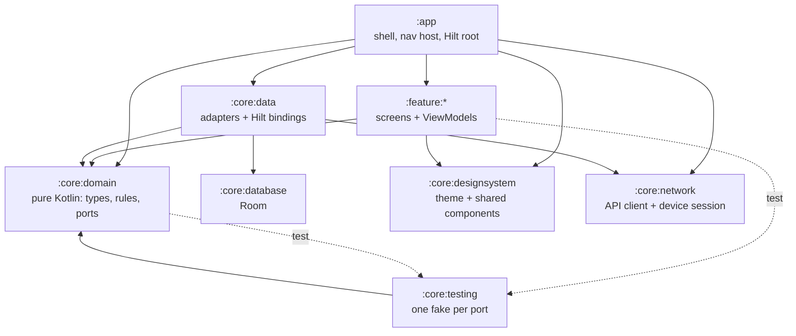

# Awrad Android Next — architecture

A proof-of-concept rebuild of the Android app that tests stricter, **build-enforced** structure. It uses the same stack as `awrad-android`: Kotlin 2.0, Compose, Hilt, Room, DataStore and Navigation. Versions are pinned to match so lessons transfer directly.

Status: **scaffold plus the goal domain and Hijri calendar (slices 1 and 1b), and accounts (slices 2a and 2b).** The goal model and its rules are real; persistence and screens for them come in later slices. Accounts are real end to end: input rules, API client, device session, account settings and screens.

## Why this exists

The architecture review of `awrad-android` found these problems:

- Domain rules copied across UI, repositories and notifications.
- Single files of 3,000–4,000 lines.
- Logic that can only be "tested" by reading source text.

This project checks whether module boundaries plus build-time rules prevent that. It will **replace `awrad-android`** (ADR 0003). Neither app is released, so there is no user data to carry over.

## Modules



| Module | Plugin | May depend on |
|---|---|---|
| `:app` | `awrad.android.application` | anything |
| `:feature:*` | `awrad.android.feature` | `:core:domain`, `:core:designsystem` (and `:core:testing` in tests) |
| `:core:domain` | `awrad.jvm.library` (no Android) | nothing |
| `:core:data` | `awrad.android.library` + `hilt` | `:core:domain`, `:core:database`, `:core:network` |
| `:core:database` | `awrad.android.library` + Room | nothing |
| `:core:network` | `awrad.android.library` + `hilt` + serialization | nothing |
| `:core:designsystem` | `awrad.android.library` + `compose` | nothing |
| `:core:testing` | `awrad.jvm.library` | `:core:domain` |

**The key seam:** features never see adapters. A feature asks for a port, such as `OnboardingStatusStore` or `GoalRepository`. `:core:data` binds the real adapter in `DataModule`, and tests use the fake from `:core:testing`. That gives two adapters per port, which is the reason the seam exists.

## What the build enforces

| Standard | Mechanism | Problem in awrad-android it targets |
|---|---|---|
| Module graph above | `ModuleRulesConventionPlugin` fails configuration | No boundaries; anything imports anything |
| Explicit visibility | Kotlin explicit API mode in all library modules | Accidental public surface |
| No warnings | Kotlin `allWarningsAsErrors`, lint `warningsAsErrors` | Deprecations and lint debt pile up |
| Static analysis | detekt with compose-rules and ktlint formatting, `warningsAsErrors` | Inconsistent Compose and state patterns |
| ≤ 400 lines per file | `verifySourceFileSize` (part of `check`) | `CountingScreen.kt` at 4,341 lines |
| Committed schemas | Room Gradle plugin → `core/database/schemas/` | Same rule as today, now automatic |
| Colours only from the shared roles | `verifyAwradColors`, `verifyColorLiterals` (run by `detekt`), detekt `ForbiddenImport` | Hex values and sage shades scattered through screens |

Every rule lives in `build-logic/` or `config/detekt/detekt.yml`, so changing a standard is a reviewed diff.

## Goal domain

The goal model and rules live once, in `:core:domain`, and follow `contracts/goal-model/v1/` and `CONTEXT.md`. Nothing else in the app may re-derive a rule.

- **Types** (`app.awrad.core.domain.goal`): `Goal` (identity) wraps a `GoalDefinition`: `Schedule` (sealed: every day, weekdays, every N days, month days, specific dates, one time, Hijri month days, and `Yearly` with a `CalendarSystem` and inclusive `YearlyRange`s), `ActivePeriod`, `PausedRange`, `CountPolicy` with `StreakThreshold`, `Session`, `Requirement` (sealed: per due date, cumulative total, period total, days per period, tracker; periods are `CalendarPeriod` week, month or Hijri month) and `CompletionPolicy`. `CountEntry` is a whole-number count on an effective practice day. Invalid shapes (empty sets, a duration below 1) fail on construction.
- **Valid goals only** (`GoalValidity.kt`): `GoalDefinition`'s constructor is private. `GoalDefinition.create(…)` returns `GoalDefinitionResult.Valid` or `GoalDefinitionResult.Invalid` with every `GoalDefinitionError` (`TARGET_REQUIRED`, `SESSION_TARGET_REQUIRED`, `STREAK_THRESHOLD_VALUE_REQUIRED`, fixture `goal_validity`). Creation, sync and import go through it, so the rules never see a goal without a required target or streak threshold value.
- **Practice policy** (`app.awrad.core.domain.practice`): `DayReset`, `WeekStart`, and the `EffectivePracticeDay` rule. Prayer times are inputs.
- **Rules** (`app.awrad.core.domain.goal.rules`), one file each, pure functions on `GoalDefinition`: `isDueOn` (`GoalDue.kt`), `standingOn` (`RequirementStanding.kt`), `daysPerPeriodOn` (`DaysPerPeriodStanding.kt`), `isCompletedOn` (`GoalCompletion.kt`) and `streakOn` (`GoalStreak.kt`). Every rule that reads schedules takes the account's `HijriCorrections` (no default, like `WeekStart`). Shared internals (count index, "does this day meet the target or streak threshold", `PeriodCalendar` for weeks, months and Hijri months) are in `DayProgress.kt`.
- **Fixture runner** (`:core:testing`, `app.awrad.core.testing.fixtures`): `FixtureRunner` finds `contracts/<model>/v1/fixtures/<rule>.json` (goal-model, hijri-calendar and account-model) by walking up from the working directory. It fails when a file is missing or empty, runs every case, and reports failures by case id. `GoalModelJson.kt` decodes the fixture JSON into domain types through `GoalDefinition.create` (`goal()` for rule fixtures, which only hold valid goals; `goalResult()` for `goal_validity`); `HijriCalendarJson.kt` decodes corrections (`hijriCorrections()`, absent = none). `:core:domain:test` has one `…FixtureTest` per rule, and `FixtureCoverageTest` fails when a rule file in any of those directories has no runner. The fixtures are the spec: fix the rule, never the case.

## Hijri calendar

Hijri dates come from one shared Umm al-Qura table (root ADR-2026-10-26), never from `HijrahDate`, ICU or another library.

- **The table** is `contracts/hijri-calendar/v1/umm-al-qura.json`, bundled as committed Kotlin source: `core/domain/.../hijri/UmmAlQuraTable.kt` (generated, don't edit). The app reads nothing from `contracts/` at runtime.
- **Freshness check:** `./gradlew :core:domain:generateUmmAlQuraTable` regenerates it (`UmmAlQuraTableTask` in `build-logic`). `verifyUmmAlQuraTable` fails the build when the committed file differs from the contract. It runs before `:core:domain:test` and as part of `check`, so the validation command catches a stale table.
- **Types** (`app.awrad.core.domain.hijri`): `HijriCorrection` is an unvalidated `{year, month, offsetDays}`. `HijriCorrections.create(…)` returns `HijriCorrectionsResult.Valid` or `Invalid` with every `HijriCorrectionsError` (fixture `hijri_corrections_validity`), so an invalid set can't exist. `HijriCalendar(corrections)` gives the corrected `HijriMonth` (first day, length) or `HijriDate` of a day, or null outside the table.

## Accounts and device sessions

Slice 2a ([`docs/slices/02-accounts.md`](../docs/slices/02-accounts.md)), following root ADR-2026-07-12 and ADR-2026-10-26. An account is optional: signing in or out never touches local practice data.

- **Input rules** (`app.awrad.core.domain.account`, `AccountInput.kt`): `EmailAddress.parse` (trim an explicit whitespace set, basic shape, at most 160 code points), `PasswordPolicy.errors` (12 to 128 code points after NFC) and `EmailCode.parse` (spaces and hyphens removed; Arabic-Indic, Eastern Arabic-Indic and fullwidth digits to ASCII). They run the shared `contracts/account-model/v1/` fixtures, and the client only checks length: the server is the authority and also rejects common passwords.
- **Ports:** `AccountRepository` (the `SignInState` flow, register, verify, resend, request and reset password, sign in, refresh account, sign out) and `AccountSettingsRepository` (slice 2b, below). Results are `AccountResult`; failures are a sealed `AccountError`. `:core:data`'s `NetworkAccountRepository` and `NetworkAccountSettingsRepository` map the API's problem `code`, and only it, to an `AccountError` (`AccountErrors.kt`), and `validation_failed` field codes to `InputProblem`s; unknown codes are `Unexpected`. Tests read every `x-error-codes` entry of the operations the app uses, and every field code their `422` responses document, and fail when one has no specific error or input problem.
- **Signed out, and why:** `SignInState.SignedOut` carries a `SignOutReason`: not signed in at start, signed out here, `SESSION_ENDED` (the server ended the session: revoked from another device, a password change or reset elsewhere, expiry) or `ACCOUNT_DELETED`. The account screen shows each with its own message. The reason is kept in memory only.
- **API client** (`:core:network`, ADR 0005): hand-written `@Serializable` classes (`ApiModels.kt`, `AccountSettingsModels.kt`), `ApiOperation` (every operation used, with method, path template and headers), `AccountsApi` and `AccountSettingsApi` over a shared `ApiCaller` and an `HttpTransport` (OkHttp in the app, a fake in tests). Errors decode as RFC 9457 `Problem` with `Retry-After`. Public operations never carry a bearer token; every POST sends a fresh `Idempotency-Key`; operations that may send email send `Accept-Language` with the app's language (`en`, `ar` or `ml`). `ApiContractTest` checks each `ApiOperation` against `contracts/api/openapi.bundled.json` and round-trips every request and response example of those operations through the classes, failing on any difference.
- **Device session** (`DeviceSessionManager`):
  - Sign-in sends the installation id (a random UUIDv4 in secure storage), the device's real model name (`Build.MANUFACTURER` + `Build.MODEL`) and `android`.
  - The refresh token is stored encrypted (ADR 0006); the access token stays in memory and is refreshed 30 seconds before it expires, or once after a `401`.
  - **Single flight:** a `Mutex` guards the tokens, so concurrent callers share one refresh.
  - **Refresh keys:** each refresh gets an `Idempotency-Key` that is stored before the call and reused until the refresh gets an answer, also across a restart. The server then replays a rotation it already did instead of treating the retry as token reuse.
  - **Failures:** tokens survive network errors, `5xx` and `429`. Only a `401` from refresh (`refresh_token_invalid`, `refresh_reuse_detected`) drops them and signs the device out (`SESSION_ENDED`). A session revoked elsewhere shows up this way: the next authenticated call gets `401`, the refresh it triggers gets `401`, and the device is signed out.
  - **Account deleted:** after `delete_account` succeeds, the session is forgotten without a sign-out call (the server has already ended every session).
  - **Sign-out** clears local credentials at once and queues `sign_out_device_session` with the refresh token, so it works after a restart without an access token. The queue is sent straight away and again at each app start (and before each sign-in) until the server answers.
- **Screens** (`:feature:account`, one `AccountDestination`): sign in, register, verify the email (resend with a 60-second cooldown, or the server's `Retry-After`), forgot password, reset password, and the signed-in account area. Verifying or resetting doesn't sign in, so the flow then signs in with the password typed earlier (kept in memory only). The home placeholder links to it.
- **Account settings** (slice 2b, tag `account_settings`): `AccountSettingsRepository` lists the account's sessions (`AccountSession`: device or browser, name or null, platform, created and last used, `isCurrent`; unknown kinds and platforms are `OTHER`), revokes one or all others, changes the password, requests and confirms an email change, and deletes the account. Every call goes through `DeviceSessionManager.authorized`. A confirmed email change updates the stored email; a deletion signs the device out with `ACCOUNT_DELETED`. Local practice data is never touched.
- **Signed-in area** (`settings/`): a nested `NavHost` inside `AccountRoute`, internal to the feature, so each page has its own ViewModel for as long as it's open. When the session ends, `AccountRoute` swaps the whole area for the sign-in screen.
  - **Account:** the email, links to the pages below, and sign out.
  - **Devices:** every session, this device first and marked, with a platform icon and label and "last used" (relative, from Android's `DateUtils`); "Web browser" for an unnamed browser. Any other session can be signed out, and all others at once, each after a confirmation. A session that had already ended (`not_found`) says so and the list reloads. This device signs out from the account page.
  - **Change password:** current and new password (the 12-character hint, checked before sending), then a confirmation that other devices were signed out.
  - **Change email:** current password and new address, then the code sent to the new address (resend with the same cooldown, by repeating the request), then the new email. `email_taken` offers to use a different address.
  - **Delete account:** says that the account and its server data go immediately and for good, and that data on this device stays; then the password and a destructive confirmation.
  - Shared pieces: `AccountPage` (Back, title, progress line, status), `ResendCooldown`, `ConfirmDialog`. Text edits update the ViewModel's state synchronously.
- **Server address:** `BuildConfig.API_BASE_URL` in `:app`. Debug is `http://10.0.2.2:4000` (the host's `localhost` from the emulator), overridable with `-Pawrad.apiBaseUrl=…`; only debug allows cleartext (`src/debug/res/xml/network_security_config.xml`). Release points at a reserved `.invalid` host until the server is deployed.

## Colours

Every colour is one of the 15 shared roles in `contracts/design-tokens/v1/colors.json` (light and dark; read its README for what each role is for). Light or dark follows the system; there is no dynamic (wallpaper) colour.

- **Generated, committed source:** `core/designsystem/.../theme/AwradColors.kt` (the `AwradColors` class, `LightAwradColors`, `DarkAwradColors`; alpha kept) and the same roles as resources, `res/values/awrad_colors.xml` and `res/values-night/awrad_colors.xml` (`@color/awrad_background` is the window background before the first frame). Don't edit them: regenerate with `./gradlew :core:designsystem:generateAwradColors` (`AwradColorsTask` in `build-logic`). `verifyAwradColors` fails when any of the three differs from the contract; it runs before the module's unit tests and lint, and in `check`.
- **Reading a role:** `MaterialTheme.colorScheme` for the roles Material has, `AwradTheme.colors` for all of them, including those Material lacks (`surfaceBar`, `outlineStrong`, `accent`, `progress`).
- **Material mapping** (`AwradColorScheme.kt`, every slot set, checked by `AwradColorSchemeTest`): `background`, `surface`, `onSurface` (also `onBackground`), `onSurfaceVariant`, `primary`, `onPrimary`, `primaryContainer`, `onPrimaryContainer`, `error`, `onError` map to their namesakes. `outline` and `outlineVariant` are `outline`. Secondary and tertiary repeat the primary roles (one brand colour, so the navigation bar's pill is `primaryContainer`). `surfaceContainerHighest`, `surfaceVariant` and `surfaceDim` are `surface` (filled cards and fields); `surfaceContainerLow`, `surfaceContainer`, `surfaceContainerHigh` and `surfaceBright` are `surfaceBar` (sheets, menus, navigation bar, dialogs); `surfaceContainerLowest` is `background`. Error containers are `error`/`onError`; `surfaceTint` is `surface`, which turns tonal elevation off; inverse slots (snackbars) are the other theme's `background`, `onSurface` and `accent`; the scrim is black.
- **Components:** Material draws `primary` as text, focus and progress colour, and `outline` as control borders; `#23553C` is unreadable on a dark background and `outline` is decorative. So screens use the design system's `AwradTextButton` (`accent`, or `error`), `AwradSecondaryButton` (`outlineStrong` border), `AwradDestructiveButton` (`error` fill, `onError` text), `AwradTextField` (`outlineStrong` border, `accent` focus) and `AwradLinearProgress`/`AwradCircularProgress` (`progress`). detekt's `ForbiddenImport` keeps the Material versions out of features and `:app`.
- **No literals:** `verifyColorLiterals` (in every module, run by `detekt` and `check`) fails on `Color(0x…)` in Kotlin or `#…` in resource XML outside the generated files. The launcher icon's background is part of the icon artwork and exempt.
- **Previews:** the design system's `ComponentPreviews.kt` and every screen preview render in light and dark (`uiMode = UI_MODE_NIGHT_YES`).

## Patterns

- **Feature interface:** one `@Serializable` destination and one `NavGraphBuilder` extension. See `feature/onboarding/OnboardingDestination.kt`.
- **Screens:** a stateful `…Route` (ViewModel and side effects) wraps a stateless `…Screen(state, onAction, modifier)`. The stateless screen is previewable and can be UI-tested without Hilt.
- **ViewModels:** one `StateFlow<…UiState>` in, one `onAction(…Action)` out. A sealed `Action` type is the whole interface the screen uses.
- **Colours:** screens pick a role (below), never a hex value, and never by checking whether the theme is dark.
- **Errors:** typed (enums or sealed types) and mapped to string resources at the UI edge.
- **Startup:** `AppShellViewModel` picks the start destination. `MainActivity` only hosts.

## Running it

```bash
./gradlew :app:installDebug                       # installs next to the real app
./gradlew assembleDebug testDebugUnitTest :core:domain:test detekt verifySourceFileSize lintDebug
```

Against a local `awrad-server-next` on port 4000: the emulator needs nothing more. On a USB device, run `adb reverse tcp:4000 tcp:4000` and build with `./gradlew :app:installDebug -Pawrad.apiBaseUrl=http://localhost:4000`.

The working app id is `app.awrad.awrad_dhikrgoalstracker.next`, so it installs next to awrad-android for side-by-side comparison. The final id is fixed before the first release.

## Decisions

Accepted ADRs live in [`docs/adr/`](docs/adr/README.md):

- One module per feature (0001).
- Plain Kotlin/JVM domain, no Kotlin Multiplatform (0002).
- **Replaces awrad-android** (0003). The schema is designed fresh and stays at Room version 1 until the first release. API, content IDs and domain behaviour stay shared with iOS and the server.
- Conventions are enforced by the build (0004).
- A `:core:network` module on OkHttp, without Retrofit (0005).
- Account credentials in Keystore-encrypted files (0006).

## Open questions

- Final `applicationId` and the switch to forward migrations. These go in an ADR before the first release.
