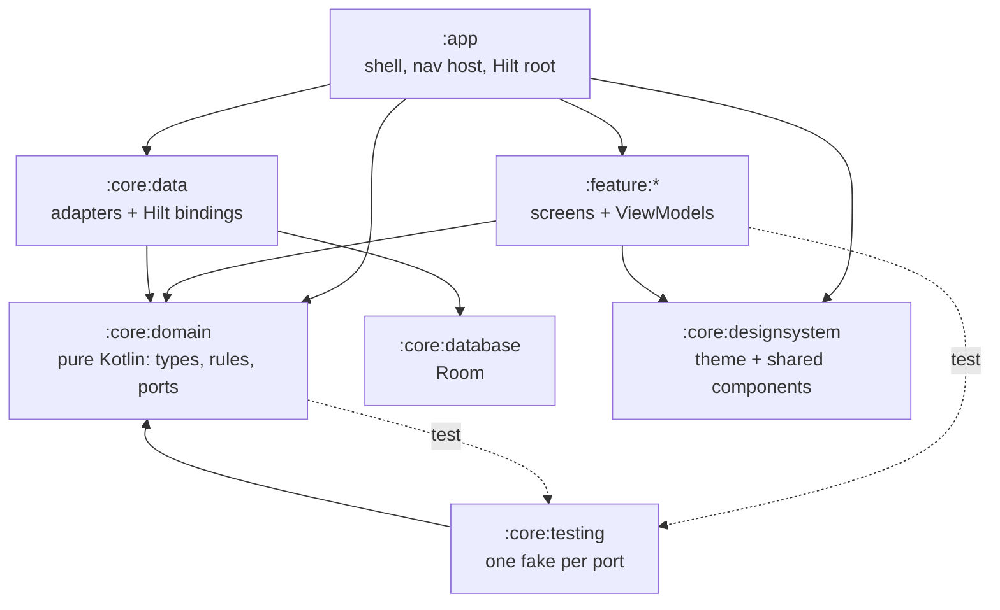

# Awrad Android Next — architecture

A proof-of-concept rebuild of the Android app that tests stricter, **build-enforced** structure. It uses the same stack as `awrad-android`: Kotlin 2.0, Compose, Hilt, Room, DataStore and Navigation. Versions are pinned to match so lessons transfer directly.

Status: **scaffold plus the goal domain and Hijri calendar (slices 1 and 1b).** One placeholder screen proves the wiring end to end. The goal model and its rules are real; persistence and screens for them come in later slices.

## Why this exists

The architecture review of `awrad-android` found these problems:

- Domain rules copied across UI, repositories and notifications.
- Single files of 3,000–4,000 lines.
- Logic that can only be "tested" by reading source text.

This project checks whether module boundaries plus build-time rules prevent that. It will **replace `awrad-android`** (ADR 0003). Neither app is released, so there is no user data to carry over.

## Modules



| Module | Plugin | May depend on |
|---|---|---|
| `:app` | `awrad.android.application` | anything |
| `:feature:*` | `awrad.android.feature` | `:core:domain`, `:core:designsystem` (and `:core:testing` in tests) |
| `:core:domain` | `awrad.jvm.library` (no Android) | nothing |
| `:core:data` | `awrad.android.library` + `hilt` | `:core:domain`, `:core:database` |
| `:core:database` | `awrad.android.library` + Room | nothing |
| `:core:designsystem` | `awrad.android.library` + `compose` | nothing |
| `:core:testing` | `awrad.jvm.library` | `:core:domain` |

**The key seam:** features never see adapters. A feature asks for a port, such as `OnboardingStatusStore` or `GoalRepository`. `:core:data` binds the real adapter in `DataModule`, and tests use the fake from `:core:testing`. That gives two adapters per port, which is the reason the seam exists.

## What the build enforces

| Standard | Mechanism | Problem in awrad-android it targets |
|---|---|---|
| Module graph above | `ModuleRulesConventionPlugin` fails configuration | No boundaries; anything imports anything |
| Explicit visibility | Kotlin explicit API mode in all library modules | Accidental public surface |
| No warnings | Kotlin `allWarningsAsErrors`, lint `warningsAsErrors` | Deprecations and lint debt pile up |
| Static analysis | detekt with compose-rules and ktlint formatting, `warningsAsErrors` | Inconsistent Compose and state patterns |
| ≤ 400 lines per file | `verifySourceFileSize` (part of `check`) | `CountingScreen.kt` at 4,341 lines |
| Committed schemas | Room Gradle plugin → `core/database/schemas/` | Same rule as today, now automatic |

Every rule lives in `build-logic/` or `config/detekt/detekt.yml`, so changing a standard is a reviewed diff.

## Goal domain

The goal model and rules live once, in `:core:domain`, and follow `contracts/goal-model/v1/` and `CONTEXT.md`. Nothing else in the app may re-derive a rule.

- **Types** (`app.awrad.core.domain.goal`): `Goal` (identity) wraps a `GoalDefinition`: `Schedule` (sealed: every day, weekdays, every N days, month days, specific dates, one time, Hijri month days, and `Yearly` with a `CalendarSystem` and inclusive `YearlyRange`s), `ActivePeriod`, `PausedRange`, `CountPolicy` with `StreakThreshold`, `Session`, `Requirement` (sealed: per due date, cumulative total, period total, days per period, tracker; periods are `CalendarPeriod` week, month or Hijri month) and `CompletionPolicy`. `CountEntry` is a whole-number count on an effective practice day. Invalid shapes (empty sets, a duration below 1) fail on construction.
- **Valid goals only** (`GoalValidity.kt`): `GoalDefinition`'s constructor is private. `GoalDefinition.create(…)` returns `GoalDefinitionResult.Valid` or `GoalDefinitionResult.Invalid` with every `GoalDefinitionError` (`TARGET_REQUIRED`, `SESSION_TARGET_REQUIRED`, `STREAK_THRESHOLD_VALUE_REQUIRED`, fixture `goal_validity`). Creation, sync and import go through it, so the rules never see a goal without a required target or streak threshold value.
- **Practice policy** (`app.awrad.core.domain.practice`): `DayReset`, `WeekStart`, and the `EffectivePracticeDay` rule. Prayer times are inputs.
- **Rules** (`app.awrad.core.domain.goal.rules`), one file each, pure functions on `GoalDefinition`: `isDueOn` (`GoalDue.kt`), `standingOn` (`RequirementStanding.kt`), `daysPerPeriodOn` (`DaysPerPeriodStanding.kt`), `isCompletedOn` (`GoalCompletion.kt`) and `streakOn` (`GoalStreak.kt`). Every rule that reads schedules takes the account's `HijriCorrections` (no default, like `WeekStart`). Shared internals (count index, "does this day meet the target or streak threshold", `PeriodCalendar` for weeks, months and Hijri months) are in `DayProgress.kt`.
- **Fixture runner** (`:core:testing`, `app.awrad.core.testing.fixtures`): `FixtureRunner` finds `contracts/<model>/v1/fixtures/<rule>.json` (goal-model and hijri-calendar) by walking up from the working directory. It fails when a file is missing or empty, runs every case, and reports failures by case id. `GoalModelJson.kt` decodes the fixture JSON into domain types through `GoalDefinition.create` (`goal()` for rule fixtures, which only hold valid goals; `goalResult()` for `goal_validity`); `HijriCalendarJson.kt` decodes corrections (`hijriCorrections()`, absent = none). `:core:domain:test` has one `…FixtureTest` per rule, and `FixtureCoverageTest` fails when a rule file in either directory has no runner. The fixtures are the spec: fix the rule, never the case.

## Hijri calendar

Hijri dates come from one shared Umm al-Qura table (root ADR-2026-10-26), never from `HijrahDate`, ICU or another library.

- **The table** is `contracts/hijri-calendar/v1/umm-al-qura.json`, bundled as committed Kotlin source: `core/domain/.../hijri/UmmAlQuraTable.kt` (generated, don't edit). The app reads nothing from `contracts/` at runtime.
- **Freshness check:** `./gradlew :core:domain:generateUmmAlQuraTable` regenerates it (`UmmAlQuraTableTask` in `build-logic`). `verifyUmmAlQuraTable` fails the build when the committed file differs from the contract. It runs before `:core:domain:test` and as part of `check`, so the validation command catches a stale table.
- **Types** (`app.awrad.core.domain.hijri`): `HijriCorrection` is an unvalidated `{year, month, offsetDays}`. `HijriCorrections.create(…)` returns `HijriCorrectionsResult.Valid` or `Invalid` with every `HijriCorrectionsError` (fixture `hijri_corrections_validity`), so an invalid set can't exist. `HijriCalendar(corrections)` gives the corrected `HijriMonth` (first day, length) or `HijriDate` of a day, or null outside the table.

## Patterns

- **Feature interface:** one `@Serializable` destination and one `NavGraphBuilder` extension. See `feature/onboarding/OnboardingDestination.kt`.
- **Screens:** a stateful `…Route` (ViewModel and side effects) wraps a stateless `…Screen(state, onAction, modifier)`. The stateless screen is previewable and can be UI-tested without Hilt.
- **ViewModels:** one `StateFlow<…UiState>` in, one `onAction(…Action)` out. A sealed `Action` type is the whole interface the screen uses.
- **Colours:** screens read roles from `MaterialTheme.colorScheme`. The raw palette is private to the design system, and nothing picks colours by checking whether the theme is dark.
- **Errors:** typed (enums or sealed types) and mapped to string resources at the UI edge.
- **Startup:** `AppShellViewModel` picks the start destination. `MainActivity` only hosts.

## Running it

```bash
./gradlew :app:installDebug                       # installs next to the real app
./gradlew assembleDebug testDebugUnitTest :core:domain:test detekt verifySourceFileSize lintDebug
```

The working app id is `app.awrad.awrad_dhikrgoalstracker.next`, so it installs next to awrad-android for side-by-side comparison. The final id is fixed before the first release.

## Decisions

Accepted ADRs live in [`docs/adr/`](docs/adr/README.md):

- One module per feature (0001).
- Plain Kotlin/JVM domain, no Kotlin Multiplatform (0002).
- **Replaces awrad-android** (0003). The schema is designed fresh and stays at Room version 1 until the first release. API, content IDs and domain behaviour stay shared with iOS and the server.
- Conventions are enforced by the build (0004).

## Open questions

- How the account/auth port maps onto the existing API contract (`CONTRACTS.md`). There is no network module yet.
- Final `applicationId` and the switch to forward migrations. These go in an ADR before the first release.
