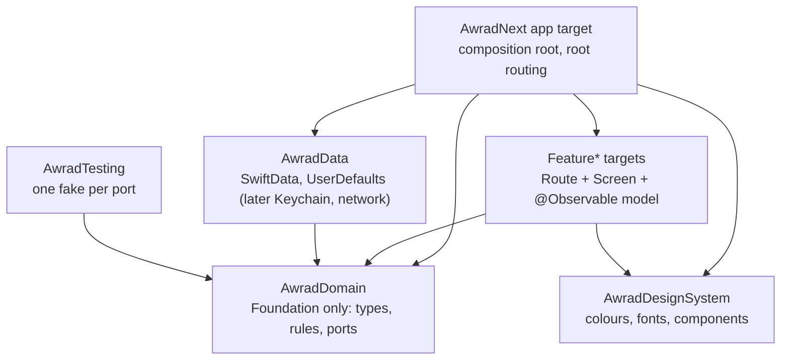

# awrad-ios-next — architecture

The Awrad iOS app, rebuilt to replace `awrad-ios/` (root ADR-2026-10-14).
- **Stack:** SwiftUI, SwiftData and Observation on iOS 18, built with Xcode 26.2 / Swift 6.2.
- **Status:** scaffold plus the slice 1 goal rules. A placeholder onboarding screen and home screen prove the wiring; features arrive in slices (`../docs/rebuild-plan.md`).

## Modules

All code lives in one local Swift package, `AwradKit`. The Xcode project holds only a thin app target (ADR 0003).

| Target | May depend on | Isolation |
|---|---|---|
| `AwradDomain` | nothing (Foundation) | nonisolated |
| `AwradData` | `AwradDomain` | nonisolated (actors for state) |
| `AwradDesignSystem` | nothing | `@MainActor` by default |
| `Feature*` | `AwradDomain`, `AwradDesignSystem` | `@MainActor` by default |
| `AwradTesting` | `AwradDomain` | nonisolated |
| Test targets | whatever they test, plus `AwradTesting` | as tested |

**Enforcement:** the compiler blocks imports a target doesn't declare, and `scripts/check-module-rules.py` blocks declarations outside this table (ADR 0001).

**Platforms:** the package targets **iOS 18 and macOS 15**, so `swift test` runs domain, data and model tests on the Mac in milliseconds. Only app-level checks need a simulator.

## Goal model and rules (slice 1)

`AwradDomain` models the goal of [`contracts/goal-model/v1`](../contracts/goal-model/v1/README.md) as Sendable value types in `Goal.swift`: `Schedule`, `ActivePeriod`, `PausedRange`, `CountPolicy` (with its `CountThreshold` streak threshold), `GoalSession`, `Requirement`, `CompletionPolicy` and `CountEntry`.
- **Days** are `CalendarDay` (year, month, day), not `Date` or `DateComponents`. All day arithmetic goes through one Gregorian calendar fixed to UTC, never `Calendar.current`. `CalendarDay` is `Strideable`, so a window is a walkable `ClosedRange<CalendarDay>`.
- **Only valid goals exist.** `Goal`'s properties are read-only and its initializer `throws(GoalValidationError)`, whose `codes` are the contract's error codes in alphabetical order (`Goal+Validity.swift`, run against `goal_validity.json`). Every caller (fixture decoding, tests, later sync and import) goes through it, so the rules never handle a missing target.
- **One file per rule**, all pure: `EffectivePracticeDay.resolve`, `Goal.isDue(on:)`, `Goal.standing(on:counts:weekStart:)`, `Goal.daysPerPeriodStanding(…)`, `Goal.isCompleted(on:counts:)` and `Goal.currentStreak(…)`. They share `GoalEvaluation.swift`, the only place that decides whether a window meets its numbers (each session its own).
- **Fixture runner:** `AwradTesting/FixtureLoader.swift` reads `contracts/<model>/v<N>/fixtures/<rule>.json` from the repository (found by walking up from `#filePath`) and fails on a missing file, zero cases or a case that won't decode. `GoalModelFixtures` decodes each rule's `given` into domain values. `AwradDomainTests/GoalModelFixtureTests` runs every case as a parameterized test named by case ID.

The fixtures are the spec. Persistence of the full goal is slice 3; `GoalRecord` stores only a placeholder subset until then.

## Screens

- **`…Route`** is stateful. It owns the model (`@State`) and the exit callbacks.
- **`…Screen(state:send:)`** is stateless and previewable.
- **The model** is `@Observable`, with `private(set) var state` and `func send(_ action:) async`. The action enum is the screen's whole interface to the model.

See `FeatureOnboarding`.

## Persistence (ADR 0002)

- **Goals:** SwiftData behind the `GoalRepository` port, through `SwiftDataGoalRepository`, a `@ModelActor` (a placeholder subset until slice 3).
- **Small flags:** `UserDefaults` behind ports, through actors.
- **Pre-release schema policy:** one schema, edited in place. If the stored schema can't be opened, `AwradStore.persistent()` deletes and recreates the dev store. Both the fallback and the single-version policy end at the first release.

## Resources

- **Fonts:** Manrope for interface text, Noto Naskh Arabic for Qur'anic and dhikr text. They're bundled in `AwradDesignSystem` and registered at launch with `AwradFonts.register()`.
- **Logo:** plain PNGs in the package bundle.
- **Strings:** String Catalogs per module (`Bundle.module`) plus the app's own. Xcode compiles them into `en`/`ar`/`ml` resources.

Command-line `swift build` copies catalogs uncompiled, so runtime localization is only exercised in Xcode builds.

## App identity

Bundle ID `app.awrad.awrad.next` and display name "Awrad Next", so it installs next to the frozen app. iPhone and iPad. The final identity is fixed before the first release.

## Decisions

See [`docs/adr/`](docs/adr/README.md). Cross-project decisions are in the root [`DECISIONS.md`](../DECISIONS.md).
