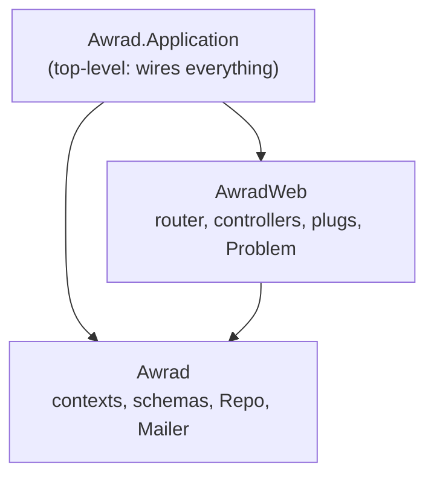

# awrad-server-next — architecture

The Awrad JSON API, rebuilt contract-first to replace `awrad_server/` (root ADR-2026-10-14).
- **Stack:** Phoenix 1.8.15 on Elixir 1.20.4 / OTP 29, Ecto with Postgres 18, Bandit.
- **API only:** no HTML, assets, LiveView or static files.
- **Status:** scaffold. One real operation (`get_browser_csrf_token`) proves the wiring; features arrive in slices (`../docs/rebuild-plan.md`).

## Boundaries

| Boundary | May use | Exports |
|---|---|---|
| `Awrad.Application` (top level) | `Awrad`, `AwradWeb` | – |
| `AwradWeb` | `Awrad` | `Endpoint`, `Telemetry` |
| `Awrad` | nothing | `Mailer`, `Repo`, plus each context's public module as contexts arrive |

Boundary checks these rules at compile time, and `mix validate` fails on any violation (ADR 0001). Test support (`test/support/`) sits outside the production boundaries.

## Request path

`Endpoint`: `Plug.RequestId` (`x-request-id`) → `ApiResponseHeaders` (`Cache-Control: no-store` by default; `application/problem+json` on errors) → parsers → session → `Router`. The router has two pipelines:

| Pipeline | Used by | Plugs |
|---|---|---|
| `:api` | Every `/api/v1` route | JSON only |
| `:browser_session` | Browser routes | Cookie session (`_awrad_session`) plus CSRF protection on state-changing methods (ADR-2026-10-15) |

A mobile bearer pipeline arrives with the accounts slice. Neither pipeline accepts the other's credential.

## Errors

Every error is an RFC 9457 problem (`contracts/api/STYLE.md` §7):

| Source | Shape | Sent by |
|---|---|---|
| Controllers | Problem with a stable `code` | `AwradWeb.Problem.send_problem/6` |
| Phoenix itself (unmatched routes, parse errors, crashes) | Problem (`not_found`, `malformed_request`, `internal_error`), never internal details | `AwradWeb.ErrorJSON` |

## Contract tests (ADR 0002)

`test/support/contract.ex` loads `../contracts/api/openapi.bundled.json`.
- **`assert_conforms(conn, operation_id)`** checks:
  - the status is documented;
  - each declared header is present;
  - the content type matches;
  - the body validates against the response schema (JSON Schema 2020-12, via JSV).
- **`ContractCoverageTest`** fails when the router and the spec disagree in either direction.

## Data

Ecto with binary (UUID) primary keys. The databases are `awrad_next_dev` and `awrad_next_test`, on the machine's Postgres 18 by default (`AWRAD_POSTGRES_PORT`, default 5432). No schemas yet.

## Decisions

See [`docs/adr/`](docs/adr/README.md). Cross-project decisions are in the root [`DECISIONS.md`](../DECISIONS.md).
