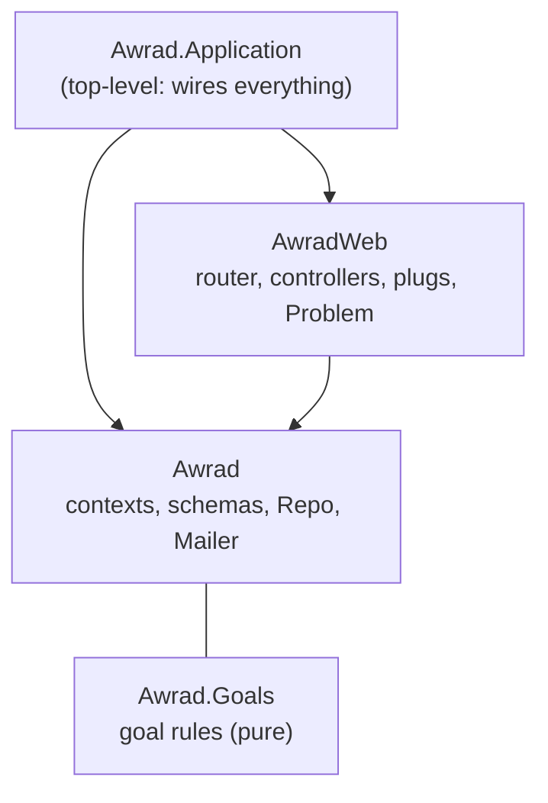

# awrad-server-next — architecture

The Awrad JSON API, rebuilt contract-first to replace `awrad_server/` (root ADR-2026-10-14).
- **Stack:** Phoenix 1.8.15 on Elixir 1.20.4 / OTP 29, Ecto with Postgres 18, Bandit.
- **API only:** no HTML, assets, LiveView or static files.
- **Status:** scaffold plus the goal rules (slice 1). One real operation (`get_browser_csrf_token`) proves the wiring; features arrive in slices (`../docs/rebuild-plan.md`).

## Boundaries

| Boundary | May use | Exports |
|---|---|---|
| `Awrad.Application` (top level) | `Awrad`, `AwradWeb` | – |
| `AwradWeb` | `Awrad` | `Endpoint`, `Telemetry` |
| `Awrad` | nothing | `Mailer`, `Repo`, and each context sub-boundary with its exports (`{Goals, []}`) |
| `Awrad.Goals` (sub-boundary of `Awrad`) | nothing | `Rules` and the goal-model structs (`Goal`, `ActivePeriod`, `PausedRange`, `CountPolicy`, `Session`, `CountEntry`, `Standing`, `SessionStanding`, `DaysPerPeriodStanding`) |

Boundary checks these rules at compile time, and `mix validate` fails on any violation (ADR 0001). Test support (`test/support/`) sits outside the production boundaries.

## Goal rules (slice 1)

`Awrad.Goals` evaluates goals for the web (slice 1 brief, decision 1): pure functions over plain structs, with no Ecto, database or HTTP. The structs mirror `contracts/goal-model/v1/goal-model.schema.json`, using `Date`, `DateTime` and integers.
- **`Awrad.Goals.Rules`** is the only entry point. It has one function per rule: `effective_practice_day/4`, `due?/2`, `standing/4`, `days_per_period/4`, `completed?/3` and `streak/4`.
- **Invalid goals can't be built.** `Awrad.Goals.Goal.new/1` is the only constructor: it returns `{:ok, goal}`, or `{:error, codes}` with the `goal_validity` error codes sorted alphabetically (`session_target_required`, `streak_threshold_value_required`, `target_required`). The rules assume a valid goal. There's no Ecto goal schema yet; when one arrives, its changeset applies the same check with the same codes.
- **Each rule has one home** under `lib/awrad/goals/rules/`: `EffectiveDay`, `Schedule`, `Requirement`, `DaysPerPeriod`, `Completion` and `Streak`. Two internal helpers, `Periods` (active-period bounds, week and month windows) and `Counts` (count index, thresholds), are shared. None of these modules is exported.
- **Time zones** come from the compiled-in `tz` database, with no runtime updates (ADR 0003).
- **The fixtures are the spec.**
  - `test/support/fixtures.ex` (`Awrad.Fixtures.cases!/2`) loads `contracts/<model>/fixtures/<rule>.json`. It raises when the file is missing, is for another rule, or has no cases.
  - `test/support/fixtures/goal_model.ex` maps the fixture JSON to the structs and the results back. Rule fixtures' goals go through `Goal.new/1` (an invalid one raises); only `goal_validity` takes the raw `goal_shape`.
  - `test/awrad/goals/rules/*_test.exs` generate one test per case, named by the case ID.

## Request path

`Endpoint`: `Plug.RequestId` (`x-request-id`) → `ApiResponseHeaders` (`Cache-Control: no-store` by default; `application/problem+json` on errors) → parsers → session → `Router`. The router has two pipelines:

| Pipeline | Used by | Plugs |
|---|---|---|
| `:api` | Every `/api/v1` route | JSON only |
| `:browser_session` | Browser routes | Cookie session (`_awrad_session`) plus CSRF protection on state-changing methods (ADR-2026-10-15) |

A mobile bearer pipeline arrives with the accounts slice. Neither pipeline accepts the other's credential.

## Errors

Every error is an RFC 9457 problem (`contracts/api/STYLE.md` §7):

| Source | Shape | Sent by |
|---|---|---|
| Controllers | Problem with a stable `code` | `AwradWeb.Problem.send_problem/6` |
| Phoenix itself (unmatched routes, parse errors, crashes) | Problem (`not_found`, `malformed_request`, `internal_error`), never internal details | `AwradWeb.ErrorJSON` |

## Contract tests (ADR 0002)

`test/support/contract.ex` loads `../contracts/api/openapi.bundled.json`.
- **`assert_conforms(conn, operation_id)`** checks:
  - the status is documented;
  - each declared header is present;
  - the content type matches;
  - the body validates against the response schema (JSON Schema 2020-12, via JSV).
- **`ContractCoverageTest`** fails when the router and the spec disagree in either direction.

## Data

Ecto with binary (UUID) primary keys. The databases are `awrad_next_dev` and `awrad_next_test`, on the machine's Postgres 18 by default (`AWRAD_POSTGRES_PORT`, default 5432). No schemas yet.

## Decisions

See [`docs/adr/`](docs/adr/README.md). Cross-project decisions are in the root [`DECISIONS.md`](../DECISIONS.md).
