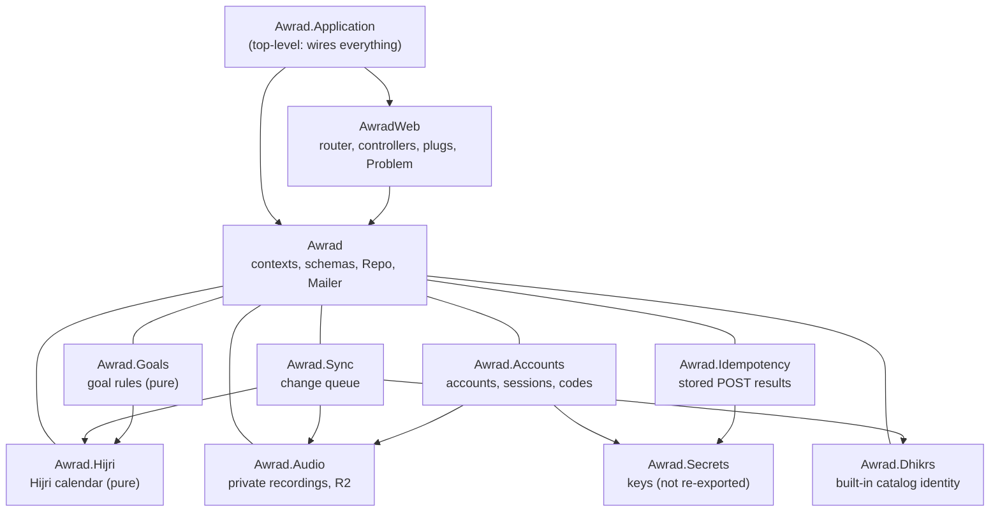

# awrad-server-next — architecture

The Awrad JSON API, rebuilt contract-first to replace `awrad_server/` (root ADR-2026-10-14).
- **Stack:** Phoenix 1.8.15 on Elixir 1.20.4 / OTP 29, Ecto with Postgres 18, Bandit.
- **API only:** no HTML, assets, LiveView or static files.
- **Status:** the goal rules and the Hijri calendar (slices 1a, 1b and 4a), accounts (slice 2a): registration, email verification and password reset by emailed code, mobile device sessions, browser cookie sessions; and account settings (slice 2b): the session list, password and email changes, account deletion; the built-in dhikr catalog's identity (slice 3a); the change queue for custom dhikrs and tags (slice 3b); private audio for custom dhikrs (slice 3c); and the account practice policy as a change-queue entity (slice 3d). Features arrive in slices (`../docs/rebuild-plan.md`).

## Boundaries

| Boundary | May use | Exports |
|---|---|---|
| `Awrad.Application` (top level) | `Awrad`, `AwradWeb` | – |
| `AwradWeb` | `Awrad` | `Endpoint`, `Telemetry` |
| `Awrad` | nothing | `ID`, `Mailer`, `Pruner`, `Repo`, `UUIDv7`, and each context sub-boundary with its exports (`{Accounts, []}`, `{Audio, []}`, `{Dhikrs, []}`, `{Goals, []}`, `{Hijri, []}`, `{Idempotency, []}`, `{Sync, []}`) |
| `Awrad.Accounts` (sub-boundary) | `Awrad` (`Repo`, `Mailer`, `Gettext`), `Awrad.Audio` (to wake its cleanup on deletion), `Awrad.Secrets` | The `Awrad.Accounts` facade, `DeviceSession`, `EmailInput`, `Grant`, `RateLimiter`, `Scope`, `User` |
| `Awrad.Idempotency` (sub-boundary) | `Awrad`, `Awrad.Secrets` | The facade and `Record` |
| `Awrad.Secrets` (sub-boundary) | nothing | Its root module, to its siblings only: `Awrad` doesn't re-export it, so `AwradWeb` can't read secrets |
| `Awrad.Goals` (sub-boundary of `Awrad`) | `Awrad.Hijri` | `Rules` and the goal-model structs: inputs (`Goal`, `Timeline`, `Version`, `Settings`, `Ended`, `ActivePeriod`, `PausedRange`, `CountPolicy`, `MakeUp`, `Session`, `CountEntry`, `CountLogEntry`) and results (`Standing`, `SessionStanding`, `DaysPerPeriodStanding`, `Streak`, `DayStatus`, `Consistency`, `DailyPace`, `Ring`, `Placement`) |
| `Awrad.Hijri` (sub-boundary of `Awrad`) | nothing | `Corrections`, `HijriDate` (and the `Awrad.Hijri` facade) |
| `Awrad.Dhikrs` (sub-boundary of `Awrad`) | nothing | `Catalog`, `Catalog.Entry` |
| `Awrad.Sync` (sub-boundary of `Awrad`) | `Awrad` (`Repo`, `ID`, `UUIDv7`), `Awrad.Audio`, `Awrad.Dhikrs`, `Awrad.Hijri` (to check a practice policy's corrections) | Only the `Awrad.Sync` facade |
| `Awrad.Audio` (sub-boundary of `Awrad`) | `Awrad` (`Repo`, `UUIDv7`) | The `Awrad.Audio` facade, `Storage` (the R2 behaviour) and `Cleaner` (the job) |

Boundary checks these rules at compile time, and `mix validate` fails on any violation (ADR 0001). Test support (`test/support/`) sits outside the production boundaries.

## Goal rules (slices 1 and 4a)

`Awrad.Goals` evaluates goals (slice 1 brief, decision 1; slice 4a): pure functions over plain structs, with no Ecto, database or HTTP. The structs mirror `contracts/goal-model/v1/goal-model.schema.json`, using `Date`, `DateTime`, `Time` and integers.
- **`Awrad.Goals.Rules`** is the only entry point, with one function per rule file (its moduledoc has the table): `effective_practice_day/4`, `due?/3`, `standing/5`, `days_per_period/5`, `completed?/3`, `streak/5`, `version_on/2`, `add_version/3`, `attribute_counts/2`, `day_statuses/5` (make-up), `excuse/5` and `unexcuse/3`, `consistency/5`, `daily_pace/4`, `today_ring/5` and `place/4` (list placement). Every rule that can read Hijri dates takes the account's `Awrad.Hijri.Corrections` as its last argument. `goal_order_merge` is the phones' (the server only conflicts), so `shared_fixtures_test.exs` lists it as client-only.
- **Goals and timelines.** A `Goal` is what a rule evaluates on one day: one version's `Settings` plus the pauses and excused days. A `Timeline` is the goal document's rule-facing part: dated `Version`s (`from` + `Settings`), pauses, excused days and `Ended`. Rules that look across days take either, judging each day by the version in force that day (`Rules.Versions.resolve/3`, which also caps an ended goal's last day); a single `Goal` stands for a timeline with one version that never ended.
- **Invalid goals can't be built.** `Goal.new/1` and `Timeline.new/1` are the only constructors: they return `{:ok, value}`, or `{:error, codes}` with the `goal_validity` error codes sorted alphabetically (a timeline has every version's codes plus `structural_change`, `versions_out_of_order` and `first_version_not_created_on`). The rules assume a valid goal. Slice 4b's goal sync entity parses the document into these structs and answers `document_invalid` with the same codes.
- **Each rule has one home** under `lib/awrad/goals/rules/`: `EffectiveDay`, `Schedule`, `Requirement`, `DaysPerPeriod`, `Completion`, `Streak`, `Versions`, `Attribution`, `DayStatuses` (make-up), `ExcusedDays`, `Consistency`, `Pace` (daily pace and the streak amount), `Ring`, `Placement` and `Validity`. Shared helpers: `Periods` (active-period bounds, week, month and Hijri-month windows), `Counts` (count index, units, targets) and `PeriodWalk` (a period goal's weeks or months, newest first). None of these modules is exported.
- **Time zones** come from the compiled-in `tz` database, with no runtime updates (ADR 0003).
- **Schedules** include `{:hijri_month_days, days}` and `{:yearly, :gregorian | :hijri, ranges}` (slice 1b); periods are `:week`, `:month` and `:hijri_month`. Outside the Hijri table, Hijri schedules and Hijri-month periods are never due.
- **The fixtures are the spec.**
  - `test/support/fixtures.ex` (`Awrad.Fixtures.cases!/2`) loads `contracts/<model>/fixtures/<rule>.json`. It raises when the file is missing, is for another rule, or has no cases.
  - `test/support/fixtures/goal_model.ex` maps the fixture JSON to the structs, and `goal_model/encode.ex` maps the results back. Rule fixtures' goals and timelines go through `Goal.new/1` and `Timeline.new/1` (an invalid one raises); only `goal_validity` takes the raw shapes.
  - `test/awrad/goals/rules/*_test.exs` and `test/awrad/hijri/*_test.exs` generate one test per case, named by the case ID. `test/support/fixtures/hijri_calendar.ex` maps the Hijri fixtures, and the goal-model runners pass each case's optional `hijri_corrections`.
  - `test/awrad/shared_fixtures_test.exs` fails when a rule file in `contracts/goal-model/v1/fixtures/` or `contracts/hijri-calendar/v1/fixtures/` has no runner.
  - Until slice 4b builds the `goal` and `goal_order` sync entities, `sync_receipts_test.exs` skips the cases that name them (`Awrad.Fixtures.Sync.goal_entities?/1`).

## Hijri calendar (slice 1b)

`Awrad.Hijri` gives the Hijri date of an effective practice day from the shared Umm al-Qura table (1400–1500 AH) and the account's month-start corrections (root ADR-2026-10-26). No Hijri library.
- **API:** `Awrad.Hijri.date/2` (`%HijriDate{year, month, day, month_length}` or `nil` outside the table), `month/2` (the adjusted month's Gregorian days) and `days/1` (the adjusted table's span).
- **Corrections:** `Awrad.Hijri.Corrections.new/1` is the only constructor besides `none/0`. It returns `{:ok, corrections}` or `{:error, codes}` with the `hijri_corrections_validity` codes sorted alphabetically (`duplicate_month`, `month_length_invalid`, `month_out_of_range`, `offset_out_of_range`), like `Goal.new/1`.
- **The table** is compiled into `Awrad.Hijri.Table` from a checked copy, `priv/hijri-calendar/umm-al-qura.json`. The release never reads `contracts/`; `test/awrad/shared_fixtures_test.exs` fails `mix validate` when the copy differs from the contracts file (ADR 0004).

## Built-in dhikr catalog (slice 3a)

`Awrad.Dhikrs.Catalog` holds the identity of the built-in dhikrs (`contracts/dhikr-catalog/v1/catalog.json`, ADR-2026-07-13), so later slices can check that a goal's built-in dhikr exists and know its kind. The change queue uses it to accept a `dhikr_personal` for a built-in dhikr. No API and no table: the apps bundle the content.
- **API:** `fetch_by_id/1` and `fetch_by_key/1` (`{:ok, %Catalog.Entry{id, key, kind, collections}}` or `:error`), `builtin?/1`, `kind/1` (`{:ok, :quran | :dhikr | :dua | :salawat | :name_of_allah}` or `:error`) and `content_revision/0`. IDs match exactly, in lowercase.
- **Compiled in** like the Hijri table (ADR 0004): from the checked copy `priv/dhikr-catalog/catalog.json` (`@external_resource`), keeping only key, id, kind and collection membership. Compilation fails on an unknown kind, a duplicate or non-UUIDv4 id, a duplicate key, or a collection listing an unknown key.
- **Checks:** `test/awrad/shared_fixtures_test.exs` fails when the copy differs from the contracts file (refresh with `cp ../contracts/dhikr-catalog/v1/catalog.json priv/dhikr-catalog/`); `test/awrad/dhikrs/catalog_test.exs` checks every key and id against `contracts/progress-model/v1/builtin-dhikrs.json`. The search fixtures are client-only.

## Change queue (slice 3b)

`Awrad.Sync` is the only entry point (`docs/slices/03b-custom-dhikrs-sync.md`, root ADR-2026-10-28 "The change queue", `contracts/sync/v1/`, server ADR 0009). It's how custom dhikrs, tags, per-dhikr records and the practice policy (`custom_dhikr`, `user_tag`, `dhikr_personal`, `practice_policy`) are written and read, by phones and the web alike; no other endpoint writes them.

- **API** (`AwradWeb.SyncController`, `contracts/api/paths/sync.yaml`):
  - `post_sync_commands` (`POST /api/v1/sync/commands`) and `list_sync_changes` (`GET /api/v1/sync/changes?after&limit`), behind `AccountAuth` (bearer, or cookie plus CSRF on the POST).
  - `X-Awrad-Account` must be the signed-in account: missing or not an ID is `400 malformed_request`, another account `409 account_mismatch`, before anything is read or written. `Idempotency-Key` is accepted and ignored.
  - The body must be `{"commands": [...]}` (`AwradWeb.Params`, `400` otherwise). `Awrad.Sync.Batch` checks the envelope: `422 validation_failed` with `batch_size_invalid` on `/commands` or `command_malformed` on `/commands/{i}[/member]`, nothing applied. `after` (0 to 2^53 - 1, default 0) and `limit` (1–500, default 200) are decimal integers, `400` otherwise.
  - Receipts and changes are built in their wire shape (string keys) and sent as they are (`AwradWeb.SyncJSON`); receipts are stored that way, so a duplicate replays its original exactly.
- **Applying a batch** (`Sync.Commands`, `Sync.Rules`): one transaction holding the account's `sync_heads` row `FOR UPDATE`. Each command, in order, is checked as the contract orders it (receipt store and payload hash; `dhikr_personal` or `practice_policy` delete, and a `practice_policy` ID that isn't the account's; document; entity state; entity rules) and is either applied at `head + 1` with its cascades at the same revision, or answered without touching any entity. The `applied` receipt of a `user_tag` or `custom_dhikr` delete lists its cascades in `cascaded` (`{entity_type, entity_id, state, version, revision}`, ordered by type, then ID; `[]` when nothing cascaded); every other `applied` receipt has `cascaded: null`. Every receipt but `command_id_reused` is stored, `cascaded` included, so a duplicate replays it.
- **Documents** (`Sync.Documents`): 64 KB of compact JSON first (`document_too_large`), then the shape, by hand: `CustomDhikrDocument` (the `custom_dhikr_validity` codes, including `range` on `/references/N/ayah_end` for a Qur'an reference that ends before it starts), `TagName` (trim and collapse `White_Space`, NFC, full case folding with `:string.casefold/1`, 40 graphemes, 128 bytes; `normalized_name` must equal the server's fold, `mismatch`), `{tag_ids}` (at most 20 distinct UUIDs), and `PracticePolicyDocument` (below). Field pointers get `/document` in front in a receipt.
- **Entity rules:** a tag create whose normalized name is taken merges (an alias row, no revision); a rename onto a taken name is `tag_name_taken`; at most 100 active tags and 1,000 active custom dhikrs; a `dhikr_personal` needs a built-in (`Catalog.builtin?/1`) or an active custom dhikr of the account (`dhikr_not_found`), and its tag IDs are rewritten (alias to tag, deleted dropped, repeats removed; never seen is `tag_not_found` at its index). Deleting a tag removes it from every `dhikr_personal`; deleting a custom dhikr deletes its `dhikr_personal`.
- **Recordings** (`Sync.AudioReferences`, slice 3c): after the custom dhikr limit, a put whose `audio` names an uploaded recording needs a ready asset of the account (`audio_not_found`, `not_found` on `/document/audio/asset_id`) with the same `byte_size` and `content_type` (`audio_mismatch`, `mismatch` on each disagreeing member). The check locks the asset row until the batch commits. Once a custom dhikr is written or deleted, the assets its old and new documents named are told whether an active custom dhikr still names them (`referenced`, `last_referenced_at`), which the audio cleanup reads.
- **Practice policy** (slice 3d, `docs/slices/03d-practice-settings.md`, root ADR-2026-10-29): one `practice_policy` per account, its `entity_id` the account's ID, else `rejected entity_id_invalid` (`mismatch` on `/entity_id`, `current` null); never deleted (`delete_not_allowed`). `Sync.PracticePolicyDocument` checks the document as `practice_policy_validity` defines: `required`, `not_allowed` (device context such as `location` or `timezone`) and `invalid` per member; `invalid` per malformed correction; `duplicate` on a later correction of the same month; and `range` on `/hijri_corrections` when a month would lose 29 or 30 days, which `Awrad.Hijri.Corrections.new/1` decides. Conflicts are ordinary `conflict` receipts; clients merge by setting. The server stores and validates the policy only: it never computes Maghrib and receives no time zone, location or city.
- **Feed** (`Sync.Feed`): one SQL statement per page (one snapshot): matching changes (revision above `after`, active only when `after` is 0) ordered by revision, `entity_type` (`COLLATE "C"`) and `entity_id`, up to the revision of the `limit`-th one; `has_more` when any match lies beyond it, `next_after` that revision or else the head.
- **Housekeeping:** `Awrad.Pruner` deletes receipts older than 90 days.
- **No rate limit yet.** The contract allows `429` on both operations, but no limit has been agreed; `RateLimiter` holds account-action limits only.
- **The fixtures are the spec** (`test/awrad/sync/`): `sync_receipts_test.exs` puts each case's state (audio uploads included) into the database for a fresh account (`test/support/fixtures/sync.ex`), runs the batch through `Awrad.Sync.apply_batch/2` and compares receipts, head, changes, aliases and stored receipts; `sync_changes_feed_test.exs`, `tag_name_normalization_test.exs` `custom_dhikr_validity_test.exs` and `practice_policy_validity_test.exs` run the other server-side files. `sync_receipts` states carry `account_id`, which the runner creates the account with (so that module isn't async: every case shares one ID). `server_limits_test.exs` covers what the fixtures leave out (1,000 custom dhikrs, 64 KB, 90 days). `test/awrad/shared_fixtures_test.exs` fails when a `sync/v1` fixture file has no runner; `outbox_enqueue`, `apply_changes` and `profile_switch` are exempt as phone-only, and `practice-settings/v1`'s `practice_policy_merge`, `practice_policy_first_sign_in` and `maghrib_time` as client-only.

## Private audio (slice 3c)

`Awrad.Audio` is the only entry point (`docs/slices/03c-audio-upload.md`, root ADR-2026-10-29, `contracts/audio/v1/`, server ADR 0011). Clients `PUT` recordings to and `GET` them from the private R2 bucket with short-lived signed links; the bytes never pass through the server or the change queue.

- **API** (`AwradWeb.AudioController`, `contracts/api/paths/audio.yaml`), behind `AccountAuth` (bearer, or cookie plus CSRF on the POSTs), with `X-Awrad-Account` checked first as on the change queue (`AwradWeb.AccountHeader`). `Idempotency-Key` is accepted and ignored.
  - `create_audio_upload` (`POST /api/v1/audio_uploads`): the body must match the request schema (`400 malformed_request`). An `asset_id` already used is looked at first, under a per-account advisory lock: the account's own with the same body is `200` (a fresh link while pending, `{asset}` once ready); a different body, one being deleted, or another account's is `409 asset_id_in_use`. Then the rules (`Audio.Rules`, `audio_upload_validity`): `415 unsupported_audio_type`, `422 invalid_size`, `413 file_too_large`, `422 storage_full` with `used_bytes` and `limit_bytes` (ready plus pending, against 500,000,000). Otherwise a pending row and `201` with a `PUT` link for 15 minutes, signed with `content-type` and `x-amz-checksum-sha256`.
  - `complete_audio_upload` (`POST /api/v1/audio_uploads/{asset_id}/complete`): `HEAD` the object; none is `409 upload_incomplete`; one whose size, type or checksum differs is deleted, its row becomes `deleting`, and the answer is `422 upload_mismatch`. A match turns the row `ready` (only if still pending, so a race can't confirm a cleaned-up upload). A ready asset is returned again; anything else (unknown, another account's, cleaned up, not an ID) is `404`.
  - `get_audio_download` (`GET /api/v1/audio_assets/{asset_id}/download`): a `GET` link for 10 minutes to a ready asset of the account, else `404`.
  - `get_audio_usage` (`GET /api/v1/audio_assets/usage`): `{used_bytes, limit_bytes}`.
  - No rate limit yet: the contract allows `429`, but none has been agreed, as on the change queue.
- **Storage** (`Audio.Storage`, ADR 0011): a behaviour; `Audio.R2` signs with Req's SigV4 (path-style `https://<account>.r2.cloudflarestorage.com/<bucket>/<key>`, region `auto`). `HEAD` sends `x-amz-checksum-mode: ENABLED`, so R2 returns the stored SHA-256. Object keys are `users/<account_id>/audio/<asset_id>`.
- **Secrets:** `AWRAD_R2_ACCOUNT_ID`, `AWRAD_R2_PRIVATE_BUCKET`, `AWRAD_R2_ACCESS_KEY_ID` and `AWRAD_R2_SECRET_ACCESS_KEY`, read by `config/runtime.exs` in dev and prod (locally from `mise.local.toml`, which git ignores). They're needed only when audio is used: a missing one raises `Audio.R2.ConfigError`, which names the variable but never a value.
- **Cleanup** (`Audio.Cleanup`, run by `Audio.Cleaner` every 10 minutes and woken by account deletion; `Audio.clean/1` on demand in tests). It runs in two steps.
  - Conditional updates mark rows `deleting`:
    - a pending upload reserved more than 24 hours ago;
    - a ready asset with `referenced` false and `last_referenced_at` more than 24 hours ago;
    - every row of a deleted account.

    Each row gets `delete_after`, which is never before its latest upload link expires.
  - Due rows are then swept: the object is deleted, then the row. When R2 fails, the row stays and the next run retries.

  A `deleting` row is invisible to clients (not an asset, not counted), and its `asset_id` stays in use until it goes.
- **Account deletion:** `audio_assets.user_id` is `ON DELETE SET NULL`, unlike every other account table. The rows outlive the account only as cleanup work, holding the object key, so no object is forgotten.
- **Real bucket:** `mix awrad.r2_check` (run where the `AWRAD_R2_*` variables are set) round-trips a small object under `r2-check/`, and prints statuses only:
  - a presigned `PUT`, and R2 refusing other bytes (400) or another type (403);
  - `HEAD` and the confirmation comparison;
  - a presigned `GET`, with the bytes compared;
  - `DELETE`.
- **Tests:**
  - `test/awrad/audio/audio_upload_validity_test.exs` runs the fixture;
  - `test/awrad_web/controllers/audio_uploads_test.exs` and `audio_assets_test.exs` cover every operation and status with `assert_conforms`, including the signed links' host, path, expiry and signed headers;
  - `cleanup_test.exs` covers the job, through the change queue, and account deletion;
  - `r2_test.exs` checks the client against an independent SigV4 computation and `Req.Test`.

  Tests use `Awrad.Audio.FakeStorage` (`test/support/`) and never reach R2.

## IDs

Root ADR-2026-10-28, `contracts/identity/v1/`. Every ID the server generates is a UUIDv7; the built-in dhikr IDs stay the catalog's UUIDv4 constants.
- **Generation** (`Awrad.UUIDv7`): `from_parts/2` lays out a Unix millisecond time and 10 random bytes as `uuid_v7_layout.json` fixes; `generate/0` feeds it `System.os_time(:millisecond)` and `:crypto.strong_rand_bytes(10)`.
- **Primary keys:** `Awrad.UUIDv7` is also an Ecto type (`:uuid`), and every schema declares `@primary_key {:id, Awrad.UUIDv7, autogenerate: true}`. Code that builds rows itself (registration's `insert_all`) calls `Awrad.UUIDv7.generate/0`. There are no database defaults. Foreign keys stay `:binary_id`, and casting or loading accepts any UUID.
- **Validation** (`Awrad.ID.valid?/1`): lowercase, hyphenated, any version, not nil or max, nothing trimmed (`uuid_format.json`). It's the one check for `Idempotency-Key` (`AwradWeb.Plugs.Idempotency`), installation IDs (`Input`), the `session_id` path parameter, session-list cursors and access-token claims. Never `Ecto.UUID.cast/1`, which accepts upper case and raw bytes.
- **Not IDs:** refresh tokens, browser session tokens and email codes are random secrets (`:crypto.strong_rand_bytes/1`), and `Idempotency-Key`s and installation IDs are the client's.
- **Never read the timestamp:** nothing orders, expires or authorizes by an ID's time.
- **Checks** (`test/awrad/identity/`): `uuid_v7_layout_test.exs` and `uuid_format_test.exs` run the fixture files case by case from `contracts/` (and `test/awrad/shared_fixtures_test.exs` fails when an identity rule has no runner); `generated_ids_test.exs` creates an account, a device session, a browser session and an idempotency record through the API, checks every row's stored ID has version nibble 7, and checks every schema's primary key is an autogenerated `Awrad.UUIDv7`.

## Accounts (slice 2a)

`Awrad.Accounts` is the only entry point (`docs/slices/02-accounts.md`, ADR-2026-07-12, ADR-2026-10-15, root ADR-2026-10-26). It takes request values as given, validates them, and returns `{:error, {:validation, [{field, code}]}}` with every field error.

- **Accounts** (`users`): `citext` email (≤ 160, case kept as typed, compared case-insensitively), Argon2id hash of the NFC-normalised password, `confirmed_at`.
  - Registering an email that's verified changes nothing and sends nothing.
  - Registering one that isn't verified yet replaces its password and sends a new code, so the inbox owner's latest registration wins (no pre-registration hijack).
  - Every path hashes the password first, so they cost the same.
- **Input rules** run the shared fixtures (`contracts/account-model/v1/`): `EmailInput` (trim the explicit whitespace set, shape check) and `PasswordPolicy` (12–128 code points after NFC, plus the server-only list `priv/accounts/common-passwords.txt` → `password_too_common`). A code must be six ASCII digits; clients normalise other scripts, so `email_code_input` is client-only (`test/awrad/shared_fixtures_test.exs` records why).
- **Email codes** (`email_codes`, `EmailCode`): 6 digits, stored as an HMAC bound to account and purpose (`verify_email`, `reset_password`), 15 minutes, 5 tries (a wrong try is kept even though the request fails), one live code per account and purpose. Verifying doesn't sign in.
- **Password reset** (`PasswordReset`), in one transaction: new password, email verified, every device session and refresh token revoked (`password_reset`), every browser session token deleted, other codes deleted.
- **Sign-in** (`Accounts.authenticate/3`): a wrong email or password is `invalid_credentials` with the same Argon2 work (`Argon2.no_user_verify/0`). A right password on an unverified account is `403 email_verification_required` and emails a fresh code (at most 5 an hour per account).
- **Device sessions** (`device_sessions`, `DeviceSessions`):
  - installation ID stored as an HMAC, device name, platform;
  - `last_seen_at` on refresh, and on authenticated requests at most every 5 minutes;
  - 30-day idle and 180-day absolute expiry, `revoked_at`/`revoke_reason` (`replaced`, `signed_out`, `password_reset`, `refresh_reuse`);
  - signing in again from the same installation replaces the account's session there (a partial unique index keeps one live session per account and installation).
- **Access tokens** (`AccessToken`, ADR 0005): HS256 JWTs, 15 minutes, `sub` + `sid`; every request re-checks the session and account in the database.
- **Refresh tokens** (`refresh_tokens`): 32 random bytes, SHA-256 stored, single use, rotated under a `FOR UPDATE` row lock. `Idempotency-Key` is required:
  - the same key within 60 seconds returns the same tokens (the successor grant is stored encrypted);
  - any other reuse of a spent token revokes the session (`refresh_reuse_detected`);
  - a key that already rotated another token is `idempotency_key_reused`;
  - a token that still worked when its account was deleted is `401 account_deleted` (ADR 0010).

  Sign-out takes the refresh token and always answers `204`.
- **Browser sessions** (`users_tokens`, `UserToken`, `BrowserSessions`, `AwradWeb.UserAuth`): `phx.gen.auth`'s session tokens and plugs, minus magic links and confirmation links. 14 days, remember-me (default on), session renewal on sign-in (new session ID and CSRF token). Cookies are `HttpOnly`, `SameSite=Lax`, and `Secure` in production. Changed for the session list (ADR 0008):
  - each row is one browser session, with a `name` parsed from `User-Agent` at sign-in (`AwradWeb.BrowserName`, "Firefox on Windows", `nil` when unknown) and `last_seen_at` (updated at most every 5 minutes);
  - reissue after 7 days replaces the token **in place**; the replaced token works for 60 more seconds (`previous_token`), and a request carrying it is moved onto the current one.
- **Emails** (`UserNotifier`): Swoosh, sent from a supervised task (`Awrad.TaskSupervisor`) so a response's timing doesn't reveal whether an email has an account. Localized from `Accept-Language` (en, ar, ml; default en) with `Awrad.Gettext` and key-based messages in `priv/gettext/<locale>/LC_MESSAGES/emails.po`: codes (`verify_email`, `reset_password`, `change_email`) and notices (`password_changed`, `email_taken`, `email_changed`, `account_deleted`). In development they land in the Swoosh mailbox at `/dev/mailbox` (JSON at `/dev/mailbox/json`).
- **Rate limits** (`RateLimiter`, ADR 0006): fixed windows in Postgres, per IP and per account, on every account action; `429` with `Retry-After`. Signed-in actions are limited by account ID: `password_check` (10 per account and 30 per IP in 15 minutes, shared by change password, request email change and delete), `request_email_change` (5 per account an hour), `confirm_email_change` (10 an hour).
- **Secrets** (`Awrad.Secrets`): `access_token_secret`, `hmac_pepper` and `encryption_secret`. Dev and test values are in `config/`. Production reads `AWRAD_ACCESS_TOKEN_SECRET`, `AWRAD_HMAC_PEPPER` and `AWRAD_ENCRYPTION_SECRET` (`config/runtime.exs` raises when one is missing); `AWRAD_MAIL_FROM` sets the sender.
- **Housekeeping:** `Awrad.Pruner` deletes expired idempotency results, email codes, rate-limit windows and deleted accounts' refresh-token hashes hourly (off in tests).

## Account settings (slice 2b)

`docs/slices/02-accounts.md` (slice 2b), `contracts/api/paths/account_settings.yaml`. Every operation takes either credential through `AccountAuth`, and ownership comes from the `Scope`, which names the caller's own session (`device_session` for a bearer token, `browser_session_id` for the cookie).

- **Session list** (`AccountSessions.list/3`): live device sessions (not revoked, within both expiries) and live browser sessions (`users_tokens` younger than 14 days), most recently used first by `(last_seen_at, id)` descending; `is_current` for the caller's own. A device session's ID is its `DeviceSession.id`; a browser's is its `users_tokens` row ID. Cursor: base64url of the last item's position, opaque to clients (`400 malformed_request` when it doesn't parse); default 50, maximum 100.
- **Revoke one** (`AccountSessions.revoke/2`): a live session of the account, of either kind, else `404 not_found` (another account's, ended, or not an ID by `Awrad.ID.valid?/1`). A device session is revoked (`revoked`, or `signed_out` for the caller's own); a browser session's row is deleted, and for the caller's own the cookies are cleared too.
- **Revoke others** (`revoke_others/1`): every session but the caller's, in one transaction.
- **Change password** (`Settings.change_password/4`): the current password (Argon2; out-of-bounds input costs a dummy verify and is `current_password_incorrect`), `PasswordPolicy` for the new one, both errors reported together. In one transaction: new hash, every other device session revoked (`password_changed`), every other browser token deleted, pending reset code deleted. The caller's device session or browser token is untouched, so its cookie and CSRF token keep working (ADR 0008). Then a `password_changed` notice.
- **Email change** (`Settings.request_email_change/4`, `confirm_email_change/3`):
  - request: current password, `EmailInput` (`email_invalid`), not the current email ignoring case (`email_unchanged`); the earlier `change_email` code is cancelled; if the address has an account (verified or not), that address gets an `email_taken` notice, otherwise a `change_email` code (`email_codes.new_email`, part of the HMAC). Same `202` either way.
  - confirm: the code (15 minutes, 5 tries) switches the email; `409 email_taken` if the address got an account meanwhile (checked, and the unique index as backstop; the code then stays usable); pending reset codes are deleted; the old address gets an `email_changed` notice naming the new one. Sessions stay.
- **Delete account** (`Settings.delete/3`): current password, then in one transaction the account's ID-keyed rate-limit windows, the hashes of its still-working refresh tokens into `deleted_account_refresh_tokens` (ADR 0010), and the `users` row, which cascades to `users_tokens`, `email_codes`, `device_sessions` (→ `refresh_tokens`), the account's `idempotency_records` and its `sync_*` rows. Its `audio_assets` rows lose their account (`SET NULL`) and the audio cleanup job is woken to delete every object. IP- and email-keyed windows stay until pruned (anti-abuse). A cookie caller's cookies are cleared; an `account_deleted` email goes to the address.
- **Idempotency:** `revoke_others`, `change_password`, `request_email_change` and `confirm_email_change` run the `:idempotent` pipeline after `AccountAuth`, so stored results are per account (ADR 0008). `delete_account` checks the key's shape only; a repeat after success is `401`.

### Client IP and proxies

Per-IP rate limits use `conn.remote_ip`, the TCP peer. That's correct when Bandit faces clients directly. **Behind a reverse proxy or load balancer, every client shares the proxy's address.** The deployment must then rewrite `remote_ip` from the proxy's trusted forwarding header before the router (for example the `remote_ip` plug, configured with the proxy's addresses), and never trust a forwarding header a client can set. There's no deployment yet; this is a prerequisite for the first one.

## Request path

`Endpoint`: `Plug.RequestId` (`x-request-id`) → `ApiResponseHeaders` (`Cache-Control: no-store` by default; `application/problem+json` on errors) → parsers → session → `Router`. The pipelines:

| Pipeline | Used by | Plugs |
|---|---|---|
| `:api` | Every `/api/v1` route | JSON only |
| `:idempotent` | Public account `POST`s, `create_device_session`, and the account settings `POST`s (after `:any_account`, so results are per account) | `Idempotency` (`mode: :replay`; ADR 0007, 0008) |
| `:any_account` | `get_current_account`, the account settings (`/api/v1/account/...`), the change queue (`/api/v1/sync/...`) and audio (`/api/v1/audio_uploads...`, `/api/v1/audio_assets/...`) | `AccountAuth`: with an `Authorization` header, **only** the bearer token is checked; without one, **only** the cookie session, after the CSRF check on state-changing methods (`403 csrf_token_invalid`) |
| `:browser_session` | Browser routes | Cookie session (`_awrad_session`), CSRF check on state-changing methods (`X-CSRF-Token`, `403 csrf_token_invalid`), current user from the cookie only (ADR-2026-10-15) |
| `:idempotent_browser_sign_in` | `create_browser_session` | `Idempotency` (`mode: :rerun`: a cookie can't be replayed) |
| `:require_browser_user` | `delete_browser_session` | `401 unauthenticated` without a signed-in cookie session |

`refresh_device_session` and `sign_out_device_session` handle `Idempotency-Key` themselves.

**Neither credential crosses pipelines.** `BearerAuth` reads only the `Authorization` header; `UserAuth` reads only the session and remember-me cookies. `test/awrad_web/auth_pipeline_separation_test.exs` proves both directions: a valid cookie doesn't satisfy the bearer plug, a valid bearer token doesn't satisfy the cookie plug or sign a browser out, and a bad bearer token never falls back to a valid cookie.

`get_browser_csrf_token` works for any browser: a signed-out one gets an anonymous session cookie with its token, which `create_browser_session` then needs.

**Request bodies** (`AwradWeb.Params`) must be an `application/json` object with only the declared fields and JSON types. Anything else (an unknown or missing field, a wrong type, another content type) is `400 malformed_request`. Content checks are the domain's (`422 validation_failed`).

## Errors

Every error is an RFC 9457 problem (`contracts/api/STYLE.md` §7):

| Source | Shape | Sent by |
|---|---|---|
| Controllers | Problem with a stable `code` | `AwradWeb.Problem` (`send_code/2` for the catalogued codes, `validation_failed/2`, `validation_failed_at/2` for errors that carry their own JSON Pointer, `malformed/2`, `rate_limited/2`), mostly through `AwradWeb.FallbackController` |
| Phoenix itself (unmatched routes, parse errors, crashes) | Problem (`not_found`, `malformed_request`, `internal_error`), never internal details | `AwradWeb.ErrorJSON` |

## Contract tests (ADR 0002)

`test/support/contract.ex` loads `../contracts/api/openapi.bundled.json`.
- **`assert_conforms(conn, operation_id)`** checks:
  - the status is documented;
  - each declared header is present;
  - the content type matches;
  - the body validates against the response schema (JSON Schema 2020-12, via JSV).
- **`ContractCoverageTest`** fails when the router and the spec disagree in either direction.

## Data

Every table's primary key is a Postgres `uuid` that the server generates as a UUIDv7 (root ADR-2026-10-28; see [IDs](#ids)). The databases are `awrad_next_dev` and `awrad_next_test`, on the machine's Postgres 18 by default (`AWRAD_POSTGRES_PORT`, default 5432).

| Table | Holds |
|---|---|
| `users` | Accounts (`citext` email, unique) |
| `users_tokens` | Browser sessions (`phx.gen.auth` tokens), with name, `last_seen_at` and the token a reissue replaced |
| `email_codes` | One live code per account and purpose (HMAC); `new_email` for an email change |
| `device_sessions` | Mobile sessions; one live per account and installation |
| `refresh_tokens` | Single-use refresh tokens (SHA-256), rotation key and encrypted retry grant |
| `auth_rate_limits` | Fixed-window counters (HMAC subjects) |
| `idempotency_records` | Stored `Idempotency-Key` results (encrypted bodies), with the account for signed-in operations |
| `deleted_account_refresh_tokens` | SHA-256 of a deleted account's still-working refresh tokens, until they'd have expired (ADR 0010); no account reference |
| `sync_heads` | One per account: its head revision, locked for each batch |
| `sync_entities` | Every synced entity's latest state (`jsonb` document; tombstones kept), unique per account, type and ID |
| `sync_receipts` | Each command's first receipt and payload hash, 90 days |
| `sync_tag_aliases` | Merged tag IDs and the tag each became |
| `audio_assets` | Each upload of a recording, from its reservation to the deletion of its object: account, `asset_id` (unique per account), object key, declared size, type and SHA-256, `pending`/`ready`/`deleting`, link expiry, `referenced` and `last_referenced_at`, `delete_after` |

Every table holding account data references `users` with `ON DELETE CASCADE` (directly, or through `device_sessions` for `refresh_tokens`), except `audio_assets` (`SET NULL`, so its cleanup can still delete the objects); `auth_rate_limits` holds only HMACs and is cleared by account ID on deletion, and `deleted_account_refresh_tokens` holds only hashes of random secrets.

API JSON is mapped field by field (`AwradWeb.AccountJSON`), never straight from schemas.

## Decisions

See [`docs/adr/`](docs/adr/README.md). Cross-project decisions are in the root [`DECISIONS.md`](../DECISIONS.md).
