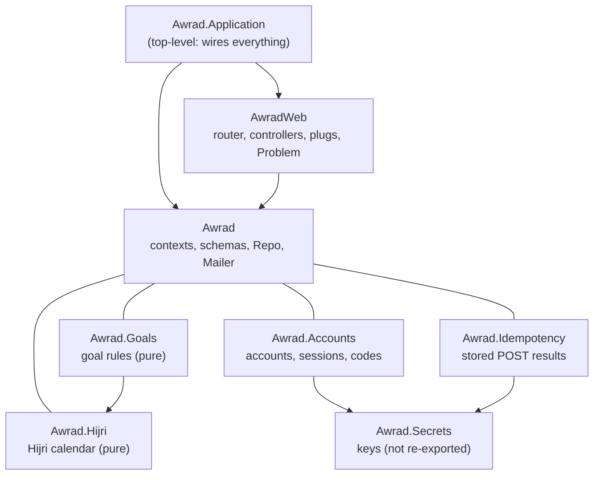

# awrad-server-next — architecture

The Awrad JSON API, rebuilt contract-first to replace `awrad_server/` (root ADR-2026-10-14).
- **Stack:** Phoenix 1.8.15 on Elixir 1.20.4 / OTP 29, Ecto with Postgres 18, Bandit.
- **API only:** no HTML, assets, LiveView or static files.
- **Status:** the goal rules and the Hijri calendar (slices 1a and 1b), and accounts (slice 2a): registration, email verification and password reset by emailed code, mobile device sessions, browser cookie sessions. Features arrive in slices (`../docs/rebuild-plan.md`).

## Boundaries

| Boundary | May use | Exports |
|---|---|---|
| `Awrad.Application` (top level) | `Awrad`, `AwradWeb` | – |
| `AwradWeb` | `Awrad` | `Endpoint`, `Telemetry` |
| `Awrad` | nothing | `Mailer`, `Pruner`, `Repo`, and each context sub-boundary with its exports (`{Accounts, []}`, `{Goals, []}`, `{Hijri, []}`, `{Idempotency, []}`) |
| `Awrad.Accounts` (sub-boundary) | `Awrad` (`Repo`, `Mailer`, `Gettext`), `Awrad.Secrets` | The `Awrad.Accounts` facade, `DeviceSession`, `EmailInput`, `Grant`, `RateLimiter`, `Scope`, `User` |
| `Awrad.Idempotency` (sub-boundary) | `Awrad`, `Awrad.Secrets` | The facade and `Record` |
| `Awrad.Secrets` (sub-boundary) | nothing | Its root module, to its siblings only: `Awrad` doesn't re-export it, so `AwradWeb` can't read secrets |
| `Awrad.Goals` (sub-boundary of `Awrad`) | `Awrad.Hijri` | `Rules` and the goal-model structs (`Goal`, `ActivePeriod`, `PausedRange`, `CountPolicy`, `Session`, `CountEntry`, `Standing`, `SessionStanding`, `DaysPerPeriodStanding`) |
| `Awrad.Hijri` (sub-boundary of `Awrad`) | nothing | `Corrections`, `HijriDate` (and the `Awrad.Hijri` facade) |

Boundary checks these rules at compile time, and `mix validate` fails on any violation (ADR 0001). Test support (`test/support/`) sits outside the production boundaries.

## Goal rules (slice 1)

`Awrad.Goals` evaluates goals for the web (slice 1 brief, decision 1): pure functions over plain structs, with no Ecto, database or HTTP. The structs mirror `contracts/goal-model/v1/goal-model.schema.json`, using `Date`, `DateTime` and integers.
- **`Awrad.Goals.Rules`** is the only entry point. It has one function per rule: `effective_practice_day/4`, `due?/3`, `standing/5`, `days_per_period/5`, `completed?/3` and `streak/5`. Every rule that can read Hijri dates (Hijri schedules, Hijri-month periods) takes the account's `Awrad.Hijri.Corrections` as its last argument.
- **Invalid goals can't be built.** `Awrad.Goals.Goal.new/1` is the only constructor: it returns `{:ok, goal}`, or `{:error, codes}` with the `goal_validity` error codes sorted alphabetically (`session_target_required`, `streak_threshold_value_required`, `target_required`). The rules assume a valid goal. There's no Ecto goal schema yet; when one arrives, its changeset applies the same check with the same codes.
- **Each rule has one home** under `lib/awrad/goals/rules/`: `EffectiveDay`, `Schedule`, `Requirement`, `DaysPerPeriod`, `Completion` and `Streak`. Two internal helpers, `Periods` (active-period bounds, week, month and Hijri-month windows) and `Counts` (count index, thresholds), are shared. None of these modules is exported.
- **Time zones** come from the compiled-in `tz` database, with no runtime updates (ADR 0003).
- **Schedules** include `{:hijri_month_days, days}` and `{:yearly, :gregorian | :hijri, ranges}` (slice 1b); periods are `:week`, `:month` and `:hijri_month`. Outside the Hijri table, Hijri schedules and Hijri-month periods are never due.
- **The fixtures are the spec.**
  - `test/support/fixtures.ex` (`Awrad.Fixtures.cases!/2`) loads `contracts/<model>/fixtures/<rule>.json`. It raises when the file is missing, is for another rule, or has no cases.
  - `test/support/fixtures/goal_model.ex` maps the fixture JSON to the structs and the results back. Rule fixtures' goals go through `Goal.new/1` (an invalid one raises); only `goal_validity` takes the raw `goal_shape`.
  - `test/awrad/goals/rules/*_test.exs` and `test/awrad/hijri/*_test.exs` generate one test per case, named by the case ID. `test/support/fixtures/hijri_calendar.ex` maps the Hijri fixtures, and the goal-model runners pass each case's optional `hijri_corrections`.
  - `test/awrad/shared_fixtures_test.exs` fails when a rule file in `contracts/goal-model/v1/fixtures/` or `contracts/hijri-calendar/v1/fixtures/` has no runner.

## Hijri calendar (slice 1b)

`Awrad.Hijri` gives the Hijri date of an effective practice day from the shared Umm al-Qura table (1400–1500 AH) and the account's month-start corrections (root ADR-2026-10-26). No Hijri library.
- **API:** `Awrad.Hijri.date/2` (`%HijriDate{year, month, day, month_length}` or `nil` outside the table), `month/2` (the adjusted month's Gregorian days) and `days/1` (the adjusted table's span).
- **Corrections:** `Awrad.Hijri.Corrections.new/1` is the only constructor besides `none/0`. It returns `{:ok, corrections}` or `{:error, codes}` with the `hijri_corrections_validity` codes sorted alphabetically (`duplicate_month`, `month_length_invalid`, `month_out_of_range`, `offset_out_of_range`), like `Goal.new/1`.
- **The table** is compiled into `Awrad.Hijri.Table` from a checked copy, `priv/hijri-calendar/umm-al-qura.json`. The release never reads `contracts/`; `test/awrad/shared_fixtures_test.exs` fails `mix validate` when the copy differs from the contracts file (ADR 0004).

## Accounts (slice 2a)

`Awrad.Accounts` is the only entry point (`docs/slices/02-accounts.md`, ADR-2026-07-12, ADR-2026-10-15, root ADR-2026-10-26). It takes request values as given, validates them, and returns `{:error, {:validation, [{field, code}]}}` with every field error.

- **Accounts** (`users`): UUIDv4 IDs, `citext` email (≤ 160, case kept as typed, compared case-insensitively), Argon2id hash of the NFC-normalised password, `confirmed_at`.
  - Registering an email that's verified changes nothing and sends nothing.
  - Registering one that isn't verified yet replaces its password and sends a new code, so the inbox owner's latest registration wins (no pre-registration hijack).
  - Every path hashes the password first, so they cost the same.
- **Input rules** run the shared fixtures (`contracts/account-model/v1/`): `EmailInput` (trim the explicit whitespace set, shape check) and `PasswordPolicy` (12–128 code points after NFC, plus the server-only list `priv/accounts/common-passwords.txt` → `password_too_common`). A code must be six ASCII digits; clients normalise other scripts, so `email_code_input` is client-only (`test/awrad/shared_fixtures_test.exs` records why).
- **Email codes** (`email_codes`, `EmailCode`): 6 digits, stored as an HMAC bound to account and purpose (`verify_email`, `reset_password`), 15 minutes, 5 tries (a wrong try is kept even though the request fails), one live code per account and purpose. Verifying doesn't sign in.
- **Password reset** (`PasswordReset`), in one transaction: new password, email verified, every device session and refresh token revoked (`password_reset`), every browser session token deleted, other codes deleted.
- **Sign-in** (`Accounts.authenticate/3`): a wrong email or password is `invalid_credentials` with the same Argon2 work (`Argon2.no_user_verify/0`). A right password on an unverified account is `403 email_verification_required` and emails a fresh code (at most 5 an hour per account).
- **Device sessions** (`device_sessions`, `DeviceSessions`):
  - installation ID stored as an HMAC, device name, platform;
  - `last_seen_at` on refresh, and on authenticated requests at most every 5 minutes;
  - 30-day idle and 180-day absolute expiry, `revoked_at`/`revoke_reason` (`replaced`, `signed_out`, `password_reset`, `refresh_reuse`);
  - signing in again from the same installation replaces the account's session there (a partial unique index keeps one live session per account and installation).
- **Access tokens** (`AccessToken`, ADR 0005): HS256 JWTs, 15 minutes, `sub` + `sid`; every request re-checks the session and account in the database.
- **Refresh tokens** (`refresh_tokens`): 32 random bytes, SHA-256 stored, single use, rotated under a `FOR UPDATE` row lock. `Idempotency-Key` is required:
  - the same key within 60 seconds returns the same tokens (the successor grant is stored encrypted);
  - any other reuse of a spent token revokes the session (`refresh_reuse_detected`);
  - a key that already rotated another token is `idempotency_key_reused`.

  Sign-out takes the refresh token and always answers `204`.
- **Browser sessions** (`users_tokens`, `UserToken`, `AwradWeb.UserAuth`): `phx.gen.auth`'s session tokens and plugs, minus magic links and confirmation links. 14 days, remember-me (default on), session renewal on sign-in (new session ID and CSRF token), reissue after 7 days. Cookies are `HttpOnly`, `SameSite=Lax`, and `Secure` in production.
- **Emails** (`UserNotifier`): Swoosh, sent from a supervised task (`Awrad.TaskSupervisor`) so a response's timing doesn't reveal whether an email has an account. Localized from `Accept-Language` (en, ar, ml; default en) with `Awrad.Gettext` and key-based messages in `priv/gettext/<locale>/LC_MESSAGES/emails.po`. In development they land in the Swoosh mailbox at `/dev/mailbox` (JSON at `/dev/mailbox/json`).
- **Rate limits** (`RateLimiter`, ADR 0006): fixed windows in Postgres, per IP and per account, on every account action; `429` with `Retry-After`.
- **Secrets** (`Awrad.Secrets`): `access_token_secret`, `hmac_pepper` and `encryption_secret`. Dev and test values are in `config/`. Production reads `AWRAD_ACCESS_TOKEN_SECRET`, `AWRAD_HMAC_PEPPER` and `AWRAD_ENCRYPTION_SECRET` (`config/runtime.exs` raises when one is missing); `AWRAD_MAIL_FROM` sets the sender.
- **Housekeeping:** `Awrad.Pruner` deletes expired idempotency results, email codes and rate-limit windows hourly (off in tests).

### Client IP and proxies

Per-IP rate limits use `conn.remote_ip`, the TCP peer. That's correct when Bandit faces clients directly. **Behind a reverse proxy or load balancer, every client shares the proxy's address.** The deployment must then rewrite `remote_ip` from the proxy's trusted forwarding header before the router (for example the `remote_ip` plug, configured with the proxy's addresses), and never trust a forwarding header a client can set. There's no deployment yet; this is a prerequisite for the first one.

## Request path

`Endpoint`: `Plug.RequestId` (`x-request-id`) → `ApiResponseHeaders` (`Cache-Control: no-store` by default; `application/problem+json` on errors) → parsers → session → `Router`. The pipelines:

| Pipeline | Used by | Plugs |
|---|---|---|
| `:api` | Every `/api/v1` route | JSON only |
| `:idempotent` | Public account `POST`s and `create_device_session` | `Idempotency` (`mode: :replay`; ADR 0007) |
| `:any_account` | `get_current_account` | `AccountAuth`: with an `Authorization` header, **only** the bearer token is checked; without one, **only** the cookie session |
| `:browser_session` | Browser routes | Cookie session (`_awrad_session`), CSRF check on state-changing methods (`X-CSRF-Token`, `403 csrf_token_invalid`), current user from the cookie only (ADR-2026-10-15) |
| `:idempotent_browser_sign_in` | `create_browser_session` | `Idempotency` (`mode: :rerun`: a cookie can't be replayed) |
| `:require_browser_user` | `delete_browser_session` | `401 unauthenticated` without a signed-in cookie session |

`refresh_device_session` and `sign_out_device_session` handle `Idempotency-Key` themselves.

**Neither credential crosses pipelines.** `BearerAuth` reads only the `Authorization` header; `UserAuth` reads only the session and remember-me cookies. `test/awrad_web/auth_pipeline_separation_test.exs` proves both directions: a valid cookie doesn't satisfy the bearer plug, a valid bearer token doesn't satisfy the cookie plug or sign a browser out, and a bad bearer token never falls back to a valid cookie.

`get_browser_csrf_token` works for any browser: a signed-out one gets an anonymous session cookie with its token, which `create_browser_session` then needs.

**Request bodies** (`AwradWeb.Params`) must be an `application/json` object with only the declared fields and JSON types. Anything else (an unknown or missing field, a wrong type, another content type) is `400 malformed_request`. Content checks are the domain's (`422 validation_failed`).

## Errors

Every error is an RFC 9457 problem (`contracts/api/STYLE.md` §7):

| Source | Shape | Sent by |
|---|---|---|
| Controllers | Problem with a stable `code` | `AwradWeb.Problem` (`send_code/2` for the catalogued codes, `validation_failed/2`, `malformed/2`, `rate_limited/2`), mostly through `AwradWeb.FallbackController` |
| Phoenix itself (unmatched routes, parse errors, crashes) | Problem (`not_found`, `malformed_request`, `internal_error`), never internal details | `AwradWeb.ErrorJSON` |

## Contract tests (ADR 0002)

`test/support/contract.ex` loads `../contracts/api/openapi.bundled.json`.
- **`assert_conforms(conn, operation_id)`** checks:
  - the status is documented;
  - each declared header is present;
  - the content type matches;
  - the body validates against the response schema (JSON Schema 2020-12, via JSV).
- **`ContractCoverageTest`** fails when the router and the spec disagree in either direction.

## Data

Ecto with binary (UUID) primary keys. The databases are `awrad_next_dev` and `awrad_next_test`, on the machine's Postgres 18 by default (`AWRAD_POSTGRES_PORT`, default 5432).

| Table | Holds |
|---|---|
| `users` | Accounts (`citext` email, unique) |
| `users_tokens` | Browser session tokens (`phx.gen.auth`) |
| `email_codes` | One live code per account and purpose (HMAC) |
| `device_sessions` | Mobile sessions; one live per account and installation |
| `refresh_tokens` | Single-use refresh tokens (SHA-256), rotation key and encrypted retry grant |
| `auth_rate_limits` | Fixed-window counters (HMAC subjects) |
| `idempotency_records` | Stored `Idempotency-Key` results (encrypted bodies) |

API JSON is mapped field by field (`AwradWeb.AccountJSON`), never straight from schemas.

## Decisions

See [`docs/adr/`](docs/adr/README.md). Cross-project decisions are in the root [`DECISIONS.md`](../DECISIONS.md).
