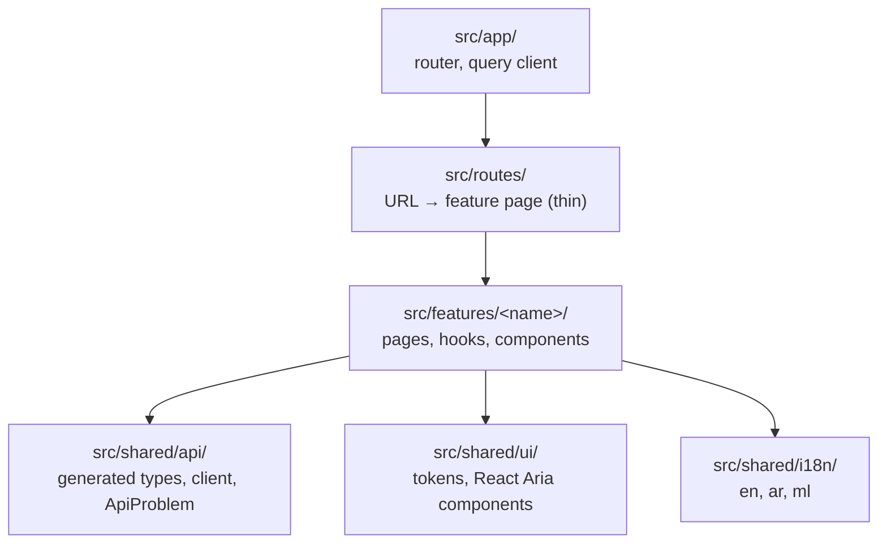

# awrad-web-next — architecture

The Awrad web app, an online-only React client of `awrad-server-next` (root ADR-2026-10-14). It replaces the LiveView pages of the frozen `awrad_server`.

- **Stack:** React 19, TypeScript 6.0, Vite 8 with the React Compiler, TanStack Router (file-based) and Query, `openapi-fetch`, React Aria Components, Tailwind 4, i18next.
- **Status:** slices 2a and 2b (accounts, account settings) built against the contract; features arrive in slices (`../docs/rebuild-plan.md`).

## Features

- **`src/features/account`** (slices 2a and 2b, `../docs/slices/02-accounts.md`):
  - Screens: home (`/`), sign in, register, verify email (with resend and cooldown), forgot password, reset password, and the account page (email, settings links, sign out).
  - Calls only operations tagged `accounts`, `browser` and `account_settings`; `device_sessions` are mobile-only.
  - Signed-in state is `get_current_account` in TanStack Query (`401 unauthenticated` → `null`).
  - The email and password between "register / sign in" and "verify" are kept in module memory (`pending.ts`), never in the URL, history state or storage. Verifying doesn't sign in (root ADR-2026-10-26), so the verify and reset screens then sign in with that password; after a reload they ask for the email and send the person to sign in.
  - Search params carry only a notice name (`search.ts`: "verified", "session_ended", "account_deleted", …), never personal data.
- **`src/features/account/settings`** (slice 2b), under the `/account` layout route (`AccountArea`), which needs a signed-in account and sends a signed-out visitor to sign in:
  - **Devices** (`/account/devices`): `list_account_sessions` (every page), phones and browsers together, the current one marked, platform, relative last use (`Intl.RelativeTimeFormat` in the UI language), and "Web browser" / "Unknown device" for a `null` name. Signing one out (`revoke_account_session`) or all others (`revoke_other_account_sessions`) goes through a confirmation dialog; `404 not_found` means it had already gone and is shown as a notice.
  - **Change password** (`/account/password`): current and new password, the 12-character hint; afterwards the account page says the other devices are signed out.
  - **Change email** (`/account/email`, then `/account/email/confirm`): password and new address, then the code sent to it, with the resend cooldown. "Send a new code" repeats `request_email_change`, so the password and new address are kept in module memory (`pendingEmailChange.ts`) like `pending.ts`. After a reload the code still works, but a new code means starting again. `409 email_taken` ends the attempt and offers "Use a different email".
  - **Delete account** (`/account/delete`): what happens (immediate, every session ends, device data stays, confirmation email, no undo), the password, then a destructive confirmation dialog (`ConfirmDialog`, an `alertdialog` whose initial focus is Cancel). Afterwards home shows signed out with a message.
  - **Session ended:** any `401 unauthenticated` from these operations (`sessionEnded.ts`) drops the account's cached queries (`forgetAccount`: the current account becomes `null`, the rest are removed), clears the CSRF token, and shows sign-in with "your session has ended". Sign-out and delete use `forgetAccount` too.
- **`src/shared/account-input`**: the shared input rules `email_input`, `password_policy` (code points after NFC) and `email_code_input` (other digit scripts). `fixtures.test.ts` runs every file in `contracts/account-model/v1/fixtures/` and fails on a file without an adapter.

## Layout and module rules

dependency-cruiser enforces:

- features never import each other;
- `src/shared` never imports features, routes or the app;
- only `src/shared/api` imports `openapi-fetch`;
- routes don't call the API directly;
- no cycles;
- production code never imports test code.

## API (root ADR-2026-10-16)

- **Types:** generated by `openapi-typescript` from `contracts/api/openapi.bundled.json` into `src/shared/api/schema.gen.ts`, which is committed. A check fails when it's stale.
- **Client:** `api` is an `openapi-fetch` client on the page's own origin, sending the session cookie.
  - It looks up `fetch` on every call, so test mocks and instrumentation see every request.
- **Session and CSRF** (ADR-2026-10-15), in the client's `fetch`:
  - Every state-changing request sends `X-CSRF-Token`. The token lives in module memory only (never `localStorage`); the session cookie is httpOnly and JavaScript never sees it.
  - The first write fetches the token from `get_browser_csrf_token` (single-flight). A `401` there leaves no token, and the write's own answer is the result.
  - `create_browser_session` renews the session, so its `csrf_token` replaces the old one; sign-out clears it.
  - On `403 csrf_token_invalid` the client refetches the token once and retries the same request (same `Idempotency-Key`). A second rejection is returned.
- **Headers:** `Accept-Language` follows the UI language on every request, so emails the server sends match it. Retryable POSTs carry a fresh `Idempotency-Key` per user action.
- **Errors:** every non-2xx response becomes an `ApiProblem` with the server's stable `code`, field `errors` and `Retry-After`. The UI maps `code` (and field codes) to translated text; never `detail`. `problemOf` checks the status, since openapi-fetch reports an empty error body as `error: undefined`.

## Hosting (ADR 0001)

**Production:** one origin. A small web container serves the built app and reverse-proxies `/api` and `/socket` to Phoenix. Web and server deploy independently, with no cross-origin setup, and the cookie stays `SameSite=Lax`.

**Development:** the same shape. Vite serves the app and proxies `/api` and `/socket` to `localhost:4000`; `AWRAD_API_ORIGIN` overrides the target. The container itself is built with the staging environment (rebuild plan).

## UI, i18n and RTL

- **Design tokens:** CSS variables in `src/shared/ui/theme.css`, with light and dark via `light-dark()`, and the same palette as Android and iOS.
- **Components:** React Aria Components provide keyboard, focus, screen-reader and RTL behaviour; Tailwind styles them.
- **Language:** i18next with en, ar and ml. Changing language sets `<html lang dir>`, so the whole page flips to right-to-left for Arabic, and `Accept-Language` follows it.
  - The choice is kept in `localStorage` (`awrad.language`, the language code only; never credentials or account data), and the next page load starts in it. Without one, the app starts in English.
- **Fonts:** Arabic uses Noto Naskh Arabic for both content and interface text; other languages use Manrope.

## Tests

- **Framework:** Vitest with Testing Library in jsdom.
- **API mocks:** MSW handlers built from the spec's own examples, so they can't drift from the contract:
  - `specHandler(operationId, status)` serves the example for a status (an empty body when it has none), with the documented header examples such as `Retry-After`;
  - `specProblem(operationId, code)` serves the problem example for a code in the operation's `x-error-codes`, also when several codes share a status (`403`).
  - A state the spec has no example of (a session with a `null` name, an account signed in only here) is derived from the example with `specHandler(…, { from })`, so it keeps the documented shape.
  - Path parameters (`{session_id}`) match any value.
- **Whole-app tests:** `renderRoute(path)` renders the real route tree; `recordRequests()` captures what the app sent.
- **Isolation:** the test page's origin is `http://web.awrad.test`, which never resolves, so an unmocked request can't reach a real server.

## Decisions

See [`docs/adr/`](docs/adr/README.md). Cross-project decisions are in the root [`DECISIONS.md`](../DECISIONS.md).
