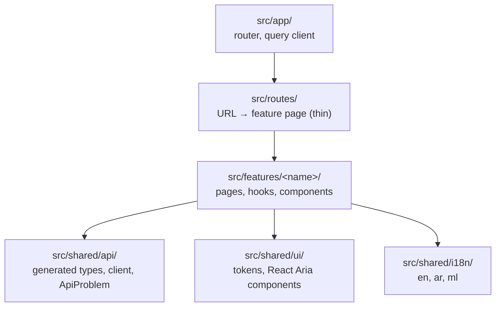

# awrad-web-next — architecture

The Awrad web app, an online-only React client of `awrad-server-next` (root ADR-2026-10-14). It replaces the LiveView pages of the frozen `awrad_server`.

- **Stack:** React 19, TypeScript 6.0, Vite 8 with the React Compiler, TanStack Router (file-based) and Query, `openapi-fetch`, React Aria Components, Tailwind 4, i18next.
- **Status:** slices 2a and 2b (accounts, account settings) built against the contract, slice 3a (the dhikr catalog and library), the web side of slice 3b (custom dhikrs and tags over the change queue), and the web side of slice 3c (private audio for custom dhikrs: add, play, storage used); features arrive in slices (`../docs/rebuild-plan.md`).

## Features

- **`src/features/account`** (slices 2a and 2b, `../docs/slices/02-accounts.md`):
  - Screens: home (`/`), sign in, register, verify email (with resend and cooldown), forgot password, reset password, and the account page (email, "Audio storage", settings links, sign out).
  - Calls only operations tagged `accounts`, `browser` and `account_settings`; `device_sessions` are mobile-only.
  - Signed-in state is `get_current_account` in TanStack Query (`401 unauthenticated` → `null`).
  - **Audio storage** (slice 3c, `../docs/slices/03c-audio-upload.md`): the account page's card reads `get_audio_usage` (`audioUsageQuery` from `src/shared/audio`) and shows "120.5 MB of 500 MB": decimal megabytes like the limits, formatted by `Intl.NumberFormat` (`unit: megabyte`) in the UI language. While loading it says so; a failed read says it couldn't load, and the rest of the page works.
  - The email and password between "register / sign in" and "verify" are kept in module memory (`pending.ts`), never in the URL, history state or storage. Verifying doesn't sign in (root ADR-2026-10-26), so the verify and reset screens then sign in with that password; after a reload they ask for the email and send the person to sign in.
  - Search params carry only a notice name (`search.ts`: "verified", "session_ended", "account_deleted", …), never personal data.
- **`src/features/account/settings`** (slice 2b), under the `/account` layout route (`AccountArea`), which needs a signed-in account and sends a signed-out visitor to sign in:
  - **Devices** (`/account/devices`): `list_account_sessions` (every page), phones and browsers together, the current one marked, platform, relative last use (`Intl.RelativeTimeFormat` in the UI language), and "Web browser" / "Unknown device" for a `null` name. Signing one out (`revoke_account_session`) or all others (`revoke_other_account_sessions`) goes through a confirmation dialog; `404 not_found` means it had already gone and is shown as a notice.
  - **Change password** (`/account/password`): current and new password, the 12-character hint; afterwards the account page says the other devices are signed out.
  - **Change email** (`/account/email`, then `/account/email/confirm`): password and new address, then the code sent to it, with the resend cooldown. "Send a new code" repeats `request_email_change`, so the password and new address are kept in module memory (`pendingEmailChange.ts`) like `pending.ts`. After a reload the code still works, but a new code means starting again. `409 email_taken` ends the attempt and offers "Use a different email".
  - **Delete account** (`/account/delete`): what happens (immediate, every session ends, device data stays, confirmation email, no undo), the password, then a destructive confirmation dialog (`ConfirmDialog`, an `alertdialog` that takes focus, with Cancel the first Tab stop). Afterwards home shows signed out with a message.
  - **Session ended:** any `401 unauthenticated` from these operations (`sessionEnded.ts`) drops the account's cached queries (`forgetAccount`: the current account becomes `null`, the rest are removed), clears the CSRF token, and shows sign-in with "your session has ended". Sign-out and delete use `forgetAccount` too.
- **`src/features/library`** (slice 3a, `../docs/slices/03a-dhikr-catalog.md`), read-only and with no API:
  - **Routes:** `/library` (large title, search field, collection tiles, "All dhikrs" rows), `/library/collections/$key` (the collection's dhikrs in order) and `/library/dhikrs/$key` (the detail: Back and the dhikr's title, in `title`, in the top bar). The collection and dhikr pages are pushed pages: no bottom bar (`showsBottomBar`). Each route's loader awaits `loadCatalog()`, so the page renders with the catalog in hand. An unknown key shows a not-found page with a link back to the Library.
  - **Search:** the query is the `q` search param (`search.ts`), replaced (not pushed) as you type, so a search can be shared and reloaded; the field keeps its own state so typing never waits for the router, and a navigation that clears `q` (the Library tab) clears it. While searching only the results show, with a count in a `status` region and an empty state.
  - **Rows** (`DhikrList.tsx`): one link each, the title in `rowTitle`, the Arabic on one line in `quranLine` (`lang="ar" dir="rtl"`, truncated) aligned right in every language, and a trailing `chevron`.
  - **Detail by kind** (`DhikrText.tsx`): `quran` one ayah per line with its reference label, then transliteration and translation; `name_of_allah` the name in `name-of-allah` with its meaning in `title`, both in the card; `dhikr`, `dua`, `salawat` the Arabic, then transliteration and translation. Then "Tags" (chips) and "Virtues" (cards), each under a `section-title` label, each with its references' labels (`referenceLabel.ts`: "Qur'an 112:1–4", "Sunan Abi Dawud 1518 · Da'if (al-Albani)"; the numbers are left-to-right isolated in Arabic). Catalog text paragraphs use `dir="auto"`, so an English fallback reads left to right on an Arabic page.
  - **Audio** (`AudioPlayer.tsx`, components.md "Audio player bar"), at the bottom of the Arabic card: a `RoundButton` with `play` / `pause` (the progress indicator while loading, from `play()` or `waiting` to `playing`), a progress line (`h-ring-stroke`, `outline` track, `progress` fill; a React Aria `ProgressBar` named "Playback position") and the time in `caption` ("0:14 / 0:26"), from the `<audio preload="none">` element's `timeupdate` and `durationchange`. It plays a `PlayerSource`: the catalog's `audio.url`, or (slice 3c) a custom dhikr's uploaded recording through a signed link. It pauses when the page is hidden (`visibilitychange`) or left (unmount; it's keyed by the dhikr, or by the recording's asset ID, so another one starts fresh), and a rejected `play()` or a load error shows a message.
  - **Uploaded recordings** (slice 3c, `usePlayback` in `AudioPlayer.tsx`): no link is stored or asked for before the first play. Play asks `get_audio_download` for a link (valid 10 minutes), sets it as the element's `src` and plays; playing again reuses it while it has more than 30 seconds left, and otherwise asks for a fresh one and carries on from the same position. A load error (storage refusing an expired link) gets one fresh link before the message shows; a `404` (the recording was cleaned up) shows the message. The `<audio>` keeps `preload="none"` and no `src` attribute until then.
- **`src/features/library`, slice 3b** (`../docs/slices/03b-custom-dhikrs-sync.md`, ADR 0009): the account's own dhikrs and tags, online and signed in only. Signed out, the Library still shows every built-in, with a note that offers a sign-in link (the editor, Manage tags and the "Your dhikrs" page do too); nothing is offered offline.
  - **Data** (`custom/data.ts`): `useYours()` is who is signed in (`currentAccountQuery`), then their entities (`useSyncState`): `loading`, `signedOut`, `error` (with a retry) or `ready`. `asDhikr` gives a custom dhikr the catalog's `Dhikr` shape (its ID is its key; each text in the UI language, then English, then any; no virtues, catalog tags or audio), so rows, the detail and the filter treat both alike. `tagIdsOf` reads a dhikr's personal record, leaving out deleted tags.
  - **Library** (`/library`): with an account, the large title's round + ("New dhikr") opens the editor. When the account has dhikrs of its own, the "Your dhikrs" collection tile (components.md, "N dhikrs" with plurals) comes first in the tile row (`CollectionTiles`' `first`) and opens `/library/yours` (`YoursPage`, a pushed page like a collection's: the title, the count and the dhikrs newest first, in UUIDv7 order, or an empty state with "New dhikr"). "Filter by tag" shows the account's tags as `FilterChips`, with "Manage tags" at its end; with some chosen, the dhikrs (built-in and custom) that have every one (AND), counted in a `status` region. The chosen tags are the `tags` search param (`search.ts`, IDs), so a filter survives a reload; a tag that's gone is ignored.
  - **Editor** (`/library/dhikrs/new`, `/library/dhikrs/$key/edit`, route file `$key_.edit.tsx` so it isn't nested in the detail): kind (option rows), the Arabic (required, a right-to-left text area in the Arabic font), a title in each language (at least one), transliteration (en, ml) and translation (en, ar, ml) as text areas, references in the catalog's shapes (a card per reference, its type chosen in a bottom sheet, up to 20), the account's tags (checkbox option rows, up to 20), and "Audio" (below). Texts are trimmed and an empty one is `null`. Saving runs `customDhikrProblems` first and shows each `{field, code}` on its field (`form.ts`, `errorMessages`; a reversed Qur'an range, `range`, on its last ayah), then sends the dhikr and, when they changed, its tags, each on the version the editor opened with; a `rejected` receipt's fields land the same way. Built-ins can't be edited (not found).
  - **Audio in the editor** (slice 3c, `editor/AudioField.tsx`, `editor/useAudioUpload.ts`): a card with the recording the dhikr has ("No recording yet.", "Recording, 4.2 MB, 0:31", or "Audio is on the phone that added it." for `{local_only: true}`), then **Add audio** (or **Replace recording**) and **Remove recording**. Add opens React Aria's `FileTrigger` for `.mp3` and `.m4a` (and their media types). A picked file goes through `uploadAudio` (`src/shared/audio`) at once, its progress shown as a progress line ("Uploading dhikr.mp3…" and the percentage), and on success the editor's `audio` becomes `{asset_id, byte_size, content_type, duration_ms}`; Save (disabled while uploading) sends the dhikr naming it, as the one custom dhikr put it already sends. Replace keeps the old recording until the new one is confirmed; Remove sets `audio` to `null`, and a phone's recording can be replaced or removed the same way. Failures show under the recording, translated by kind: unsupported type, empty, over 10 MB, storage full ("497.3 MB of 500 MB used", from the server's problem or the usage the pre-check read), a mismatch (Try again uploads afresh under a new `asset_id`), and an upload that didn't arrive (Try again reserves the same `asset_id` again). A `rejected` `audio_not_found` or `audio_mismatch` receipt opens "Change refused" with its reason and marks the recording (focus lands on its first button). Every upload marks the usage query stale.
  - **Detail** (`/library/dhikrs/$key`): a catalog key or a custom dhikr's ID. Every dhikr, signed in, gets "Your tags" (chips) and "Manage tags", a bottom sheet to choose its tags or make a new one (a new tag that `merged` is chosen under the surviving ID). After Virtues, "Sources" lists the reference labels shown nowhere else (`sourceReferences`: not those a virtue cites, nor the Qur'an reference a `quran` dhikr shows in its card), one per line in `caption`; a custom dhikr, with no virtues, lists all of its others. A custom dhikr also gets Edit in the top bar, its uploaded recording in the player bar (or a note when its recording is on a phone), and "Delete dhikr" (a destructive `ConfirmDialog`, then one `delete`; gone already counts as done). A text a custom dhikr lacks leaves its section out.
  - **Manage tags** (`/library/tags`, a pushed page): a new-tag field, then the tags with how many dhikrs have each, Rename (a bottom sheet) and Delete (a destructive confirmation; the server removes it from every dhikr). Names go through `normalizeTagName`; an empty or too long name, or one another tag has, is caught before sending.
  - **Edits and conflicts** (`custom/useEdit.ts`): every edit goes through `useEdit`, which settles a `conflict` with `ConflictDialog` (components.md "Conflict banner", as a dialog: "Changed on another device", the server's copy, then **Keep mine**, which resends on the server's version, and **Use theirs**), and opens `RefusedDialog` ("Change refused": the reason for the `rejected` receipt's code, and OK) for a refusal; the page itself then says nothing more (`settledKey`). Problems map by `code` (`problemKey`, `settledKey`) to `library.sync.*` text.
  - **Home** is two features side by side: the `/` route renders the account feature's `WelcomePage` with the library's `FeaturedCollections` ("Featured dhikr collections", "View all" to `/library`, the tiles) as its child, since features never import each other. The tiles wait for the catalog in a `Suspense` space of their own height.
- **`src/shared/dhikr-catalog`** (ADR 0008): the built-in catalog from `../contracts/dhikr-catalog/v1/catalog.json`.
  - `npm run catalog` (`scripts/generate-catalog.mjs`) writes `catalog.gen.ts` (committed, formatted), the JSON typed as `Catalog` (`types.ts`, read-only). It fails on a key, kind, audio style, reference type or version it doesn't know, or a missing required key, so a contract change can't miss the types; `check:catalog` in `validate` fails when the file is stale. `scripts/catalog.test.mjs` tests it. Qur'an references are `ayah_start` and `ayah_end` (snake_case since contentRevision 4, slice 3b), the same shape a custom dhikr's references use.
  - Only `load.ts` imports `catalog.gen.ts`, dynamically, so the catalog is a chunk of its own (about 15 kB gzipped) and the first page doesn't carry it. `loadCatalog()` loads it once; `useCatalog()` reads it with React's `use`, at once when a loader already loaded it. `findDhikr`, `findCollection`, `findTag` and `collectionDhikrs` look things up by key.
  - **Display language** (`localize.ts`): `localized(text, language)` falls back to English; `transliterationFor` returns none in Arabic and English where Malayalam has none. `useLanguage()` (`src/shared/i18n`) gives the UI language.
  - **Search** (`search.ts`): `normalizeForSearch` and `searchDhikrs` implement `dhikr_search_normalization` and `dhikr_search`. `fixtures.test.ts` runs every file in `contracts/dhikr-catalog/v1/fixtures/` and fails on a file without an adapter, like the account-model fixtures.
- **`src/shared/sync`** (root ADR-2026-10-28 "The change queue", `../contracts/sync/v1/`, ADR 0009): the change queue on the web, with no queue.
  - `fetchSyncState` reads every page of `list_sync_changes` from `after=0` (`limit` 200) into a `SyncState` (active entities by type and ID, and the head revision); `sendEdit` posts one command with a new UUIDv7 `command_id`. Both send `X-Awrad-Account`, the signed-in account's ID; the client adds CSRF to the POST.
  - `syncQuery` keeps the state under `["account", "sync", <account id>]`, so `forgetAccount` drops it. `useSendEdit` applies the receipt to the cache (`applyReceipt`: `applied` the edit, `duplicate` as its original, `conflict` and `rejected` the server's copy, `merged` the surviving tag, `gone` removed, with the server's cascades; an `applied` receipt's `cascaded` sets the version of each cascaded record, or removes a deleted one), rereads the feed, and resolves to an `EditResult`. `401` forgets the account; `409 account_mismatch` drops the entities and asks who is signed in.
  - **Shared rules:** `normalizeTagName` (`tag_name_normalization`: White_Space trimmed and collapsed, NFC, full case folding, 40 graphemes by `Intl.Segmenter`, 128 UTF-8 bytes) and `customDhikrProblems` (`custom_dhikr_validity`, with the Qur'an range rule the schema can't express: `range` on `/references/N/ayah_end`; `audio` is `null`, `{local_only: true}` or slice 3c's uploaded recording, every member present: a lowercase UUID, 1 to 10,000,000 bytes, `audio/mpeg` or `audio/mp4`, and a `duration_ms` of at least 1 or `null`). `fixtures.test.ts` runs both; the other five files there are the server's or the phones', listed so a new file fails until it's classified.
- **`src/shared/audio`** (slice 3c, root ADR-2026-10-29, `../contracts/audio/v1/`): a user's own recordings, shared by the Library (editor, player) and the account page (storage used).
  - **Rules** (`rules.ts`): `uploadRuleError` is `audio_upload_validity` (the type exactly `audio/mpeg` or `audio/mp4`, then 1 to 10,000,000 bytes, then `used_bytes + byte_size` at most 500,000,000), and `contentTypeOf` maps a picked file as the README's "Media types on import" allows: an `.mp3` is `audio/mpeg`, an `.m4a` is `audio/mp4`, then the system types `audio/mpeg`, `audio/mp4` and `audio/x-m4a`; anything else keeps its own type and the rule refuses it. `fixtures.test.ts` runs every file in `contracts/audio/v1/fixtures/` and fails on a file without an adapter.
  - **Uploading** (`upload.ts`, `uploadAudio`): type and size are checked with no network; then `get_audio_usage` for the quota; then the SHA-256 (`sha256Hex`, WebCrypto) and the length (`measureDurationMs`, the browser reading the file's metadata through an object URL, `null` when it can't within 5 s); then `create_audio_upload` with a new UUIDv7 `asset_id`, `putToStorage` with the link and headers, and `complete_audio_upload`. A ready asset on reserving (a repeat) skips the PUT and the confirmation. A PUT that storage refuses or that never arrives, and `409 upload_incomplete`, get one more try (reserving the same body again gives a fresh link), then `upload_failed` with the `asset_id` to try again with. `413`, `415`, `422 invalid_size`, `422 storage_full` (with the problem's `used_bytes` and `limit_bytes`) and `422 upload_mismatch` become an `AudioUploadError`; other problems are rethrown as `ApiProblem`s. The `audio` it returns copies `byte_size` and `content_type` from the confirmed asset.
  - **Reading** (`api.ts`): `getAudioDownload` (a `SignedLink`: the URL and when it expires) and `getAudioUsage`; `audioUsageQuery` keeps usage under `["account", "audio-usage", <account id>]`, so `forgetAccount` drops it. Every call sends `X-Awrad-Account`; the client adds CSRF to the POSTs. `formatMegabytes` writes bytes as decimal megabytes in the UI language.
- **`src/shared/session`**: who is signed in, shared by the account feature and the Library: `currentAccountQuery` (`get_current_account`, `null` when signed out) and `forgetAccount`. The account feature re-exports them.
- **`src/shared/account-input`**: the shared input rules `email_input`, `password_policy` (code points after NFC) and `email_code_input` (other digit scripts). `fixtures.test.ts` runs every file in `contracts/account-model/v1/fixtures/` and fails on a file without an adapter.
- **`src/shared/identity`** (root ADR-2026-10-28, `../contracts/identity/v1/`): every ID the app generates is a UUIDv7.
  - `uuidV7FromParts(unixMs, randomBytes)` lays out a 48-bit millisecond time and 10 random bytes exactly as `uuid_v7_layout.json` fixes them; `newUuidV7()` feeds it `Date.now()` and `crypto.getRandomValues`, and takes an injected clock and random source instead. `isValidId(text)` is `uuid_format.json`: any lowercase, hyphenated UUID except nil and max, nothing trimmed.
  - Today it makes the `Idempotency-Key`s (`idempotencyKey()` in `src/shared/api/client.ts`). ESLint (`no-restricted-syntax`) rejects `.randomUUID` anywhere else, since it makes v4.
  - An ID's timestamp never orders, expires or authorizes anything. `fixtures.test.ts` runs every file in `contracts/identity/v1/fixtures/` and fails on a file without an adapter.

## Layout and module rules

dependency-cruiser enforces:

- features never import each other;
- `src/shared` never imports features, routes or the app;
- only `src/shared/api` imports `openapi-fetch`;
- routes don't call the API directly;
- no cycles;
- production code never imports test code;
- only `main.tsx` imports `src/dev/` (the component gallery, development builds only).

## API (root ADR-2026-10-16)

- **Types:** generated by `openapi-typescript` from `contracts/api/openapi.bundled.json` into `src/shared/api/schema.gen.ts`, which is committed. A check fails when it's stale.
- **Client:** `api` is an `openapi-fetch` client on the page's own origin, sending the session cookie.
  - It looks up `fetch` on every call, so test mocks and instrumentation see every request.
- **Session and CSRF** (ADR-2026-10-15), in the client's `fetch`:
  - Every state-changing request sends `X-CSRF-Token`. The token lives in module memory only (never `localStorage`); the session cookie is httpOnly and JavaScript never sees it.
  - The first write fetches the token from `get_browser_csrf_token` (single-flight). A `401` there leaves no token, and the write's own answer is the result.
  - `create_browser_session` renews the session, so its `csrf_token` replaces the old one; sign-out clears it.
  - On `403 csrf_token_invalid` the client refetches the token once and retries the same request (same `Idempotency-Key`). A second rejection is returned.
- **Headers:** `Accept-Language` follows the UI language on every request, so emails the server sends match it. Retryable POSTs carry a fresh `Idempotency-Key` (a UUIDv7 from `src/shared/identity`) per user action.
- **Private storage** (`storage.ts`, slice 3c): `putToStorage` PUTs a file straight to R2 with a signed link from `create_audio_upload`, with exactly the `upload_headers` it came with and nothing of the API's (no cookie, CSRF or `Accept-Language`), through `XMLHttpRequest` so the editor can show upload progress. The bucket's CORS allows the web origin. Its failures are `StorageError`s with the HTTP status (0 when no answer came).
- **Errors:** every non-2xx response becomes an `ApiProblem` with the server's stable `code`, field `errors`, `Retry-After`, and any extension members (`extensions`: `storage_full`'s `used_bytes` and `limit_bytes`). The UI maps `code` (and field codes) to translated text; never `detail`. `problemOf` checks the status, since openapi-fetch reports an empty error body as `error: undefined`.

## Hosting (ADR 0001)

**Production:** one origin. A small web container serves the built app and reverse-proxies `/api` and `/socket` to Phoenix. Web and server deploy independently, with no cross-origin setup, and the cookie stays `SameSite=Lax`.

**Development:** the same shape. Vite serves the app and proxies `/api` and `/socket` to `localhost:4000`; `AWRAD_API_ORIGIN` overrides the target. The container itself is built with the staging environment (rebuild plan).

## UI, i18n and RTL

- **Colours** (ADR 0005) come only from the shared tokens `../contracts/design-tokens/v1/colors.json`, the same 16 roles Android and iOS use:
  - `npm run tokens:colors` generates `src/shared/ui/colors.gen.css` (committed): one `--awrad-color-<role>` custom property per role, light in `:root` and dark under `@media (prefers-color-scheme: dark)`, `#RRGGBBAA` alpha kept. It also maps every role into Tailwind's theme and removes Tailwind's default palette, so classes read by role (`bg-surface`, `text-on-surface`, `bg-primary-container`, `text-accent`, `bg-error`, `text-on-error`) and `text-white` or `bg-red-500` don't exist.
  - `npm run validate` fails when the committed file differs from what the JSON produces (`check:colors`), and when a hex colour, a CSS colour function or a Tailwind palette class appears anywhere else in `src/` or `index.html` (`check:raw-values`, below). `scripts/colors.test.mjs` tests both.
  - How the roles are used (`../contracts/design-system/v1/components.md` has the rest): cards `surface`; dialogs, sheets and the bottom bar `surface-bar`; headings `on-surface`; links and accent text `accent` (pale green in dark mode; `primary` as text only where the spec pairs it, a selected option row's avatar and check); main buttons `primary`; secondary buttons, unselected option rows and pills `secondary-container` / `on-secondary-container`; a selected option row `primary` / `on-primary-variant`; the selected language, "this device" chip and bottom-bar pill `primary-container` / `on-primary-container`; destructive confirmations `error` / `on-error`; a checkbox's box `outline-strong`; the bottom bar's shadow `shadow`.
  - `data-color-scheme="light"` or `"dark"` on an element forces that scheme's roles on its subtree (generated after the `prefers-color-scheme` block). Only the dev component gallery sets it.
  - **States** (`colors.json` `states`) are opacities, not colours: the same file gets `--awrad-state-disabled-opacity` (0.38) and the `opacity-disabled` class. A disabled control keeps its colours and is drawn at that opacity (`disabled:opacity-disabled` on every button); there are no disabled colours.
- **Shapes, line widths, spacing, sizes and type** (ADR 0006) come only from `../contracts/design-tokens/v1/{shape,spacing,typography}.json`, the same tokens Android and iOS use:
  - `npm run tokens:design` (`scripts/generate-tokens.mjs`) generates `src/shared/ui/tokens.gen.css` (committed): an `--awrad-radius-*`, `--awrad-stroke-*`, `--awrad-space-*`, `--awrad-size-*` or `--awrad-text-<style>-{size,line-height,weight}` custom property per token, roles pointing at their scale step. It replaces Tailwind's radius, spacing, container, text-size, line-height, tracking and weight scales with the tokens, so `rounded-xl` means the token `xl` (24) and `p-4`, `gap-1.5`, `max-w-md`, `text-sm`, `leading-tight` and `font-black` don't exist. Tailwind reads classes from `src/` only (`source("../..")` in `theme.css`), so the class names in the scripts' tests and the docs don't reach the stylesheet.
  - The generators fail on a key in the token files they don't know (`scripts/token-keys.mjs`), so a new token can't be skipped silently.
  - **Radius:** `rounded-<role>` — `card`, `tile`, `button`, `field`, `chip`, `round-button`, `nav-bar`, `nav-pill`, `sheet`, `dialog`, `screen-depth`, `checkbox` (4, a checkbox's box), `step-dot` (2, so the step dots are squares), `tab-indicator`, `content-sheet` — or a scale step (`xxxs` 2, `xxs` 4, `xs` 8 … `3xl` 32, `full`), with Tailwind's sides (`rounded-t-sheet`, `rounded-s-field`). Every finite radius also sets `corner-shape: squircle` under `@supports`, so corners are continuous in browsers that have it and plainly rounded elsewhere. Fully rounded shapes (chips, pills, round buttons) stay round.
  - **Line widths** (`shape.json` `strokes`, the only lines allowed): each stroke is a `border-<stroke>` width and an `outline-<stroke>` solid outline, plus `outline-offset-<stroke>` when it has an offset. `border-field-error` (1.5, a field's error border, transparent at rest), `border-checkbox` (2, a checkbox's box), and `outline-focus-ring outline-offset-focus-ring` (2, offset 2, the keyboard focus ring). Pair them with a colour role (`border-error`, `border-outline-strong`, `outline-accent`). Chrome draws widths in whole device pixels, so the 1.5 border shows as 1px on a 1× screen and 1.5px (3 device pixels) on a 2× one.
  - **Spacing and sizes:** the spacing utilities (`p`, `m`, `gap`, `space`, `inset`, `w`, `h`, `size`, `min-h`, …) take a role — `page-margin`, `section-gap`, `card-padding`, `row-gap`, `inline-gap` (so `px-page-margin`, `gap-row-gap`) — a scale step (`xxs` 2, `xs` 4, `sm` 8, `md` 12, `lg` 16, `xl` 20, `2xl` 24, `3xl` 32, `4xl` 40, `5xl` 48), or a size: `touch-target` 48, `list-row` 56, `control` 56 (buttons and fields), `icon` 24, `icon-small` 20, `ring-small` 36, `ring-stroke` 4, `logo` 148, and the component sizes `top-bar` 56, `nav-bar` 72, `nav-pill-width` 56 × `nav-pill-height` 32, `round-button` 48, `round-button-small` 32, `avatar` 36, `checkbox` 20, `switch-width` 52 × `switch-height` 32, `switch-thumb` 24, `step-dot` 8, `tab-indicator-width` 24 × `tab-indicator-height` 4. The scale's `none` is `0` (`p-0`, `inset-0`, `min-w-0`), since `*-none` would clash with `max-w-none`. Use a role where one fits; scale steps are for the rest. Spacing is in px, like dp on Android.
  - **Content widths:** a size named `<name>MaxWidth` is a Tailwind container, not a spacing size: `max-w-content` (`contentMaxWidth` 448, a page's column) and `max-w-dialog` (`dialogMaxWidth` 384). They're the only containers; Tailwind's own scale is removed.
  - **Elevation** (`shape.json` `elevation`): `shadow-floating` (y 4, blur 16, the `shadow` role, so none in dark), only under the bottom bar. Tailwind's own shadow, inset-shadow, drop-shadow and text-shadow scales are removed.
  - **Type:** `text-<style>` sets size, line height and weight together: `text-large-title` (34, a main tab's title), `text-title`, `text-card-title`, `text-row-title`, `text-section-title`, `text-body` (the page default), `text-input` (text typed into a field, 16 so iOS Safari doesn't zoom), `text-body-small`, `text-label`, `text-button`, `text-caption`, `text-nav-label`, `text-counter` (with `tabular-nums`), `text-quran`, `text-quran-line`, `text-name-of-allah` (40, a name of Allah on its own). Sizes and line heights are in rem (`1rem` = 16px), so text follows the browser's text-size setting like sp on Android. Weights are only those the styles use (`font-normal`, `font-medium`, `font-semibold`, `font-bold`), for emphasis inside a style.
  - A style with its own `fontFamily` (`quran`: Noto Naskh Arabic) also sets `font-family` to that family's theme font: `FONT_KEYS` in the generator maps each family to its `--font-<key>` in `theme.css` (`--font-arabic` here), and the build fails on a family the web doesn't load. `text-quran` is the dhikr detail's Arabic and `text-quran-line` (`quranLine`, 18) a dhikr row's one line of Arabic.
  - Where the old literals differed, the tokens won: headings are `title` 22 (were 24 and 30), body text 15, field text `input` 16 (was `body` 15), buttons and fields `control` 56 tall (were 48), cards `card` 24 (were 16), the dialog `dialog` 32, the page margin 20 (was 24), settings rows `list-row` 56, content widths 448 and 384 px (were 28rem and 24rem, the same at the default text size). A row button (`Button size="row"`, sign out one device) is `touch-target` 48 so it fits inside its row.
- **Raw values** (`check:raw-values`, `scripts/check-raw-values.mjs`): `npm run validate` fails when anything outside the generated files writes a value instead of naming a token:
  - anywhere in `src/` and `index.html`: a hex colour, a colour function or a palette class;
  - in class names (string literals in code, `@apply` in CSS): arbitrary values or properties (`p-[13px]`, `rounded-[10px]`, `text-(--x)`, `[mask:none]`), a radius that isn't a shape token (`rounded`, `rounded-none`), a text size that isn't a style (`text-sm`), `leading-*` and `tracking-*`, a weight no style uses, numeric spacing and sizes (`p-4`, `gap-1.5`, `min-h-11`, `h-12`, `size-5`, `p-px`), a max width that isn't a content width or spacing token (`max-w-page`, `max-w-prose`), a border, outline or ring width (`border`, `border-2`, `outline-2`, `outline-offset-2`, `ring`, `divide-y`), a numeric opacity on a disabled control (`disabled:opacity-50`), a shadow that isn't an elevation (`shadow`, `shadow-lg`, `drop-shadow-md`), and animation classes (`animate-*`, `transition*`, `duration-*`, `delay-*`, `ease-*`);
  - in hand-written CSS: raw durations, easing functions and easing keywords in `animation` and `transition` (`linear`, `ease-out`), and raw lengths in radius, spacing, text, `border*-width`, `border`, `outline`, `box-shadow` and `text-shadow` declarations.
  - Not covered by tokens, so still written as numbers: `z-10`, the pressed and pending opacities of buttons (`data-pressed:opacity-90`, `data-pending:opacity-70`), and fractions (`w-1/2`). `scripts/tokens.test.mjs` tests the generator and the check.
- **Motion** (ADRs 0006 and 0007, `src/shared/ui/motion.css`): fades and colour cross-fades only, from `motion.json`'s `webPage`, `contentSwap`, `select` and `reducedMotion`; no movement, scaling, springs or other animation.
  - **Selection:** `select-fade` cross-fades colours and opacity over `select.colorDuration` with `select.easing` (option rows, checkboxes, switches, segmented pills, the bottom bar, the step indicator). The pill's fill and bar, the bottom bar's pill and the switch thumb fade in place instead of moving; the switch has an off thumb and an on thumb that swap opacity. Reduced motion uses the `reducedMotion` timing.
  - **Overlays:** `overlay-fade` fades dialogs and the bottom sheet in (`contentSwap.fadeIn`) and out (`contentSwap.fadeOut`, which React Aria waits for); reduced motion uses `reducedMotion`.
  - **Pending:** the web's own progress indicator (components.md lets each platform use its own): a pending button's three dots fade in turn (`progress-pulse`, `long`, staggered by `color` and `medium`); they stay still with reduced motion.
  - **Press:** buttons, cards and rows dim (`data-pressed:opacity-90`) instead of the mobile `press` scale.
  - **Page changes:** the router's `defaultViewTransition` wraps each navigation in a view transition. Only the page area (`page-transition` in `AppShell`) animates: the old page fades out in `fade` (100 ms) while the new one fades in in `color` (150 ms), both `emphasized`, with the group's move-and-resize animation switched off. The header and the rest swap at once. Browsers without view transitions (and jsdom) swap instantly.
  - **In-place swaps:** `content-swap` fades an element in over `contentSwap.fadeIn` (150 ms) with `contentSwap.easing` (`linear`) when it mounts; a `key` that changes with the content remounts it. Used on home's session status and on `FormAlert` / `FormNotice`. The outgoing content goes at once.
  - **Reduced motion** (`prefers-reduced-motion: reduce`): page changes become the `reducedMotion` cross-fade (150 ms, `reducedMotion.easing` `linear`, both pages at once); `content-swap` doesn't animate.
  - `press` (with its `pressEasing`) and `sheet` are mobile motions; the web has neither.
- **No outlines** (`../contracts/design-tokens/v1/README.md`): the design is filled shapes, not lines.
  - Fields, cards, form alerts and unselected language pills are filled, with no border. The fill comes from `useFill()` (`src/shared/ui/Surface.tsx`): `surface` on the page, `background` inside a `surface` area. `Card` sets this for its content (`OnSurface` or `OnBackground`); `ContentSheet` wraps its content in `OnSurface`. Dialogs and sheets (`surface-bar`) count as the page.
  - Secondary buttons, unselected option rows and unselected segmented pills are `secondary-container` (`useSecondaryFill()`), except on a `surface` card, where light `secondary-container` is the card's own colour: there they're `background` with `on-surface` text, like fields (ADR 0007).
  - Fields: placeholder `on-surface-variant`, caret `accent`. A field in error gets an `error` border (`border-field-error`) with its message; at rest the border is transparent, so the text doesn't shift when an error appears.
  - Rows inside a card (account settings links, devices) are separated by their own padding, not divider lines.
  - Only three lines remain: the keyboard focus ring, a checkbox's box (`outline-strong`, `primary` when ticked), and the field error border. `outline` is for progress tracks, which the web doesn't have yet.
  - Keyboard focus is the `focus-ring` utility in `theme.css`: an `accent` outline the `focusRing` stroke wide (2), offset by its `offset` (2) so it shows next to a `primary` fill, readable in both themes. Fields and the checkbox draw the same ring from React Aria's `data-focus-visible` (`outline-focus-ring outline-offset-focus-ring outline-accent`), so it appears for keyboard focus but not when a field is clicked (the caret shows focus then).
- **Components** (`src/shared/ui/`, the key components of `../contracts/design-system/v1/components.md`): React Aria Components provide keyboard, focus, screen-reader and RTL behaviour; Tailwind styles them with tokens. Every one has a disabled state (`opacity-disabled`), the keyboard focus ring, logical properties, and its role and label. A control whose visible text sits in a wrapper span (`Button`, `Checkbox`, `Switch`, `OptionRow`, filter chips, segmented pills, the bottom bar's items, `CollectionTile`) also sets that text as its `aria-label` (`nameFromText`), since some accessibility trees don't look into the span; an explicit name wins. Their own strings (`ui.back`, `ui.more`, `ui.loading`, `ui.stepOf`) are in the locales.
  - **Containers:** `Card` (`shape` `card` or `tile`, `padded`) and `ClickableCard` (a React Aria button); `ContentSheet` and `ContentSheetSection`; `BottomSheet` (a React Aria modal at the bottom, up to `max-w-content`, with a decorative handle); `ConfirmDialog` (the dialog: `alertdialog`, actions at the end, the error button to confirm); `OptionRadioGroup` / `OptionCheckboxGroup` with `OptionRow` (radios or checkboxes, an optional avatar, a check when selected).
  - **Buttons:** `Button` (`variant` `main`, `secondary` or `error`; `size` `control` or `row`; `width` `fill` or `label`; `icon`; `isPending` shows the fading dots in a React Aria `ProgressBar` and keeps the label for the name; a text label is also its `aria-label`, so it's named even by accessibility trees that don't look into the label's span), `TextButton` (`accent`; `on="secondaryContainer"` or `on="primary"` on those fills takes the fill's content colour, as in the conflict banner), `RoundButton` (`regular` or `small`, inside a 48 target) and `IconButton`, both with a required `aria-label`.
  - **Inputs:** `TextField` (label above, `control` tall, help and error in `caption`), `Checkbox`, `Switch` (label at the start), `SegmentedPills` with `SegmentPanel` (React Aria tabs).
  - **Navigation:** `TopBar` (`start`, `title`, `end`), `BackButton`, `StepIndicator` (one `img` named "Step 2 of 7"), `LargeTitleHeader` (the `h1`; a compact top bar fades in once the title has scrolled away, found with an `IntersectionObserver` on the nearest scroller), `BottomBar` with `BottomBarPanel` (React Aria tabs; fixed `page-margin` inside the side safe areas and `lg` above the bottom one, `bottom-bar-offset`; `max-w-content` and centred from that width up; panels are padded to clear it, `bottom-bar-clearance`). Each item shows the same outline icon selected or not; the `primary-container` pill shows the selection.
  - **Icons** (`../contracts/design-tokens/v1/icons.json` and `icons/*.svg`, Material Symbols Rounded outline, weight 300): `npm run icons` (`scripts/generate-icons.mjs`) generates `src/shared/ui/icons.gen.tsx` (committed, formatted with the project's Prettier config). Each icon name becomes a component (`home` → `HomeIcon`, `back` → `BackIcon`, `forward` → `ForwardIcon`, `add` → `AddIcon`, …) drawing the SVG's paths on its `0 -960 960 960` grid, `fill="currentColor"`, `aria-hidden` (the control holding it carries the label), `icon` (24) or `small` (`iconSmall`, 20). `mirrorInRtl` icons (`back`, `forward`) get `rtl:-scale-x-100`, so they flip in right-to-left layouts. Each component holds its own paths, so a build carries only the icons it uses; `ICONS` (every icon by name) is for the gallery. `npm run validate` fails when the file is stale (`check:icons`), on a key in `icons.json` the generator doesn't know, and on an SVG that isn't a plain path-only one on that grid; `scripts/icons.test.mjs` tests it. Components, the gallery and screens use only these: no hand-drawn SVGs and no icon library (the checkbox's tick is `CheckIcon`).
  - **Safe areas:** `index.html`'s viewport has `viewport-fit=cover`, so on phones with a notch or a home indicator the page reaches the screen's edges and `env(safe-area-inset-*)` is set (iOS Safari reports zero without it). `theme.css` has `safe-area-x`, `safe-area-top` and `safe-area-bottom`, padding by those insets (zero elsewhere). `AppShell` pads every page by all four; fixed layers keep clear themselves: the large-title header's compact bar (top and sides), the bottom bar (`bottom-bar-offset`), and the bottom sheet (its overlay pads the top and sides; the sheet's fill runs down behind the home indicator). The dialog is centred inside `page-margin`, so it needs none.
  - **Library components:** `CollectionTile` (a router link, `collectionTile` 128 square, `useFill()` surface, `tile` corners, the title in `rowTitle` up to two lines over its count in `caption`, and `SmallRoundIcon` with `forward`, drawn rather than a button since the whole tile is the link); `SearchField` (React Aria `SearchField`: filled like `TextField`, the `search` icon, a `close` "Clear search" button once there's text, Escape clears, the focus ring around the whole field, named by `label`); `TextButtonLink` (a text button that navigates, "View all").
  - **Slice 3b components:** `TagChip` (components.md "Tag chip", display only) and `FilterChips` (components.md "Filter chip": a React Aria toggle button group with multiple selection, so each chip is a toggle button named by its label with `aria-pressed`; off chips are the secondary fill, on chips `primary` with `onPrimary` text and a leading `check` an `inlineGap` from it, cross-fading with `select-fade`; `chip` shape, padding `sm` × `md`, `sm` apart, each in a `touchTarget` tall touch area); `ChoiceDialog` (the conflict banner as a dialog that can't be dismissed: a `secondaryContainer` card with the `error` icon and the title in `body`, then two text buttons at the end); `NoticeDialog` (a dialog with a message and one text button that closes it, "Change refused"); `TextField`'s `multiline` (a text area that starts one line tall and grows with its text up to 6 lines, then scrolls: `field-sizing-content` and `field-max-lines` in `theme.css`; no resize grip) and `textLanguage="ar"` (right to left, the Arabic font); `FormAlert` and `FormNotice` (moved here from the account feature, which re-exports them).
  - `AppShell`'s header is a `TopBar`, and every page but a pushed one (`showsBottomBar`: not `/library/collections/*`, `/library/dhikrs/*`, `/library/tags` or `/library/yours`) sits in a `BottomBar` (Home, Library) whose items are links (`href`); the selected tab follows the path (`mainTabOf`: `/library…` is Library, everything else Home). `AriaRouter` (in the root route) is React Aria's `RouterProvider` on TanStack Router, so React Aria links navigate without a reload and their `href`s are typed paths. The account screens use `Button`, `Card` and `ConfirmDialog`.
- **Component gallery** (`/dev/components`, `src/dev/gallery/`, ADR 0007): every component in every state and every icon by name, with on-page toggles for dark (`data-color-scheme` on `<html>`) and right to left (switches the UI to Arabic); `?scheme=dark|light` and `?dir=rtl|ltr` set the first state. `main.tsx` loads it only under `import.meta.env.DEV`, outside the router, so production builds contain neither its code nor its sample strings (`grep -r "Component gallery" dist` finds nothing). Its sample text is the `gallery` i18n namespace in `src/dev/gallery/locales/`, checked by `check:translations` like the app's.
- **Plurals** are i18next keys with CLDR suffixes (`dhikrCount_one`, `dhikrCount_other`; Arabic also `_zero`, `_two`, `_few`, `_many`). `check:translations` counts a plural as one key and requires exactly the forms each language's `Intl.PluralRules` uses (`scripts/translations.test.mjs`).
- **Language:** i18next with en, ar and ml. Changing language sets `<html lang dir>`, so the whole page flips to right-to-left for Arabic, and `Accept-Language` follows it.
  - The choice is kept in `localStorage` (`awrad.language`, the language code only; never credentials or account data), and the next page load starts in it. Without one, the app starts in English.
- **Fonts** (`../contracts/design-tokens/v1/fonts/README.md`): the same files as Android and iOS, copied byte for byte into `public/fonts/` and loaded by `@font-face` in `src/shared/ui/theme.css` (400, 500, 600 and 700, `font-display: swap`, no synthetic bold or italic).
  - Interface text is Google Sans Flex Rounded, the font of the frozen apps: `--font-sans` is `"Google Sans Flex Rounded", system-ui, sans-serif`.
  - Interface text in Arabic and Malayalam uses the system font for that script. Google Sans Flex has no glyphs for them, so the browser falls back glyph by glyph to `system-ui` through the same stack; nothing switches font by language.
  - Noto Naskh Arabic is only for Qur'anic and dhikr text, never interface text: the `text-quran` style, which uses `--font-arabic` (also available as `font-arabic`).
  - `npm run validate` fails when a file in `public/fonts/` isn't listed in the contracts' `SHA256SUMS` or its checksum differs, and when `theme.css` loads a font that isn't served (`check:fonts`). To update a font, copy it from contracts. `scripts/fonts.test.mjs` tests the check.

## Tests

- **Framework:** Vitest with Testing Library in jsdom.
- **API mocks:** MSW handlers built from the spec's own examples, so they can't drift from the contract:
  - `specHandler(operationId, status)` serves the example for a status (an empty body when it has none), with the documented header examples such as `Retry-After`;
  - `specProblem(operationId, code)` serves the problem example for a code in the operation's `x-error-codes`, also when several codes share a status (`403`).
  - A state the spec has no example of (a session with a `null` name, an account signed in only here) is derived from the example with `specHandler(…, { from })`, so it keeps the documented shape.
  - Path parameters (`{session_id}`) match any value.
  - `specProblem` also finds a code among a response's named `examples` (`422` `storage_full` and `invalid_size`).
- **Whole-app tests:** `renderRoute(path)` renders the real route tree; `recordRequests()` captures what the app sent (JSON bodies parsed, others as text).
- **Uploads** (`src/test/storage.ts`): `storageHandlers` stands in for R2 at `create_audio_upload`'s example link, answering the browser's CORS preflight and recording each PUT's headers and body; `uploadHandlers` serves the usage, reserve and confirm examples. jsdom never loads media, so `setup.ts` removes `URL.createObjectURL` and a recording's length is `null` at once; `file.test.ts` puts one back to test the measurement.
- **Isolation:** the test page's origin is `http://web.awrad.test`, which never resolves, so an unmocked request can't reach a real server.

## Decisions

See [`docs/adr/`](docs/adr/README.md). Cross-project decisions are in the root [`DECISIONS.md`](../DECISIONS.md).
