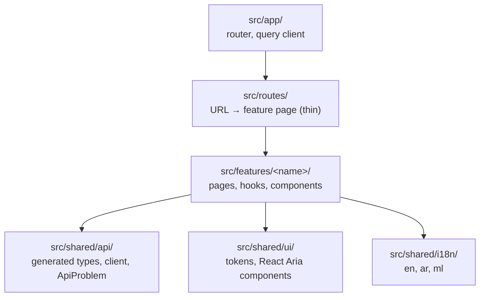

# awrad-web-next — architecture

The Awrad web app, an online-only React client of `awrad-server-next` (root ADR-2026-10-14). It replaces the LiveView pages of the frozen `awrad_server`.

- **Stack:** React 19, TypeScript 6.0, Vite 8 with the React Compiler, TanStack Router (file-based) and Query, `openapi-fetch`, React Aria Components, Tailwind 4, i18next.
- **Status:** scaffold. One placeholder page proves the wiring; features arrive in slices (`../docs/rebuild-plan.md`).

## Layout and module rules

dependency-cruiser enforces:

- features never import each other;
- `src/shared` never imports features, routes or the app;
- only `src/shared/api` imports `openapi-fetch`;
- routes don't call the API directly;
- no cycles;
- production code never imports test code.

## API (root ADR-2026-10-16)

- **Types:** generated by `openapi-typescript` from `contracts/api/openapi.bundled.json` into `src/shared/api/schema.gen.ts`, which is committed. A check fails when it's stale.
- **Client:** `api` is an `openapi-fetch` client on the page's own origin, sending the session cookie.
  - It looks up `fetch` on every call, so test mocks and instrumentation see every request.
  - A middleware adds `X-CSRF-Token` to every state-changing request (ADR-2026-10-15). The token comes from `get_browser_csrf_token`.
- **Errors:** every non-2xx response becomes an `ApiProblem` with the server's stable `code`. The UI maps `code` to translated text.

## Hosting (ADR 0001)

**Production:** one origin. A small web container serves the built app and reverse-proxies `/api` and `/socket` to Phoenix. Web and server deploy independently, with no cross-origin setup, and the cookie stays `SameSite=Lax`.

**Development:** the same shape. Vite serves the app and proxies `/api` and `/socket` to `localhost:4000`; `AWRAD_API_ORIGIN` overrides the target. The container itself is built with the staging environment (rebuild plan).

## UI, i18n and RTL

- **Design tokens:** CSS variables in `src/shared/ui/theme.css`, with light and dark via `light-dark()`, and the same palette as Android and iOS.
- **Components:** React Aria Components provide keyboard, focus, screen-reader and RTL behaviour; Tailwind styles them.
- **Language:** i18next with en, ar and ml. Changing language sets `<html lang dir>`, so the whole page flips to right-to-left for Arabic.
- **Fonts:** Arabic uses Noto Naskh Arabic for both content and interface text; other languages use Manrope.

## Tests

- **Framework:** Vitest with Testing Library in jsdom.
- **API mocks:** MSW handlers built from the spec's own examples (`specHandler`), so they can't drift from the contract.
- **Isolation:** the test page's origin is `http://web.awrad.test`, which never resolves, so an unmocked request can't reach a real server.

## Decisions

See [`docs/adr/`](docs/adr/README.md). Cross-project decisions are in the root [`DECISIONS.md`](../DECISIONS.md).
