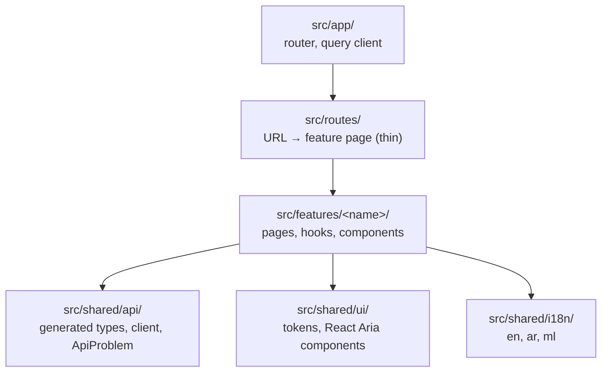

# awrad-web-next — architecture

The Awrad web app, an online-only React client of `awrad-server-next` (root ADR-2026-10-14). It replaces the LiveView pages of the frozen `awrad_server`.

- **Stack:** React 19, TypeScript 6.0, Vite 8 with the React Compiler, TanStack Router (file-based) and Query, `openapi-fetch`, React Aria Components, Tailwind 4, i18next.
- **Status:** slices 2a and 2b (accounts, account settings) built against the contract; features arrive in slices (`../docs/rebuild-plan.md`).

## Features

- **`src/features/account`** (slices 2a and 2b, `../docs/slices/02-accounts.md`):
  - Screens: home (`/`), sign in, register, verify email (with resend and cooldown), forgot password, reset password, and the account page (email, settings links, sign out).
  - Calls only operations tagged `accounts`, `browser` and `account_settings`; `device_sessions` are mobile-only.
  - Signed-in state is `get_current_account` in TanStack Query (`401 unauthenticated` → `null`).
  - The email and password between "register / sign in" and "verify" are kept in module memory (`pending.ts`), never in the URL, history state or storage. Verifying doesn't sign in (root ADR-2026-10-26), so the verify and reset screens then sign in with that password; after a reload they ask for the email and send the person to sign in.
  - Search params carry only a notice name (`search.ts`: "verified", "session_ended", "account_deleted", …), never personal data.
- **`src/features/account/settings`** (slice 2b), under the `/account` layout route (`AccountArea`), which needs a signed-in account and sends a signed-out visitor to sign in:
  - **Devices** (`/account/devices`): `list_account_sessions` (every page), phones and browsers together, the current one marked, platform, relative last use (`Intl.RelativeTimeFormat` in the UI language), and "Web browser" / "Unknown device" for a `null` name. Signing one out (`revoke_account_session`) or all others (`revoke_other_account_sessions`) goes through a confirmation dialog; `404 not_found` means it had already gone and is shown as a notice.
  - **Change password** (`/account/password`): current and new password, the 12-character hint; afterwards the account page says the other devices are signed out.
  - **Change email** (`/account/email`, then `/account/email/confirm`): password and new address, then the code sent to it, with the resend cooldown. "Send a new code" repeats `request_email_change`, so the password and new address are kept in module memory (`pendingEmailChange.ts`) like `pending.ts`. After a reload the code still works, but a new code means starting again. `409 email_taken` ends the attempt and offers "Use a different email".
  - **Delete account** (`/account/delete`): what happens (immediate, every session ends, device data stays, confirmation email, no undo), the password, then a destructive confirmation dialog (`ConfirmDialog`, an `alertdialog` that takes focus, with Cancel the first Tab stop). Afterwards home shows signed out with a message.
  - **Session ended:** any `401 unauthenticated` from these operations (`sessionEnded.ts`) drops the account's cached queries (`forgetAccount`: the current account becomes `null`, the rest are removed), clears the CSRF token, and shows sign-in with "your session has ended". Sign-out and delete use `forgetAccount` too.
- **`src/shared/account-input`**: the shared input rules `email_input`, `password_policy` (code points after NFC) and `email_code_input` (other digit scripts). `fixtures.test.ts` runs every file in `contracts/account-model/v1/fixtures/` and fails on a file without an adapter.

## Layout and module rules

dependency-cruiser enforces:

- features never import each other;
- `src/shared` never imports features, routes or the app;
- only `src/shared/api` imports `openapi-fetch`;
- routes don't call the API directly;
- no cycles;
- production code never imports test code;
- only `main.tsx` imports `src/dev/` (the component gallery, development builds only).

## API (root ADR-2026-10-16)

- **Types:** generated by `openapi-typescript` from `contracts/api/openapi.bundled.json` into `src/shared/api/schema.gen.ts`, which is committed. A check fails when it's stale.
- **Client:** `api` is an `openapi-fetch` client on the page's own origin, sending the session cookie.
  - It looks up `fetch` on every call, so test mocks and instrumentation see every request.
- **Session and CSRF** (ADR-2026-10-15), in the client's `fetch`:
  - Every state-changing request sends `X-CSRF-Token`. The token lives in module memory only (never `localStorage`); the session cookie is httpOnly and JavaScript never sees it.
  - The first write fetches the token from `get_browser_csrf_token` (single-flight). A `401` there leaves no token, and the write's own answer is the result.
  - `create_browser_session` renews the session, so its `csrf_token` replaces the old one; sign-out clears it.
  - On `403 csrf_token_invalid` the client refetches the token once and retries the same request (same `Idempotency-Key`). A second rejection is returned.
- **Headers:** `Accept-Language` follows the UI language on every request, so emails the server sends match it. Retryable POSTs carry a fresh `Idempotency-Key` per user action.
- **Errors:** every non-2xx response becomes an `ApiProblem` with the server's stable `code`, field `errors` and `Retry-After`. The UI maps `code` (and field codes) to translated text; never `detail`. `problemOf` checks the status, since openapi-fetch reports an empty error body as `error: undefined`.

## Hosting (ADR 0001)

**Production:** one origin. A small web container serves the built app and reverse-proxies `/api` and `/socket` to Phoenix. Web and server deploy independently, with no cross-origin setup, and the cookie stays `SameSite=Lax`.

**Development:** the same shape. Vite serves the app and proxies `/api` and `/socket` to `localhost:4000`; `AWRAD_API_ORIGIN` overrides the target. The container itself is built with the staging environment (rebuild plan).

## UI, i18n and RTL

- **Colours** (ADR 0005) come only from the shared tokens `../contracts/design-tokens/v1/colors.json`, the same 16 roles Android and iOS use:
  - `npm run tokens:colors` generates `src/shared/ui/colors.gen.css` (committed): one `--awrad-color-<role>` custom property per role, light in `:root` and dark under `@media (prefers-color-scheme: dark)`, `#RRGGBBAA` alpha kept. It also maps every role into Tailwind's theme and removes Tailwind's default palette, so classes read by role (`bg-surface`, `text-on-surface`, `bg-primary-container`, `text-accent`, `bg-error`, `text-on-error`) and `text-white` or `bg-red-500` don't exist.
  - `npm run validate` fails when the committed file differs from what the JSON produces (`check:colors`), and when a hex colour, a CSS colour function or a Tailwind palette class appears anywhere else in `src/` or `index.html` (`check:raw-values`, below). `scripts/colors.test.mjs` tests both.
  - How the roles are used (`../contracts/design-system/v1/components.md` has the rest): cards `surface`; dialogs, sheets and the bottom bar `surface-bar`; headings `on-surface`; links and accent text `accent` (pale green in dark mode; `primary` as text only where the spec pairs it, a selected option row's avatar and check); main buttons `primary`; secondary buttons, unselected option rows and pills `secondary-container` / `on-secondary-container`; a selected option row `primary` / `on-primary-variant`; the selected language, "this device" chip and bottom-bar pill `primary-container` / `on-primary-container`; destructive confirmations `error` / `on-error`; a checkbox's box `outline-strong`; the bottom bar's shadow `shadow`.
  - `data-color-scheme="light"` or `"dark"` on an element forces that scheme's roles on its subtree (generated after the `prefers-color-scheme` block). Only the dev component gallery sets it.
  - **States** (`colors.json` `states`) are opacities, not colours: the same file gets `--awrad-state-disabled-opacity` (0.38) and the `opacity-disabled` class. A disabled control keeps its colours and is drawn at that opacity (`disabled:opacity-disabled` on every button); there are no disabled colours.
- **Shapes, line widths, spacing, sizes and type** (ADR 0006) come only from `../contracts/design-tokens/v1/{shape,spacing,typography}.json`, the same tokens Android and iOS use:
  - `npm run tokens:design` (`scripts/generate-tokens.mjs`) generates `src/shared/ui/tokens.gen.css` (committed): an `--awrad-radius-*`, `--awrad-stroke-*`, `--awrad-space-*`, `--awrad-size-*` or `--awrad-text-<style>-{size,line-height,weight}` custom property per token, roles pointing at their scale step. It replaces Tailwind's radius, spacing, container, text-size, line-height, tracking and weight scales with the tokens, so `rounded-xl` means the token `xl` (24) and `p-4`, `gap-1.5`, `max-w-md`, `text-sm`, `leading-tight` and `font-black` don't exist. Tailwind reads classes from `src/` only (`source("../..")` in `theme.css`), so the class names in the scripts' tests and the docs don't reach the stylesheet.
  - The generators fail on a key in the token files they don't know (`scripts/token-keys.mjs`), so a new token can't be skipped silently.
  - **Radius:** `rounded-<role>` — `card`, `tile`, `button`, `field`, `chip`, `round-button`, `nav-bar`, `nav-pill`, `sheet`, `dialog`, `screen-depth`, `checkbox` (4, a checkbox's box), `step-dot`, `tab-indicator`, `content-sheet` — or a scale step (`xxs` 4, `xs` 8 … `3xl` 32, `full`), with Tailwind's sides (`rounded-t-sheet`, `rounded-s-field`). Every finite radius also sets `corner-shape: squircle` under `@supports`, so corners are continuous in browsers that have it and plainly rounded elsewhere. Fully rounded shapes (chips, pills, round buttons) stay round.
  - **Line widths** (`shape.json` `strokes`, the only lines allowed): each stroke is a `border-<stroke>` width and an `outline-<stroke>` solid outline, plus `outline-offset-<stroke>` when it has an offset. `border-field-error` (1.5, a field's error border, transparent at rest), `border-checkbox` (2, a checkbox's box), and `outline-focus-ring outline-offset-focus-ring` (2, offset 2, the keyboard focus ring). Pair them with a colour role (`border-error`, `border-outline-strong`, `outline-accent`). Chrome draws widths in whole device pixels, so the 1.5 border shows as 1px on a 1× screen and 1.5px (3 device pixels) on a 2× one.
  - **Spacing and sizes:** the spacing utilities (`p`, `m`, `gap`, `space`, `inset`, `w`, `h`, `size`, `min-h`, …) take a role — `page-margin`, `section-gap`, `card-padding`, `row-gap`, `inline-gap` (so `px-page-margin`, `gap-row-gap`) — a scale step (`xxs` 2, `xs` 4, `sm` 8, `md` 12, `lg` 16, `xl` 20, `2xl` 24, `3xl` 32, `4xl` 40, `5xl` 48), or a size: `touch-target` 48, `list-row` 56, `control` 56 (buttons and fields), `icon` 24, `icon-small` 20, `ring-small` 36, `ring-stroke` 4, `logo` 148, and the component sizes `top-bar` 56, `nav-bar` 72, `nav-pill-width` 56 × `nav-pill-height` 32, `round-button` 48, `round-button-small` 32, `avatar` 36, `checkbox` 20, `switch-width` 52 × `switch-height` 32, `switch-thumb` 24, `step-dot` 8, `tab-indicator-width` 24 × `tab-indicator-height` 4. The scale's `none` is `0` (`p-0`, `inset-0`, `min-w-0`), since `*-none` would clash with `max-w-none`. Use a role where one fits; scale steps are for the rest. Spacing is in px, like dp on Android.
  - **Content widths:** a size named `<name>MaxWidth` is a Tailwind container, not a spacing size: `max-w-content` (`contentMaxWidth` 448, a page's column) and `max-w-dialog` (`dialogMaxWidth` 384). They're the only containers; Tailwind's own scale is removed.
  - **Elevation** (`shape.json` `elevation`): `shadow-floating` (y 4, blur 16, the `shadow` role, so none in dark), only under the bottom bar. Tailwind's own shadow, inset-shadow, drop-shadow and text-shadow scales are removed.
  - **Type:** `text-<style>` sets size, line height and weight together: `text-large-title` (34, a main tab's title), `text-title`, `text-card-title`, `text-row-title`, `text-section-title`, `text-body` (the page default), `text-input` (text typed into a field, 16 so iOS Safari doesn't zoom), `text-body-small`, `text-label`, `text-button`, `text-caption`, `text-nav-label`, `text-counter` (with `tabular-nums`), `text-quran`. Sizes and line heights are in rem (`1rem` = 16px), so text follows the browser's text-size setting like sp on Android. Weights are only those the styles use (`font-normal`, `font-medium`, `font-semibold`, `font-bold`), for emphasis inside a style.
  - A style with its own `fontFamily` (`quran`: Noto Naskh Arabic) also sets `font-family` to that family's theme font: `FONT_KEYS` in the generator maps each family to its `--font-<key>` in `theme.css` (`--font-arabic` here), and the build fails on a family the web doesn't load. No screen uses `text-quran` yet.
  - Where the old literals differed, the tokens won: headings are `title` 22 (were 24 and 30), body text 15, field text `input` 16 (was `body` 15), buttons and fields `control` 56 tall (were 48), cards `card` 24 (were 16), the dialog `dialog` 32, the page margin 20 (was 24), settings rows `list-row` 56, content widths 448 and 384 px (were 28rem and 24rem, the same at the default text size). A row button (`Button size="row"`, sign out one device) is `touch-target` 48 so it fits inside its row.
- **Raw values** (`check:raw-values`, `scripts/check-raw-values.mjs`): `npm run validate` fails when anything outside the generated files writes a value instead of naming a token:
  - anywhere in `src/` and `index.html`: a hex colour, a colour function or a palette class;
  - in class names (string literals in code, `@apply` in CSS): arbitrary values or properties (`p-[13px]`, `rounded-[10px]`, `text-(--x)`, `[mask:none]`), a radius that isn't a shape token (`rounded`, `rounded-none`), a text size that isn't a style (`text-sm`), `leading-*` and `tracking-*`, a weight no style uses, numeric spacing and sizes (`p-4`, `gap-1.5`, `min-h-11`, `h-12`, `size-5`, `p-px`), a max width that isn't a content width or spacing token (`max-w-page`, `max-w-prose`), a border, outline or ring width (`border`, `border-2`, `outline-2`, `outline-offset-2`, `ring`, `divide-y`), a numeric opacity on a disabled control (`disabled:opacity-50`), a shadow that isn't an elevation (`shadow`, `shadow-lg`, `drop-shadow-md`), and animation classes (`animate-*`, `transition*`, `duration-*`, `delay-*`, `ease-*`);
  - in hand-written CSS: raw durations, easing functions and easing keywords in `animation` and `transition` (`linear`, `ease-out`), and raw lengths in radius, spacing, text, `border*-width`, `border`, `outline`, `box-shadow` and `text-shadow` declarations.
  - Not covered by tokens, so still written as numbers: `z-10`, the pressed and pending opacities of buttons (`data-pressed:opacity-90`, `data-pending:opacity-70`), an icon's SVG stroke (`stroke-2`, the checkbox's tick), and fractions (`w-1/2`). `scripts/tokens.test.mjs` tests the generator and the check.
- **Motion** (ADRs 0006 and 0007, `src/shared/ui/motion.css`): fades and colour cross-fades only, from `motion.json`'s `webPage`, `contentSwap`, `select` and `reducedMotion`; no movement, scaling, springs or other animation.
  - **Selection:** `select-fade` cross-fades colours and opacity over `select.colorDuration` with `select.easing` (option rows, checkboxes, switches, segmented pills, the bottom bar, the step indicator). The pill's fill and bar, the bottom bar's pill and the switch thumb fade in place instead of moving; the switch has an off thumb and an on thumb that swap opacity. Reduced motion uses the `reducedMotion` timing.
  - **Overlays:** `overlay-fade` fades dialogs and the bottom sheet in (`contentSwap.fadeIn`) and out (`contentSwap.fadeOut`, which React Aria waits for); reduced motion uses `reducedMotion`.
  - **Pending:** a pending button's three dots fade in turn (`progress-pulse`, `long`, staggered by `color` and `medium`); they stay still with reduced motion.
  - **Press:** buttons, cards and rows dim (`data-pressed:opacity-90`) instead of the mobile `press` scale.
  - **Page changes:** the router's `defaultViewTransition` wraps each navigation in a view transition. Only the page area (`page-transition` in `AppShell`) animates: the old page fades out in `fade` (100 ms) while the new one fades in in `color` (150 ms), both `emphasized`, with the group's move-and-resize animation switched off. The header and the rest swap at once. Browsers without view transitions (and jsdom) swap instantly.
  - **In-place swaps:** `content-swap` fades an element in over `contentSwap.fadeIn` (150 ms) with `contentSwap.easing` (`linear`) when it mounts; a `key` that changes with the content remounts it. Used on home's session status and on `FormAlert` / `FormNotice`. The outgoing content goes at once.
  - **Reduced motion** (`prefers-reduced-motion: reduce`): page changes become the `reducedMotion` cross-fade (150 ms, `reducedMotion.easing` `linear`, both pages at once); `content-swap` doesn't animate.
  - `press` (with its `pressEasing`) and `sheet` are mobile motions; the web has neither.
- **No outlines** (`../contracts/design-tokens/v1/README.md`): the design is filled shapes, not lines.
  - Fields, cards, form alerts and unselected language pills are filled, with no border. The fill comes from `useFill()` (`src/shared/ui/Surface.tsx`): `surface` on the page, `background` inside a `surface` area. `Card` sets this for its content (`OnSurface` or `OnBackground`); `ContentSheet` wraps its content in `OnSurface`. Dialogs and sheets (`surface-bar`) count as the page.
  - Secondary buttons, unselected option rows and unselected segmented pills are `secondary-container` (`useSecondaryFill()`), except on a `surface` card, where light `secondary-container` is the card's own colour: there they're `background` with `on-surface` text, like fields (ADR 0007).
  - Fields: placeholder `on-surface-variant`, caret `accent`. A field in error gets an `error` border (`border-field-error`) with its message; at rest the border is transparent, so the text doesn't shift when an error appears.
  - Rows inside a card (account settings links, devices) are separated by their own padding, not divider lines.
  - Only three lines remain: the keyboard focus ring, a checkbox's box (`outline-strong`, `primary` when ticked), and the field error border. `outline` is for progress tracks, which the web doesn't have yet.
  - Keyboard focus is the `focus-ring` utility in `theme.css`: an `accent` outline the `focusRing` stroke wide (2), offset by its `offset` (2) so it shows next to a `primary` fill, readable in both themes. Fields and the checkbox draw the same ring from React Aria's `data-focus-visible` (`outline-focus-ring outline-offset-focus-ring outline-accent`), so it appears for keyboard focus but not when a field is clicked (the caret shows focus then).
- **Components** (`src/shared/ui/`, the key components of `../contracts/design-system/v1/components.md`): React Aria Components provide keyboard, focus, screen-reader and RTL behaviour; Tailwind styles them with tokens. Every one has a disabled state (`opacity-disabled`), the keyboard focus ring, logical properties, and its role and label; their own strings (`ui.back`, `ui.more`, `ui.loading`, `ui.stepOf`) are in the locales.
  - **Containers:** `Card` (`shape` `card` or `tile`, `padded`) and `ClickableCard` (a React Aria button); `ContentSheet` and `ContentSheetSection`; `BottomSheet` (a React Aria modal at the bottom, up to `max-w-content`, with a decorative handle); `ConfirmDialog` (the dialog: `alertdialog`, actions at the end, the error button to confirm); `OptionRadioGroup` / `OptionCheckboxGroup` with `OptionRow` (radios or checkboxes, an optional avatar, a check when selected).
  - **Buttons:** `Button` (`variant` `main`, `secondary` or `error`; `size` `control` or `row`; `width` `fill` or `label`; `icon`; `isPending` shows the fading dots in a React Aria `ProgressBar` and keeps the label for the name), `TextButton`, `RoundButton` (`regular` or `small`, inside a 48 target) and `IconButton`, both with a required `aria-label`.
  - **Inputs:** `TextField` (label above, `control` tall, help and error in `caption`), `Checkbox`, `Switch` (label at the start), `SegmentedPills` with `SegmentPanel` (React Aria tabs).
  - **Navigation:** `TopBar` (`start`, `title`, `end`), `BackButton`, `StepIndicator` (one `img` named "Step 2 of 7"), `LargeTitleHeader` (the `h1`; a compact top bar fades in once the title has scrolled away, found with an `IntersectionObserver` on the nearest scroller), `BottomBar` with `BottomBarPanel` (React Aria tabs; fixed `page-margin` from the sides and `lg` plus the safe area from the bottom, `max-w-content` and centred from that width up; panels are padded to clear it, `bottom-bar-clearance`).
  - **Icons:** small inline SVGs drawn for Awrad in `icons.tsx` (`BackIcon` and `ArrowIcon` mirror in RTL), filled in `currentColor`, `icon` or `iconSmall` sized. No icon library.
  - `AppShell`'s header is a `TopBar`; the account screens use `Button`, `Card` and `ConfirmDialog`.
- **Component gallery** (`/dev/components`, `src/dev/gallery/`, ADR 0007): every component in every state, with on-page toggles for dark (`data-color-scheme` on `<html>`) and right to left (switches the UI to Arabic); `?scheme=dark|light` and `?dir=rtl|ltr` set the first state. `main.tsx` loads it only under `import.meta.env.DEV`, outside the router, so production builds contain neither its code nor its sample strings (`grep -r "Component gallery" dist` finds nothing). Its sample text is the `gallery` i18n namespace in `src/dev/gallery/locales/`, checked by `check:translations` like the app's.
- **Language:** i18next with en, ar and ml. Changing language sets `<html lang dir>`, so the whole page flips to right-to-left for Arabic, and `Accept-Language` follows it.
  - The choice is kept in `localStorage` (`awrad.language`, the language code only; never credentials or account data), and the next page load starts in it. Without one, the app starts in English.
- **Fonts** (`../contracts/design-tokens/v1/fonts/README.md`): the same files as Android and iOS, copied byte for byte into `public/fonts/` and loaded by `@font-face` in `src/shared/ui/theme.css` (400, 500, 600 and 700, `font-display: swap`, no synthetic bold or italic).
  - Interface text is Google Sans Flex Rounded, the font of the frozen apps: `--font-sans` is `"Google Sans Flex Rounded", system-ui, sans-serif`.
  - Interface text in Arabic and Malayalam uses the system font for that script. Google Sans Flex has no glyphs for them, so the browser falls back glyph by glyph to `system-ui` through the same stack; nothing switches font by language.
  - Noto Naskh Arabic is only for Qur'anic and dhikr text, never interface text: the `text-quran` style, which uses `--font-arabic` (also available as `font-arabic`).
  - `npm run validate` fails when a file in `public/fonts/` isn't listed in the contracts' `SHA256SUMS` or its checksum differs, and when `theme.css` loads a font that isn't served (`check:fonts`). To update a font, copy it from contracts. `scripts/fonts.test.mjs` tests the check.

## Tests

- **Framework:** Vitest with Testing Library in jsdom.
- **API mocks:** MSW handlers built from the spec's own examples, so they can't drift from the contract:
  - `specHandler(operationId, status)` serves the example for a status (an empty body when it has none), with the documented header examples such as `Retry-After`;
  - `specProblem(operationId, code)` serves the problem example for a code in the operation's `x-error-codes`, also when several codes share a status (`403`).
  - A state the spec has no example of (a session with a `null` name, an account signed in only here) is derived from the example with `specHandler(…, { from })`, so it keeps the documented shape.
  - Path parameters (`{session_id}`) match any value.
- **Whole-app tests:** `renderRoute(path)` renders the real route tree; `recordRequests()` captures what the app sent.
- **Isolation:** the test page's origin is `http://web.awrad.test`, which never resolves, so an unmocked request can't reach a real server.

## Decisions

See [`docs/adr/`](docs/adr/README.md). Cross-project decisions are in the root [`DECISIONS.md`](../DECISIONS.md).
