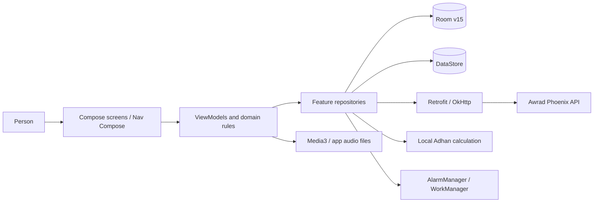
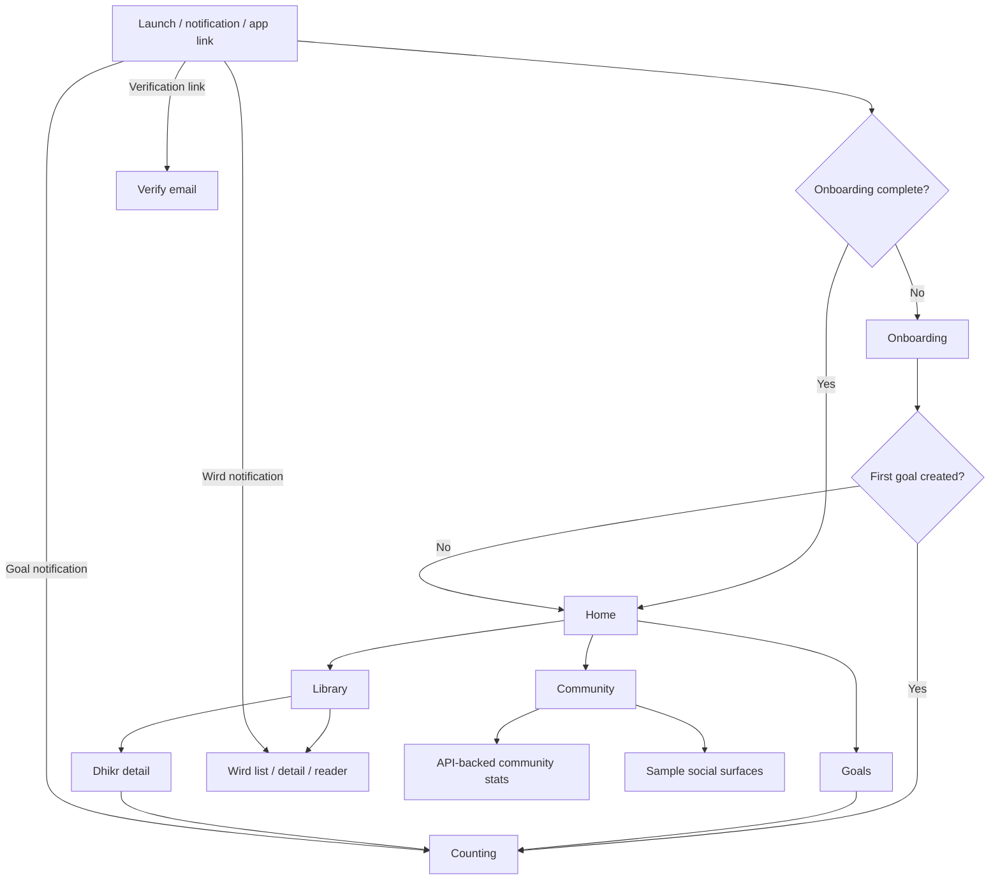
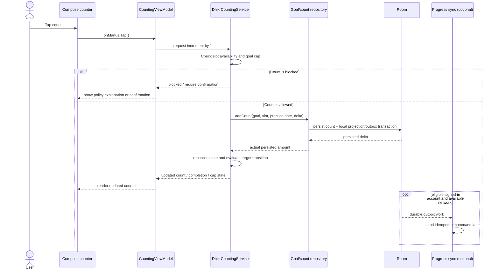
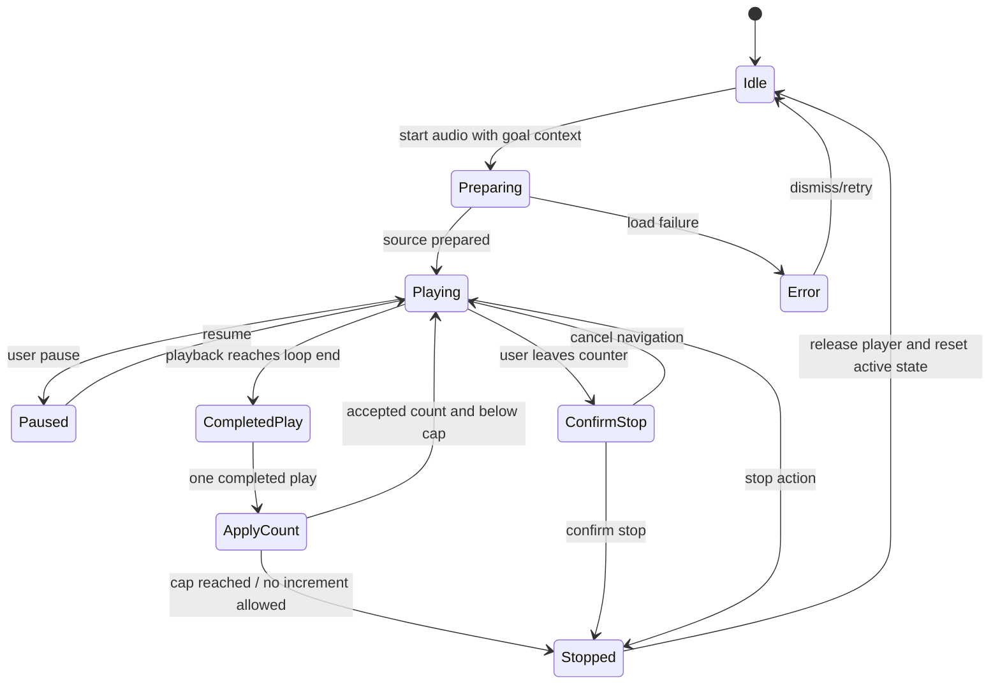
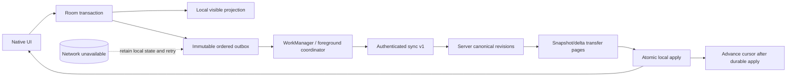
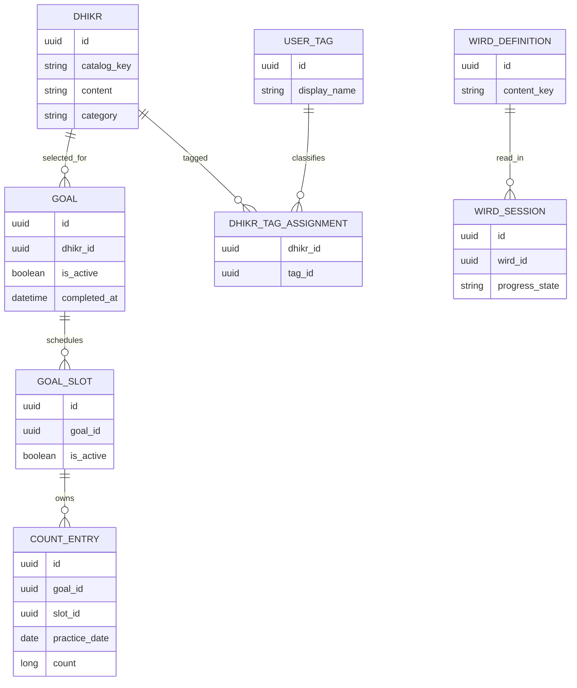

# User flows and behavior diagrams

These diagrams represent observed Android routes and ownership boundaries. Unresolved semantics are labeled in the PRDs; diagram branches are not additional product commitments.

## Runtime architecture

Ordinary counting follows Compose → ViewModel/service → repository → Room. API access is selective; reminder and media flows use Android lifecycle services.

## Application entry and navigation

## Manual count and durable local write

## Audio-assisted count lifecycle

**Count rule:** each completed play contributes the configured `audioCountPerPlay`; elapsed time or pause does not count. The service applies the same goal cap policy as manual counting. A hard limit or zero-applied increment stops audio. Current process-death resume behavior is unknown.

## Offline-first synchronization

## Data ownership overview

Entity labels show core ownership only. Reminder, recurrence, audio, and synchronization tables are omitted to keep the diagram legible. See Room v15 schemas and `contracts/progress-model/v1/` for exact fields/relationships.

